# Impact Assessment — CyberArk Privileged Session Manager (PSM, PSM for SSH, PTA)

## Document control

| | |
|---|---|
| **Document status** | DRAFT v0.10, for review by every approver and workstream lead listed below |
| **Date** | 2026-11-25 |
| **Author** | CyberArk lead (name to be added before G0) |
| **Environments** | OFFICIAL, PROTECTED and SECRET (production); PROTECTED (non-production) |
| **Target platform** | CyberArk PAM Self-Hosted **14.6** |
| **Change type** | Major technical change ([Change type: Major technical change](#change-type-major-technical-change)) |
| **Planning horizon** | Approximately 10 months under the recommended accelerated plan; approximately 15 months under the standard plan ([Deployment](#deployment)) |

| Version | Date | Change |
|---|---|---|
| 0.1 | 2026-11-20 | First outline from the template. |
| 0.2–0.5 | 2026-11-20 | Answers to the first round of questions added: OFFICIAL in scope, ServiceNow in each classification, PTA mandatory, Vault administration VM, CyberArk-based sizing, CyberArk documentation facts. |
| 0.6 | 2026-11-23 | Restructured to read top to bottom: executive summary, current state, Solution design section with figures, decision log, impact by team and persona, BAU run effort, rollback, communications. Rejected options moved to Attachment J. |
| 0.7 | 2026-11-23 | CyberArk team effort corrected from the work-package build-up; accelerated delivery option added ([Accelerated delivery option (recommended, approximately 10 months)](#accelerated-delivery-option-recommended-approximately-10-months)). |
| 0.8 | 2026-11-23 | Tone and language review: formal register, neutral source labels, requirements in "shall" form, consistent terminology, extended glossary. |
| 0.9 | 2026-11-24 | Independent stakeholder review (Attachment K). Changes: approval gates G0–G7 ([Governance and approval gates](#governance-and-approval-gates)); key deliverables extended to the design, approval, assurance and closure products ([Key deliverables](#key-deliverables)); a non-production environment in PROTECTED (DEC-17, WP30); the accelerated plan recommended (DEC-18); effort rebuilt from the work packages so that [Requirements by workstream: workstream commitments](#requirements-by-workstream-workstream-commitments) and [Resource effort and work packages](#resource-effort-and-work-packages) and the executive summary agree; schedules rebuilt so that no phase starts before its gate and hypercare ends after the last enforcement (durations restated); capacity contingency corrected to +3 PROTECTED and +2 SECRET (DEC-09); new risks R21–R27; open questions Q38–Q46 with owners and needed-by gates; incomplete statements rewritten as complete sentences. |
| 0.10 | 2026-11-25 | Answers to open questions applied: HTML5 Gateway not included (DEC-06); 15 CND users; SQL Server Management Studio and pgAdmin as database clients; two sites (primary and secondary) per classification; F5 load balancers; RHEL 8 with a concession (DEC-19); existing non-production Vault, PVWA and CPM reused (6 non-production VMs); PVWA certificate login (PKIPN) in production added to scope (WP33, KD39); eligible ticket types; 4-week accreditation lead time (schedules moved); 24x7 L2 support by the Security Operations team; jump hosts retired at enforcement; SECRET transfers through the CDS. Section numbers removed from headings; cross-references are now links. |

**Approvals.** Signing this document means that the signatory has read the sections listed against
their role, accepts the commitments and effort shown for their team ([Requirements by workstream: workstream commitments](#requirements-by-workstream-workstream-commitments) and [Resource effort and work packages](#resource-effort-and-work-packages)), and agrees
to the gate at which their approval is next needed ([Governance and approval gates](#governance-and-approval-gates)). Effort and cost figures remain
indicative until each workstream confirms them in writing before G1.

| Role | Sections to review | Next approval gate | Name | Signature and date |
|---|---|---|---|---|
| Funding approver / steering group chair | Executive summary, [Costs](#costs), [Deployment](#deployment), [Resource effort and work packages](#resource-effort-and-work-packages) | G0 | TBC | |
| Change authority | [Change type](#change-type-major-technical-change), [Deployment](#deployment) | G0 | TBC | |
| Architecture forum chair (design authority) | [Scope](#scope), [Solution design](#solution-design), [Key deliverables](#key-deliverables), [Functional and non-functional requirements](#functional-and-non-functional-requirements) | G1 and G2 | TBC | |
| Accreditation authority, OFFICIAL | [Risks](#risks), [Security, RBAC, bypass prevention and break-glass](#security-rbac-bypass-prevention-and-break-glass), [Session recording lifecycle](#session-recording-lifecycle), [Security and Accreditation](#security-and-accreditation) | G4 | TBC | |
| Accreditation authority, PROTECTED | [Risks](#risks), [Security, RBAC, bypass prevention and break-glass](#security-rbac-bypass-prevention-and-break-glass), [Session recording lifecycle](#session-recording-lifecycle), [Security and Accreditation](#security-and-accreditation) | G4 | TBC | |
| Accreditation authority, SECRET | [Risks](#risks), [Security, RBAC, bypass prevention and break-glass](#security-rbac-bypass-prevention-and-break-glass), [Session recording lifecycle](#session-recording-lifecycle), [Security and Accreditation](#security-and-accreditation) | G4 | TBC | |
| Change advisory board chair | [Deployment](#deployment) | G3, G5 and G6 | TBC | |
| Service Operations manager | [Service Operations, Service Desk and Records management](#service-operations-service-desk-and-records-management), [Service operations and BAU run effort](#service-operations-and-bau-run-effort), [Impact by team and persona](#impact-by-team-and-persona) | G7 | TBC | |
| Test lead | [Test team](#test-team), [Testing](#testing) | G2 and G4 | TBC | |
| Project manager | [Deployment](#deployment), [Resource effort and work packages](#resource-effort-and-work-packages), [Clarifications](#clarifications) | G0 | TBC | |
| CyberArk lead (author) | All | G0 | TBC | |
| Each workstream lead in [Requirements by workstream: workstream commitments](#requirements-by-workstream-workstream-commitments) | Their subsection of [Requirements by workstream](#requirements-by-workstream-workstream-commitments), their work packages in [Resource effort and work packages](#resource-effort-and-work-packages), [Impact by team and persona](#impact-by-team-and-persona) | G1 | TBC | |

### How to read this document

| Reader | Recommended sections |
|---|---|
| Funding approver or steering group | Executive summary, then [Costs](#costs), [Impact summary](#impact-summary), [Deployment](#deployment) and [Resource effort and work packages](#resource-effort-and-work-packages) |
| Architecture forum | [Scope](#scope), [Solution design](#solution-design), [Key deliverables](#key-deliverables) and [Functional and non-functional requirements](#functional-and-non-functional-requirements), then Attachment J |
| Accreditation authority | [Risks](#risks), [Ticketing (ServiceNow)](#ticketing-servicenow), [Security, RBAC, bypass prevention and break-glass](#security-rbac-bypass-prevention-and-break-glass), [Session recording lifecycle](#session-recording-lifecycle), [Session policy](#session-policy) and [Security and Accreditation](#security-and-accreditation) |
| Workstream lead | [Requirements by workstream: workstream commitments](#requirements-by-workstream-workstream-commitments) (the relevant workstream), [Resource effort and work packages](#resource-effort-and-work-packages) (its work packages) and [Impact by team and persona](#impact-by-team-and-persona) (impact on the workstream) |
| Contributor to open questions | [Open questions](#open-questions) |

- **Owner and needed-by.** Every open item names one owner (a role) and the gate or phase by which the
  answer is needed. No calendar dates are given until the steering group fixes the start date at G0.
- **TBC (Qn)** means the item waits on open question *n* in [Open questions](#open-questions). ***Assumed*** marks a working
  assumption; the owner shown corrects it if it is inaccurate.
- **[CA]** marks a statement taken from the CyberArk PAM Self-Hosted documentation (latest release). The
  CyberArk lead shall check each [CA] statement against the version 14.6 documentation before G1.
  **(to be validated)** marks a statement that has not yet been confirmed against vendor documentation;
  each one names the test or check that will confirm it.
- **Identifiers:** A assumption, R risk, D dependency, DEC decision, FR/NFR functional/non-functional
  requirement, KD key deliverable, G gate, WP work package, Q question. Figures are drawn as Mermaid
  diagrams.

---

## Executive summary

**Purpose.** This change adds CyberArk Privileged Session Manager to the existing CyberArk Privileged
Access Management (PAM) platform in the OFFICIAL, PROTECTED and SECRET classifications. It provides
isolated, recorded and ticket-controlled privileged sessions through PSM (RDP, database and web targets)
and PSM for SSH (SSH targets). Privileged Threat Analytics (PTA), ServiceNow ticket validation, and
Splunk monitoring by the security operations centre (DSOC) support it. PVWA certificate login (PKIPN), so far
tested only in development, is brought into production in every classification. Every in-scope privileged
account, including break-glass accounts, is onboarded. A non-production environment in PROTECTED, using the
existing non-production Vault, PVWA and CPM, is built first so that design, integration and upgrades are proven before they reach production.

**Rationale.** Most privileged access is currently made directly from user workstations to target
systems. Administrators know, or can retrieve, privileged passwords. Sessions are not recorded and are
not linked to an authorising ticket.

**Decision sought at G0.** The steering group is asked to:
1. approve the scope in [Scope](#scope) and the gate model in [Governance and approval gates](#governance-and-approval-gates);
2. approve the accelerated delivery plan ([Accelerated delivery option (recommended, approximately 10 months)](#accelerated-delivery-option-recommended-approximately-10-months)), including its preconditions;
3. release funding for Phase 0 and Phase 1, with further funding released at G2; and
4. approve indicative BAU funding for the run effort in [Service operations and BAU run effort](#service-operations-and-bau-run-effort), to be confirmed at G7.

**Recommendation.** The CyberArk lead recommends the **accelerated plan** (DEC-18). It brings the
first production use (the pilot) forward to approximately 4 months and completes operational acceptance
in approximately 10 months, against approximately 15 months for the standard plan. The total effort is
slightly lower, because the plan uses standard components and discovery-led onboarding, but peak demand on
each team is higher. The recommendation holds only if the preconditions in [Accelerated delivery option (recommended, approximately 10 months)](#accelerated-delivery-option-recommended-approximately-10-months) are met by the
points the table gives (most within the first 4 weeks of Phase 0). If they are not, the project falls back to the standard plan at G1.

**Scale.**

| Item | Quantity |
|---|---|
| Privileged users | 540 (250 PROTECTED, 200 SECRET, 90 OFFICIAL), plus 15 CND analysts who use all three classifications |
| New production VMs | **42 firm**: 36 PSM/PSMP, 3 PTA, 3 Vault administration. **Up to 5** further PSM nodes held in contingency (+3 PROTECTED, +2 SECRET), built only if the scale-out trigger in [Capacity](#capacity) is met. The HTML5 Gateway is not included (DEC-06) |
| New non-production VMs (PROTECTED) | **6** (2 PSM, 2 PSMP, PTA, Vault administration VM), connected to the existing non-production Vault, PVWA and CPM (Q39) |
| Load balancer VIPs (F5) | 14 (12 production, 2 non-production) |
| RDS CALs (Per User) | Approximately 655: production 292 PROTECTED, 237 SECRET and 116 OFFICIAL (each including 17 for CND), plus 10 for non-production testers |
| Project effort (all teams) | Accelerated plan: approximately **820–1,345 person-days**, plus about 115 person-days of account onboarding at the example volume in [Resource effort and work packages](#resource-effort-and-work-packages). Standard plan: approximately **860–1,400 person-days**, plus about 215 person-days of onboarding. The CyberArk team's share is 267–457 person-days (accelerated) or 279–483 person-days (standard), before onboarding. [Requirements by workstream: workstream commitments](#requirements-by-workstream-workstream-commitments) shows each team's share |
| Duration | Accelerated: pilot in production after approximately 4 months; all waves enforced after approximately 9 months; operational acceptance after approximately 10 months (Figure 11). Standard: approximately 15 months (Figure 10). Both include the 4-week accreditation lead time for each classification |

**Approval gates** ([Governance and approval gates](#governance-and-approval-gates)): G0 IA approval and funding; G1 HLD endorsed by the architecture
forum; G2 LLD endorsed by the architecture forum; G3 build readiness approved by the change advisory
board; G4 authority to operate issued for each classification; G5 pilot and each wave approved for
go-live; G6 enforcement approved for each wave; G7 operational acceptance and project closure.

**Decisions to date** ([Decision log](#decision-log)):
- PVWA *Connect* launches the user's native RDP client after the ticket check, and direct RDP to PSM is
  disabled.
- SSH users connect with their native client through PSMP and enter the ticket at PSMP.
- ServiceNow is used in each classification, and the validation logic sits in ServiceNow.
- PSM runs on Windows Server 2022.
- PTA is mandatory and has no high availability.
- The HTML5 Gateway is not included in this change (DEC-06).
- PSMP and PTA run on RHEL 8 under a concession, with an uplift to RHEL 9 before May 2029 (DEC-19).
- F5 load balancers front every pool.
- Each classification has one Vault administration VM.
- A non-production environment is built in PROTECTED, reusing the existing non-production Vault, PVWA
  and CPM.
- PVWA certificate login (PKIPN) is brought into production as part of this change.

These decisions are endorsed formally at G1.

**Principal risks** ([Risks](#risks)):
- PSM capacity at the top of the demand estimate (R3)
- firewall change volume (R2)
- a ServiceNow outage blocking access (R5, R22)
- credential rotation breaking hard-coded uses (R19, R27)
- unknown onboarding volume (R18)
- accreditation timing, particularly for SECRET (R15)
- PKIPN not in production in time for the pilot (R28)

**Requirements of other workstreams:** the commitments table in [Requirements by workstream: workstream commitments](#requirements-by-workstream-workstream-commitments) and the work packages in
[Resource effort and work packages](#resource-effort-and-work-packages).

---

## Overview

### Solution summary

This change introduces isolated, recorded, ticket-controlled privileged sessions in all three
classifications. It consists of the following components.

| Component | Purpose |
|---|---|
| PSM (Windows, Remote Desktop Session Host) | Runs sessions to Windows/RDP targets, databases, web applications and other client-based targets. |
| PSM for SSH (PSMP) (Linux) | Proxies SSH sessions to Linux/Unix servers and network devices. |
| PVWA certificate login (PKIPN) | Smart-card login to PVWA, tested so far only in development, is configured and tested in production in each classification (WP33, KD39). PSMP inherits it through MFA caching. |
| Privileged Threat Analytics (PTA) | **Mandatory.** Detects risky privileged activity and PSM bypass, and sends alerts to the SIEM. |
| Vault administration VM | One per classification. It is the only place from which the Vault and DR Vault are administered. |
| Non-production environment | Two PSM, two PSMP, a PTA and a Vault administration VM in PROTECTED, connected to the existing non-production Vault, PVWA and CPM. Used to prove designs, integrations, upgrades and connector changes before production ([Non-production environment](#non-production-environment)). |
| ServiceNow ticketing | Every session or credential use needs an eligible ServiceNow ticket ([Ticketing (ServiceNow)](#ticketing-servicenow)). |
| SIEM integration | CyberArk → Cribl → Splunk → DSOC: logs, dashboards, alerts and use cases. |
| Load balancing | F5 load balancers give highly available PSM and PSMP pools, with health checks and distribution across the primary and secondary sites. |
| Onboarding | Covers every in-scope account, platform, Safe, CPM/reconcile policy, connection component and break-glass account, and the application local credentials that a CPM plugin or the application's own API can rotate. |
| Bypass prevention | Network, credential, platform and detection controls ensure that privileged access cannot circumvent PSM/PSMP. |

**Figure 1 — Target state at a glance**

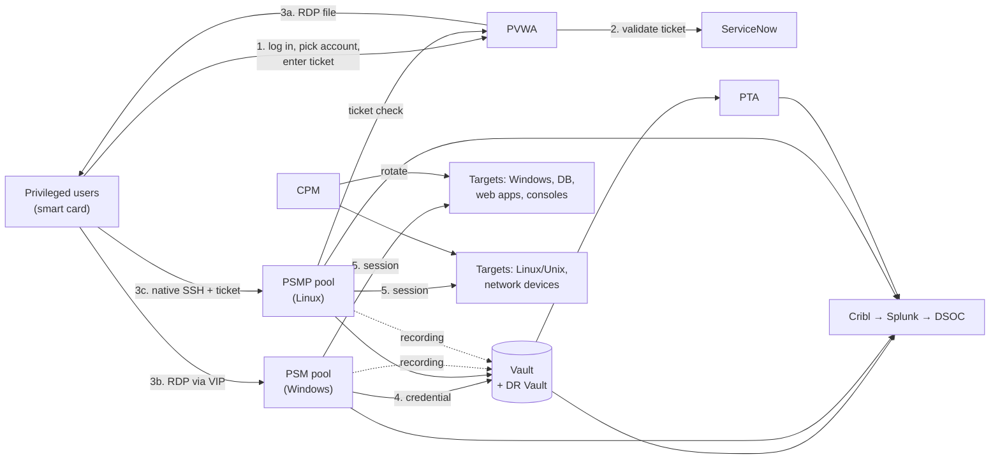

### Current state

The sponsor confirmed this current state on 2026-11-25 (Q35). The current load on PVWA and CPM is still to
be measured (Q36).

| Area | Current state |
|---|---|
| CyberArk | Each classification has a Vault, a DR Vault, 4 PVWA nodes (2 at the primary site, 2 at the secondary site) and 2 CPM servers (1 at each site). A non-production Vault, PVWA and CPM exist in PROTECTED. Alignment to 14.6 is a dependency (A1). PVWA smart-card login (PKIPN), as described in the *PVWA Certificate Authentication (PKIPN) Guide*, has been tested only in development; it is brought into production by WP33. There is no PSM, PSMP or PTA. |
| Privileged access | Most access is direct RDP, SSH, database and web access from user workstations or jump hosts. Administrators know, or can retrieve, privileged passwords. |
| Sessions | Sessions are not isolated, not recorded and not linked to tickets. |
| Detection | There is no PTA. Splunk correlates privileged activity only to a limited extent. |
| Break-glass | Break-glass accounts exist for each platform, but they are not consistently vaulted or checked out. |
| Known issues | A Group Policy Object (GPO) places an internal sub-CA in the Trusted Root store of domain servers (owner: Identity). The client-certificate revocation check was found disabled on the PVWA HTTPS binding (owner: CyberArk team). Both are tracked in [Defects debt](#defects-debt) and fixed before G3 (KD26). |

### Drivers and outcomes

| Outcome | Measure of success (reported in the closure report, KD38) |
|---|---|
| No standing knowledge of privileged passwords | In-scope accounts are used through PSM/PSMP only, CPM rotates their passwords, and end users do not hold the *Retrieve* permission. |
| Every privileged session is authorised by a ticket | 100% of PSM/PSMP sessions carry an eligible ServiceNow ticket (Incident, Problem task, Service Request, Standard Change task, or Change in its window), or a logged and alerted use of the emergency path. |
| Every privileged session is recorded and auditable | Authorised auditors can retrieve recordings for the retention period that the records authority sets (D13). |
| Bypass is prevented and detected | Direct RDP, SSH, database and administrative web access from user networks to onboarded targets is blocked, and attempts raise alerts in Splunk for DSOC. |
| Resilient service | No PSM/PSMP pool has a single point of failure, and the loss of a node does not stop new sessions. |
| Supportable for its service life | Pools run on Windows Server 2022 and RHEL 8, nodes in a pool run the same CyberArk version, and an upgrade path is documented. The service life runs from the pilot go-live to October 2031, when Windows Server 2022 extended support ends. RHEL 8 is uplifted to RHEL 9 before its maintenance support ends in May 2029 (DEC-19), and Windows Server is uplifted before October 2031. |

### Change type: Major technical change

| Criterion | Assessment |
|---|---|
| New infrastructure | Yes. There are 42 firm production VMs, up to 5 contingency PSM nodes, 6 non-production VMs, and 14 VIPs. |
| Changes how people work | Yes. About 540 privileged users change how they reach Windows, Linux, network, database and web targets. |
| Network | Yes. There are new flows in all three classifications, and direct administrative paths are removed at enforcement. |
| Identity | Yes. The change adds AD OUs, GPOs, service accounts and delegations, and changes break-glass accounts. |
| Enterprise integrations | Yes. It integrates with ServiceNow, Cribl, Splunk, DSOC, monitoring and backup. |
| Security / accreditation | Yes. New components and new data (session recordings) are introduced in OFFICIAL, PROTECTED and SECRET. |
| Licensing / procurement | Yes. It needs RDS CALs, CyberArk PSM, PSMP and PTA entitlement, RHEL subscriptions, client tool licences and Splunk ingest. |
| Operating system lifecycle | Yes. PSM is built new on Windows Server 2022 (DEC-03). |

**Classification: Major.** The sponsor confirmed this classification (Q12).

---

## Scope

### Description

#### What is in scope

The project shall:
- deploy and integrate PSM, PSMP, PTA and the Vault administration VM in each of OFFICIAL, PROTECTED and
  SECRET;
- bring PVWA certificate login (PKIPN) into production in each classification;
- build a non-production environment in PROTECTED ([Non-production environment](#non-production-environment));
- integrate ServiceNow ticketing, the SIEM and monitoring;
- onboard every in-scope account;
- prevent bypass of PSM/PSMP; and
- hand the service over to Service Operations through the operational acceptance gate (G7).

[Solution design](#solution-design) gives the design detail.

#### Server inventory

**Production, for each classification** (identical in OFFICIAL, PROTECTED and SECRET):

| Pool / server | Role | Nodes | Users | VIP |
|---|---|---|---|---|
| Consumer PSM | PSM (Windows) | 4 | Consuming teams | `psm-<env>` (RDP 3389) |
| Consumer PSMP | PSM for SSH (Linux) | 4 | Consuming teams | `psmp-<env>` (SSH 22) |
| CND PSM | PSM (Windows) | 2 | CND only | `psm-cnd-<env>` (RDP 3389) |
| CND PSMP | PSM for SSH (Linux) | 2 | CND only | `psmp-cnd-<env>` (SSH 22) |
| PTA | Privileged Threat Analytics (mandatory) | 1, no HA (DEC-05) | Security and DSOC | None |
| Vault administration VM | Windows Server 2022; administers the Vault and DR Vault | 1 (DEC-07) | CyberArk team | None |

**Production totals:** 36 PSM/PSMP + 3 PTA + 3 Vault administration = **42 firm**. Up to **5** further PSM
nodes (+3 PROTECTED, +2 SECRET) are held in contingency and are built only if the scale-out trigger in
[Capacity](#capacity) is met (KD28). The CND pools have their own VIPs, Safes and roles, and serve the 15 CND
analysts in every classification. The HTML5 Gateway is not included (DEC-06); adding it later needs a
change to this IA.

**Non-production (PROTECTED only):** PSM 2, PSMP 2, PTA 1, Vault administration VM 1 = **6 VMs**, connected
to the existing non-production Vault, PVWA and CPM (Q39, A16). It has 2 VIPs (PSM and PSMP). [Non-production environment](#non-production-environment)
describes the environment.

**Possible additions decided before G1:**
- one RD Licensing server per classification if no existing licence server can be used (up to 3; DCE
  manager, Q38);
- additional PVWA or CPM nodes if Phase 0 measurement shows a need (up to 3 per classification; Q36, R20).

**Planning ceiling for DCE:** 42 + 5 (production) + 6 (non-production) = **53 VMs**, plus up to 12 if both
possible additions are confirmed.

#### Targets and onboarding in scope

| Target type | Connection | Connection components / plugins |
|---|---|---|
| Windows servers | PSM (RDP) | PSM-RDP |
| Linux / Unix servers | PSMP (SSH); PSM-SSH is the fallback | PSMP; PSM-SSH (PuTTY-based) |
| Network devices | PSMP (SSH); PSM for HTTPS management interfaces | PSMP; web connectors |
| Databases | PSM, through a client tool installed on the PSM server | SQL Server Management Studio for Microsoft SQL Server and pgAdmin for PostgreSQL (Q21). Neither needs a commercial licence. Any other client needs a change to this IA |
| Web applications and administration consoles | PSM, browser-based | PSM web application connection components (Chromium or Edge with a matching WebDriver) |
| Virtualisation and out-of-band management (vCenter, ESXi, iLO/iDRAC, storage, backup) | PSM web connector, or SSH through PSMP | Web connectors, PSMP |

Onboarding covers:
- every in-scope account, as defined in Attachment H, which also gives the template;
- platforms: password policy, CPM change, verify and reconcile, and session settings;
- Safes and role-based access;
- reconcile accounts;
- connection components and plugins;
- the AD changes that CPM and PSM need;
- a break-glass account for every in-scope platform, under exclusive check-out and check-in;
- application local credentials, rotated natively wherever a CPM plugin or the application's API supports
  it.

Where an application cannot rotate its credentials natively, its accounts are still vaulted, used
through PSM and recorded. The application owner then raises a concession in the concession register
([Concessions debt](#concessions-debt)), naming an accountable owner and a remediation date, for Security to approve.

### Assumptions

| # | Assumption | Status, owner and needed by |
|---|---|---|
| A1 | The Vault, DR Vault, PVWA and CPM in all three classifications are healthy and on 14.6, or will be before G3. | Components confirmed (Q35, Q36); health and load open (Q36). Owner: CyberArk lead. Needed by G1. |
| A2 | PSM, PSMP and PTA are within the current CyberArk licence entitlement, or will be bought. | Open (Q14). Owner: steering group. Needed by G0. |
| A3 | There is no existing PSM to match, so sizing is CyberArk-based ([Capacity](#capacity)) and the Phase 2 performance test confirms it. | Decided (Q22). |
| A4 | Privileged users number 250 in PROTECTED, 200 in SECRET and 90 in OFFICIAL, with a peak of 2–4 sessions per active user. | Answered (Q19). |
| A5 | PSM servers are domain-joined and placed in a dedicated OU that carries the CyberArk PSM hardening GPO. | Confirmed (Q43). |
| A6 | PSMP authenticates users against AD through AD Bridge and uses PVWA MFA caching (an SSH key), so SSH access inherits PVWA's smart-card authentication once PKIPN is in production (WP33). | Confirmed (Q43); depends on KD39. |
| A7 | Each classification has a ServiceNow instance that its PVWA can reach. | Confirmed (Q23, Q30). CMDB data quality for CI matching is open (Q50). |
| A8 | Each classification has its own Cribl workers and Splunk indexes, feeding DSOC. | Answered (Q11). Detail confirmed in WP18. |
| A9 | Each classification has two data centres, a primary site and a secondary site, and pools are split evenly across them. | Confirmed (Q25, Q32). |
| A10 | SECRET has no internet access, so media, plugins, Ansible collections and client tools arrive through the cross-domain solution (CDS). | Confirmed (Q9). DevSecOps lead confirms the CDS lead time per transfer before G1. |
| A11 | The records authority has not yet set the recording retention period. The design supports any period, and recordings are kept without purge until the period is set. | Open (D13). Owner: Records management. Needed by G5 (pilot). |
| A12 | Existing jump hosts remain until each wave is enforced and are then retired. | Confirmed (Q26). |
| A13 | CND pools are reached only from CND networks. | Open. Owner: CND lead. Needed by G1. |
| A14 | There are 6–10 consuming teams; this range is used for effort estimates. | Open (Q27). Owner: project manager. Needed by G1. |
| A15 | The 14.6 ServiceNow integration validates ticket-level fields only (type, state, window, assignee, requester) and cannot send the target to ServiceNow, so target CI matching is not in the baseline. If CI matching is later required, it is added by change using option I4 (Attachment J). | *Assumed* (Q33). Owner: CyberArk lead. Tested in non-production in Phase 1; result needed by G2. |
| A16 | The existing non-production Vault, PVWA and CPM are in PROTECTED and are at, or will be upgraded to, version 14.6 before the non-production build. | *Assumed* (Q39). Owner: CyberArk lead. Needed by G1. |

### Risks

Likelihood (L) and impact (I): H high, M medium, L low. Each risk has one accountable owner; other teams
contribute to the mitigation.

| # | Risk | L | I | Mitigation | Owner | Contributors |
|---|---|---|---|---|---|---|
| R1 | Procurement or capacity delays the delivery of up to 53 VMs across four environments. | M | H | DCE receives the capacity request in Phase 0. The build sequence follows the selected plan: in the accelerated plan, all classifications are built in parallel with the pilot VMs first; in the standard plan, PROTECTED is built first. | DCE manager | Procurement |
| R2 | Firewall changes across many target networks take longer than planned. | H | H | One consolidated firewall matrix per classification (Attachment A); the target inventory is collected up front; target flows are batched per wave with standard rules. | Network manager | CyberArk lead |
| R3 | Demand at the top of the PROTECTED and SECRET estimates exceeds what 4 consumer PSM nodes can serve within CyberArk's 60-sessions-per-PSM ceiling. | M | H | The pilot measures demand; the scale-out trigger is monitored; 3 PSM nodes in PROTECTED and 2 in SECRET are held in contingency ([Capacity](#capacity), KD28). PSMP nodes are added by change if the Phase 2 test shows a lower PSMP limit. | CyberArk lead | DCE |
| R4 | A shortfall in RDS CALs, or no RD Licensing server, causes PSM to refuse sessions after the licensing grace period. | M | H | The licence model and quantities are agreed before G1 ([Costs](#costs)); licences are installed and activated before G3 (KD24). | Procurement manager | Identity |
| R5 | A ServiceNow outage blocks all privileged access. | M | H | Validation denies by default; a controlled, alerted emergency path is available ([Ticketing (ServiceNow)](#ticketing-servicenow)). | ServiceNow service owner | Security |
| R6 | Recordings exhaust Vault storage, or DR Vault replication cannot keep up. | M | H | Storage and replication are sized in [Capacity](#capacity), monitored ([Monitoring and control](#monitoring-and-control)) and capped by the archive option (Q44). | CyberArk lead | DCE |
| R7 | Hardening, AppLocker or EDR blocks PSM components or client tools. | M | M | Exclusions and AppLocker rules are agreed and proven in non-production before the production build (WP17). | DevSecOps lead | CyberArk lead |
| R8 | The Windows Server 2022 SOE is not ready in time. | M | M | SOE readiness is checked before G1. If it is not ready, PSM is built on Windows Server 2019 under a Security-approved concession, with uplift to 2022 completed before G7. | Windows Platform lead | Security |
| R9 | A load balancer health check passes while PSM is broken (port open, service down). | M | H | Monitoring drains the node through the load balancer API when the service fails, in addition to the load balancer's own checks ([High availability, load balancing and sites](#high-availability-load-balancing-and-sites)). | Network manager | Monitoring and Control |
| R10 | Privileged access circumvents PSM through known passwords or other paths. | H | H | Passwords are rotated at onboarding; direct paths are blocked at enforcement; PTA and Splunk detect bypass. | CyberArk lead | Network, DSOC |
| R11 | Productivity drops, or users resist the new access method. | M | M | A pilot team, user guides, training, phased enforcement and hypercare ([Communications and training](#communications-and-training)). | Project manager | Service Operations |
| R12 | Some applications cannot rotate their local credentials natively. | M | M | Their accounts are vaulted, used through PSM and recorded; a concession with an owner and a remediation date is raised ([Concessions debt](#concessions-debt)). | Application owner (per application) | CyberArk lead |
| R13 | Break-glass access is unusable when CyberArk itself is down. | L | H | A documented offline emergency-access procedure for CyberArk's own administration, tested every six months (KD27). | CyberArk lead | Security |
| R14 | Partial upgrades leave nodes in a load-balanced pool on different versions. | M | M | Pool-level upgrade procedure ([Service operations and BAU run effort](#service-operations-and-bau-run-effort)), rehearsed in non-production first. | CyberArk lead | None |
| R15 | Accreditation of new components, particularly at SECRET, delays production use. | M | H | Security reviews the HLD in Phase 0; the security risk assessment and system security plan for each classification are drafted from the LLD and submitted before SIT ends; authority to operate is gate G4. | Security accreditation lead | CyberArk lead |
| R16 | New log sources exceed the Splunk ingest licence or budget. | M | M | Volume is estimated from non-production and the pilot; Cribl filters low-value events. | SIEM lead | CyberArk lead |
| R17 | The GPO that places a sub-CA in Trusted Root affects the new servers. | H | M | Identity fixes the GPO at source before G3 (KD26), applying the lessons in the *PVWA Certificate Authentication (PKIPN) Guide*. | Identity lead | PKI |
| R18 | The onboarding volume is unknown, so the onboarding effort cannot be confirmed. | H | H | Attachment H returns are due in Phase 0; effort is calculated from unit rates ([Resource effort and work packages](#resource-effort-and-work-packages)) and re-baselined at G1. | Project manager | Consuming teams |
| R19 | Rotation breaks hard-coded uses of privileged passwords (Windows services, scheduled tasks, scripts, application configuration files). | H | H | Dependency discovery runs before each wave (WP29). CPM rotation is enabled for a wave only after each account owner signs the WP29 dependency checklist. | Account owner (per wave) | CyberArk lead |
| R20 | PVWA or CPM capacity is insufficient for 540 users and full onboarding. | M | M | Capacity is measured in Phase 0 ([Capacity](#capacity), Q36). The architecture forum decides at G1 whether to add PVWA or CPM nodes. | CyberArk lead | DCE |
| R21 | Some tests can only run in production, and they could disrupt service: site loss and load balancer failover (HA-03, HA-05), Vault to DR Vault failover (DR-02), the performance test, the penetration test, the bypass tests and UAT. | M | M | All other testing runs first in the non-production environment ([Non-production environment](#non-production-environment)). The infrastructure, performance and penetration tests run in approved change windows before users are onboarded in that classification. The bypass tests run at each wave's enforcement, and UAT runs in each wave, both under the wave's CAB approval. | Test lead | CyberArk lead |
| R22 | ServiceNow becomes a hard dependency for privileged access, but its service tier may not provide the availability this needs. | M | H | The ServiceNow service owner reviews the service tier before G1 (Q42); the emergency path covers outages. | ServiceNow service owner | Service Operations |
| R23 | A total PSM or PSMP pool outage leaves 540 users dependent on break-glass, which is not designed for that volume. | L | H | Pools are spread across two sites with N-1 capacity. An outage runbook ranks which break-glass accounts are used first, and Security approves it before G5. | CyberArk lead | Service Operations |
| R24 | Recording staff sessions (video and keystrokes) raises privacy and workforce-relations concerns. | M | M | A privacy impact assessment and a workforce notice are completed before the pilot (KD21); recordings are accessed only through the audited Auditor role. | Security accreditation lead | Privacy officer |
| R25 | PTA has no high availability, so detection has a gap while it is down. | M | M | The Splunk use cases run independently of PTA; a "PTA down" alert is raised; PTA is rebuilt within 2 business days ([Disaster recovery and resilience](#disaster-recovery-and-resilience)). | Security accreditation lead | CyberArk lead |
| R26 | CyberArk administrators have broad control over the platform with limited independent oversight. | M | H | CyberArk administrators work only through the Vault administration VM and PSM, so their sessions are recorded. DSOC alerts on Vault administration sessions and Safe permission changes. Security reviews a sample of CyberArk administrator sessions every month. CyberArk administrators cannot delete recordings or audit records. | Security accreditation lead | CyberArk lead |
| R27 | Non-interactive privileged use (scripts, Ansible, monitoring agents, backup tools) breaks when passwords rotate or when direct paths are blocked. | H | M | WP29 identifies these uses. Affected accounts are not rotated or enforced until the owner moves them to a supported method or obtains a concession. Moving application credentials to CyberArk credential providers is outside this change ([Exclusions](#exclusions)). | Account owner (per wave) | CyberArk lead |
| R28 | PVWA certificate login (PKIPN) is not working in production in time for the pilot. | M | H | WP33 starts in Phase 1, applies the lessons recorded in the *PVWA Certificate Authentication (PKIPN) Guide*, and is tested in non-production first. If PKIPN is late in a classification, the first wave in that classification uses the current PVWA login method, under a Security-approved concession, until KD39 is met. | CyberArk lead | PKI, Network |

### Dependencies

| # | Dependency | Owner | Needed by |
|---|---|---|---|
| D1 | Capacity and VMs to specification: 42 production VMs, 6 non-production VMs, contingency nodes when triggered | DCE | Non-production VMs within 4 weeks of the start of Phase 1 (requested in Phase 0); production VMs before G3 |
| D2 | Windows Server 2022 SOE in all three classifications; confirmation that the existing RHEL 8 SOE supports PSMP and PTA | Windows Platform; Linux Platform | Readiness confirmed before G1; SOE accepted before the production build |
| D3 | IP addresses, DNS records, VIPs and health checks | Network | Phase 1 |
| D4 | Firewall rules: component flows (Phase 1), target flows (before each wave), bypass blocks (at each wave's enforcement) | Network | Phase 1; G5 for each wave; G6 for each wave |
| D5 | AD: OUs, GPOs, service accounts, CPM delegations, RD Licensing | Identity | Phase 1, before G3 |
| D6 | Certificates for PSM RDP, VIP names, PTA and syslog TLS; CA certificates and CRL access for PKIPN | PKI | Phase 1, before G3 |
| D7 | RDS CALs, CyberArk licences, RHEL subscriptions and client tool licences | Procurement | Before G3 |
| D8 | ServiceNow instance access, integration user and validation logic, in non-production first and then in each production instance | ServiceNow team | Non-production in Phase 1; production before SIT in each classification |
| D9 | Cribl routes, Splunk indexes and add-on, DSOC use cases | SIEM; DSOC | Core use cases before G5 (pilot); full catalogue before the first G6 |
| D10 | Monitoring and alerting, including load balancer drain | Monitoring and Control | Before SIT in each classification |
| D11 | Ansible execution environment (offline in SECRET), scanning, EDR and AppLocker policy | DevSecOps | Phase 1 |
| D12 | Account inventories (Attachment H), test users and account owners for each team | Consuming teams; CND | Inventory in Phase 0 (within 4 weeks under the accelerated plan); test users and owners before each wave's G5 |
| D13 | Recording retention period | Records management, on behalf of the records authority | Before G5 for the pilot. Until it is set, recordings are kept without purge |
| D14 | Security assessment, privacy impact assessment and accreditation for each classification | Security accreditation lead | HLD review in Phase 0; authority to operate at G4 for each classification |
| D15 | Configuration backup of the new servers | Backup team | Before SIT in each classification |
| D16 | Proxy access from every production PVWA node to the CRL and OCSP addresses of the certificate authorities that issue user certificates (needed for PKIPN revocation checks) | Network | Before KD39 in each classification |

### Exclusions

The following are outside this change:
- Changes to the Vault, PVWA or CPM architecture, other than those that PSM, ticketing, onboarding and
  capacity need. Alignment to 14.6 is a dependency (A1), not part of this change.
- RDP sessions started on PSM without PVWA, using a connection string (DEC-01).
- Remote access from outside the classification networks.
- Changes to user workstations, other than publishing user guides and, where PVWA *Connect* fails on the
  standard workstation, deploying the RDP client setting described in the user guide.
- Application changes needed to make credentials rotatable. These are recorded as concessions (R12).
- Application service accounts and non-interactive credentials, including moving them to CyberArk
  credential providers. Adding them needs an approved change to this IA (R27).
- Cross-classification access. Each classification is self-contained.
- The PSM HTML5 Gateway (DEC-06). Adding it later needs a change to this IA.
- Non-production environments in OFFICIAL and SECRET. The PROTECTED non-production environment
  ([Non-production environment](#non-production-environment)) is used for testing that applies to all three classifications.

---

## Solution design

This section is the basis for the high-level design (HLD, KD16) and the low-level design for each
classification (LLD, KD17). The architecture forum endorses the HLD at G1 and the LLDs at G2.

### Logical architecture

**Figure 2 — Logical architecture (one production classification; identical in all three)**

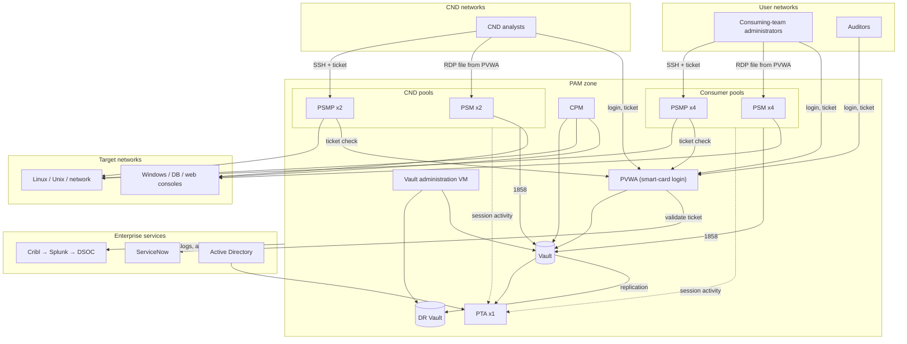

CND analysts start sessions from PVWA in the same way as consuming teams, so every CND session is ticket
checked. The CND pools have their own VIPs, Safes and roles (FR9). CND shares the Vault, PVWA, CPM and
PTA with consuming teams. The CND boundary is therefore enforced by Safe permissions and roles at those
shared tiers, and by separate pools at the session tier. The architecture forum confirms that boundary
at G1.

### Network zones and flows

**Figure 3 — Zones and main session flows** (management, monitoring, patching, backup and CPM flows are
listed in [Network: firewall and DNS](#network-firewall-and-dns) and Attachment A rather than drawn)

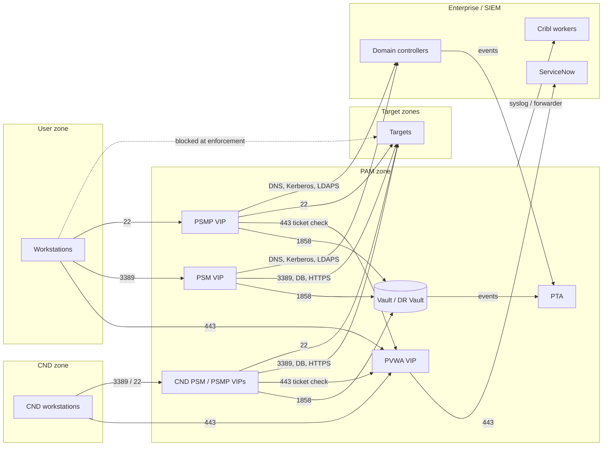

[Network: firewall and DNS](#network-firewall-and-dns) lists every flow, and the firewall matrix for each classification is Attachment A (KD19).

### Session flows

**Figure 4 — RDP, database and web sessions through PVWA and PSM**

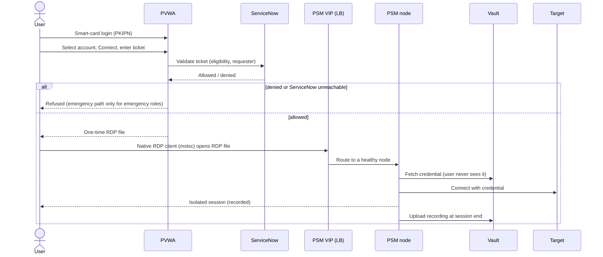

**Figure 5 — SSH sessions through PSMP**

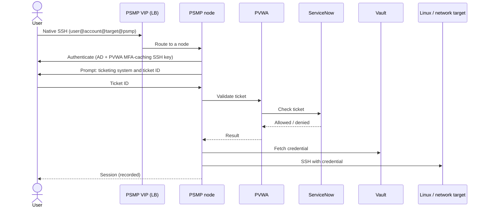

The access methods are as follows (DEC-01, DEC-02).

| Method | Ticket checked | In scope |
|---|---|---|
| PVWA *Connect* → RDP file, opened in the user's native RDP client | Yes, at PVWA, before the session | Yes (default) |
| PVWA *Connect* → HTML5 Gateway (browser) | Yes, at PVWA | No: not included (DEC-06) |
| Native SSH through PSMP | Yes: PSMP asks for the ticketing system and ticket ID and passes them to PVWA [CA] | Yes |
| RDP client straight to PSM with a connection string (never visits PVWA) | No | No: disabled |
| Password *Show/Copy* (*Retrieve*) | Yes, through the break-glass request | Break-glass accounts only ([Security, RBAC, bypass prevention and break-glass](#security-rbac-bypass-prevention-and-break-glass)) |

Ticket IDs for PSMP cannot contain the characters `( ) = ,` [CA], and the ticket can also be given in the
PSMP connection string [CA]. The PSMP ticket path is tested in the non-production environment in Phase 1.
If that test fails, the architecture forum selects one of the fallbacks in Attachment J at G2.

### High availability, load balancing and sites

**Figure 6 — Pools split across two sites**

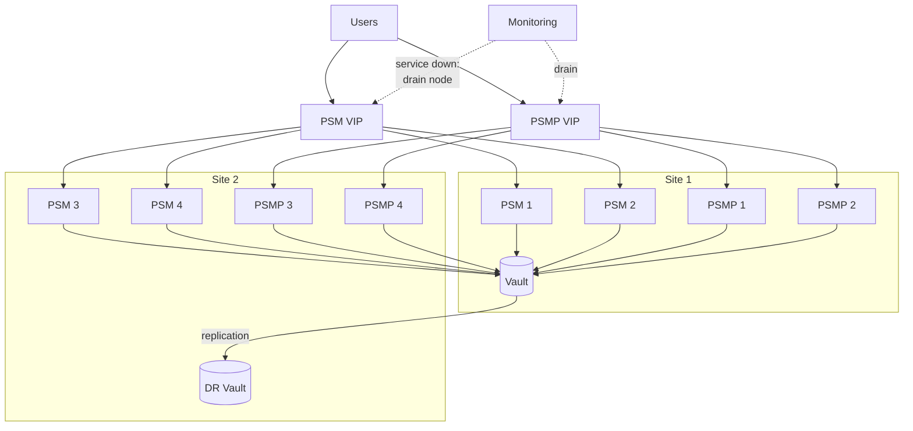

| Design item | Design |
|---|---|
| Pools | Each production classification has a consumer PSM pool (4 nodes), a consumer PSMP pool (4), a CND PSM pool (2) and a CND PSMP pool (2). |
| Load balancing approach | F5 BIG-IP load balancers in each classification (Q28) present each pool as one virtual server, in TCP pass-through mode (DEC-13). CyberArk recommends DNS load balancing and SSL pass-through [CA]. The F5 keeps pass-through and adds health monitors and monitoring-driven drain, which DNS load balancing alone does not provide. The architecture forum confirms this choice at G1 against the 14.6 load-balancing guidance. |
| CyberArk configuration | Every PSM in a pool runs the same version [CA]. Each PSM keeps its own server ID (`PSMServer`, then `PSM-<computer name>`), and platforms reference the PSM server ID [CA]. |
| Mode | TCP pass-through for RDP and SSH; the load balancer does not terminate TLS or SSH. |
| Source address | The F5 preserves the client's source IP address to the node (SNAT disabled, with the pool members routing back through the F5), because PSM/PSMP logs and the DSOC use cases depend on it. If routing does not allow this, SNAT automap is used and the F5 logs each connection's original and translated addresses to Splunk. The LLD confirms the choice. |
| Persistence | An F5 source-address persistence profile for RDP, with a timeout of at least 3,900 seconds (65 minutes), so that a user who reconnects within the idle disconnect period ([Session policy](#session-policy)) returns to the same node. SSH needs no persistence. |
| Idle timeout | The F5 TCP profile idle timeout is at least 3,900 seconds (65 minutes), longer than the PSM idle disconnect of 60 minutes ([Session policy](#session-policy)). Active sessions send keep-alives and are not cut by the load balancer. |
| Health checks | An F5 TCP monitor on 3389 or 22, every 10 seconds, with a 31-second timeout (3 missed checks). In addition, if the PSM or PSMP service fails while the port stays open, monitoring disables the pool member through the F5 iControl REST API (R9). The LLD confirms these values. |
| Live monitoring | Live monitoring uses the PSMAdminConnect user of the node that runs the session, so it reaches that node directly rather than through the VIP [CA]. |
| Site distribution | Each pool is split evenly across the primary and secondary sites, so the loss of a site leaves half of each pool. |
| Failover behaviour | Sessions on a failed node end, and users reconnect to a healthy node. Recordings are expected to be kept up to the point of failure; HA test HA-04 in [Testing](#testing) confirms this. |
| PSMP host keys | All PSMP nodes in a pool present the same SSH host key, so users do not see host-key warnings when routed to another node. The CyberArk team generates one host key pair per pool, stores it in a dedicated Safe and deploys it with Ansible. The key is replaced whenever a pool is rebuilt and at least every two years. |
| Certificates | The PSM RDP certificate on each node includes the VIP's fully qualified domain name (FQDN). |

### Platform and versions

#### Versions and operating systems

| Item | Decision |
|---|---|
| CyberArk version | Every node runs **14.6** (PSM 14.6.0.28, PSMP 14.6.0.13 [CA]). |
| Windows Server for PSM and the Vault administration VM | **Windows Server 2022** (DEC-03), built new. PSM and CPM are **not supported on Windows Server 2025** [CA], and the TLS 1.3 option needs PSM on Windows Server 2022 [CA]. Microsoft lifecycle, checked on 20 November 2026: Windows Server 2019 extended support ends on 9 January 2029, which is inside the service life; Windows Server 2022 mainstream support ended on 13 October 2026 and extended support ends on **14 October 2031**; Windows Server 2025 extended support ends on 14 November 2034. The CyberArk lead shall assess Windows Server 2025 within 6 months of CyberArk supporting it for PSM, and in any case before the end of 2029, so that the uplift completes before October 2031. |
| SOE readiness | Before G1, Windows Platform confirms (WP06) that a Windows Server 2022 SOE exists in all three classifications, with a hardening baseline, AppLocker and EDR support, and an RDS role that works with PSM 14.6. If it does not, R8 applies: PSM is built on Windows Server 2019 under a Security-approved concession, and uplift to 2022 completes before G7. |
| Linux | PSMP supports RHEL 8 and 9 (all minor versions) and Rocky 8 [CA]. PSMP needs a dedicated machine [CA]. PTA needs a minimal English installation of RHEL 8.8 or later, or 9.3 or later [CA]. **Decision (DEC-19):** PSMP and PTA are built on the existing RHEL 8 SOE (Q43), at 8.8 or later. RHEL 8 maintenance support ends in May 2029 (Red Hat lifecycle; to be validated by Linux Platform before G1), which is inside the service life. A concession records this, and the uplift to RHEL 9 completes before May 2029 as a planned in-life change. |
| RDS CAL version | Per User CALs of the same or a newer version than the PSM operating system. Procurement buys the newest version available when the order is placed, because newer CALs also license older servers. |

#### Connection components and client tools

Each connection component needs:
- its client tool installed on every PSM node of the pool;
- an AppLocker rule; and
- for web connectors, the same pinned browser and WebDriver version on every node, updated together in
  one change after a regression test in non-production.

The database clients are SQL Server Management Studio and pgAdmin (Q21); neither needs a commercial
licence. Any commercial client added later needs a licence that permits its use on PSM. Attachment F is the catalogue of components and client tools;
it records, for each one, whether keystrokes are audited and whether it is deferred under the
accelerated plan.

#### HTML5 Gateway

The HTML5 Gateway (browser-based PSM sessions) is not included in this change (Q20, DEC-06). Users connect
with their native RDP client from PVWA *Connect*. If browser access is needed later, it is added by a
change to this IA, with its own VMs, VIP, certificates and tests.

### Ticketing (ServiceNow)

**Figure 7 — Ticket decision**

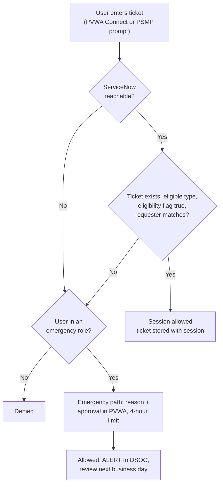

| Item | Design |
|---|---|
| Integration | CyberArk's ServiceNow ticketing integration runs on PVWA in each classification (DEC-02). PSMP sessions are also validated by PVWA [CA], so **PSMP needs HTTPS 443 to PVWA, not to ServiceNow**. |
| Validation logic | The logic sits in ServiceNow (DEC-08). Business rules maintain a computed "CyberArk access allowed" flag on each eligible ticket. The flag is true only when all of the following hold: the ticket type and state are eligible; the current time is inside the Change window; the ticket is assigned to a person; and a configuration item is set. A scheduled job runs every 5 minutes to set and clear the flag at the start and end of each Change window. |
| Eligible tickets | The eligible tickets are Incidents, Problem tasks, Service Requests (and their tasks) and Standard Change tasks (Q41). Normal Changes in state *Implement* inside their window are also eligible (*Assumed*; the ITSM process owner confirms before G2). The ITSM process owner defines the eligible state for each type in Attachment D before G2. |
| Requester match | The integration can check that the user is the requester (supported since version 10.6) [CA]. The proposed rule is that the PVWA user must be the ticket's *Assigned to* user. A ticket assigned only to a group therefore fails, and the user must assign it to themselves first. The ITSM process owner confirms the requester field in Attachment D before G2. |
| Target CI match | Not in the baseline (A15). If the 14.6 integration can send the target (checked in non-production in Phase 1) and the CMDB data is verified (Q50), the architecture forum may add CI matching at G2, using a ServiceNow Scripted REST API with a small custom ticketing plugin (Attachment J, I4). If the custom plugin is chosen, the CyberArk team owns its code, support and lifecycle. |
| Integration account | A dedicated ServiceNow user with read-only access (ACLs) to the fields needed. Its credential is vaulted and rotated by CPM. |
| Failure | If ServiceNow is unreachable, slow (no answer within 10 seconds) or returns an error, or the ticket is invalid, the session is denied by default. |
| Emergency path | Only members of the emergency role group for that classification may use it; Security approves the membership, with no more than 10 people per classification. The user records a reason, and a member of the emergency approver group approves the request in PVWA through dual control. Because approval happens in PVWA, the path works while ServiceNow is down. Access expires after 4 hours. Every use raises an immediate DSOC alert. The user raises a retrospective ticket within one business day, and Security reviews every use the next business day. For PSMP, the emergency path is used through a PVWA access request followed by PSM-SSH. Whether 14.6 supports a ticket bypass for emergency roles natively is checked in non-production in Phase 1 (Q40); if it does not, the emergency path uses the break-glass flow in Figure 8. Security approves this design at G1, subject to the Q40 test result, and confirms it at G2 (DEC-14). |
| Audit | The ticket is stored with the session and in the Vault audit. ServiceNow logs each validation call. Both logs are sent to Splunk. |

The options not chosen (SM9 and others) are in Attachment J.

### Security, RBAC, bypass prevention and break-glass

| Control | Design |
|---|---|
| Authentication | Users log in to PVWA by smart card (PKIPN, as described in the *PVWA Certificate Authentication (PKIPN) Guide*). PSMP authenticates users through AD and PVWA MFA caching. |
| RBAC | Safes are created per team and per classification. The roles are: End user (*Use* and *List*, without *Retrieve*), Approver, Safe Manager, Auditor, CyberArk Administrator and CND (separate Safes). Roles are granted through LDAP group mapping. The CyberArk architect produces the Safe and RBAC model for endorsement at G2 (DEC-15). |
| Credential controls | CPM rotates each credential at onboarding, after the dependency checks in WP29. It then changes passwords on the interval set in each platform's policy (Attachment F), reconciles on failure, and issues one-time passwords for break-glass accounts. |
| Platform controls | Every platform enforces *Connect through PSM*, requires a ticket and records sessions. Exclusive access and dual control apply to break-glass accounts and to the high-risk account classes listed in the Safe and RBAC model (for example, domain administrators and `root` on infrastructure servers). |
| Hardening | PSM and PSMP are hardened to CyberArk's guidance and the SOE baseline, with AppLocker. Only the PSMConnect and PSMAdminConnect users, and CyberArk administrators connecting through PSM, may log on interactively to PSM or PSMP servers. |
| Bypass prevention | Network blocks ([Network: firewall and DNS](#network-firewall-and-dns)), Windows target GPOs ([Identity / Active Directory](#identity--active-directory)) and Linux/Unix target `sshd` restrictions ([Linux Platform](#linux-platform)) are applied at enforcement. Users do not know the passwords, and PTA and Splunk detect bypass attempts. |
| Segregation of duties | CyberArk administrators administer the platform only from the Vault administration VM through PSM, so their sessions are recorded. They cannot delete recordings or audit records. Security reviews a sample of their sessions every month (R26). |
| Certificates | [PKI](#pki). |

**Figure 8 — Break-glass check-out and check-in**

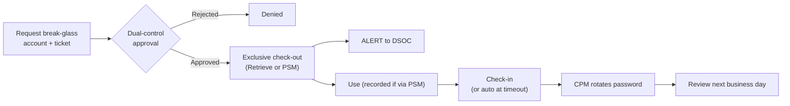

**Which path applies when something fails:**
- **ServiceNow is down:** the emergency path ([Ticketing (ServiceNow)](#ticketing-servicenow)).
- **PSM or PSMP is down, but the Vault and PVWA work:** break-glass check-out with *Retrieve*
  (Figure 8), following the outage runbook (R23).
- **The Vault or PVWA is down:** CyberArk's offline emergency-access procedure (R13).

The CyberArk lead maintains the offline procedure. The CyberArk team and Security test it every six
months and record the result (KD27).

### Session recording lifecycle

| Stage | Design |
|---|---|
| Storage | PSM and PSMP upload recordings to recording Safes in the Vault. PSM keeps a temporary copy until the upload succeeds. |
| Sizing | Vault storage = sessions per day × average hours per session × size per hour × retention days. Non-production and the pilot measure the inputs ([Capacity](#capacity)). |
| Replication | Recording Safes replicate to the DR Vault, which needs the same storage, and the replication needs bandwidth between sites ([Capacity](#capacity)). |
| Retention | Safe-level retention is set to the period that the records authority decides (D13). Until that period is set, recordings are kept without purge. |
| Archive | If the retention period outgrows Vault storage, recordings are exported periodically to an archive at the same classification, with an index by session, user, target, ticket and date. Records management and Security name and approve the archive system before G2 (Q44). |
| Retrieval | Only the dedicated *Auditor* role can retrieve recordings. Every retrieval is audited and sent to Splunk. The Service Operations request process sets a turnaround of 5 business days for each retrieval request. |
| Disposal | Recordings are purged automatically at the end of the retention period. The CyberArk team records each disposal batch in the disposal register that records management keeps. A legal hold suspends the purge for the recordings it names. |
| Classification | Recordings are held at the classification of the environment and carry any caveats of the session. Only auditors cleared to that classification and those caveats can retrieve them. |
| Privacy | The privacy impact assessment and workforce notice (KD21) are completed before the pilot goes live. |

### Logging and monitoring

**Figure 9 — Logging and monitoring paths**

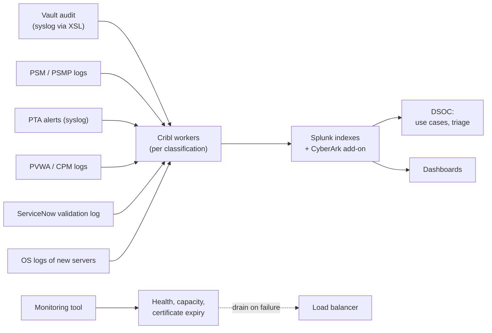

[SIEM: Cribl, Splunk and DSOC](#siem-cribl-splunk-and-dsoc) gives the SIEM detail (sources and use cases), and [Monitoring and control](#monitoring-and-control) the monitoring detail.

### PTA

| Item | Design |
|---|---|
| Deployment | One PTA server per classification, without high availability (DEC-05). It is recovered by rebuilding from automation and restoring the configuration backup. |
| Operating system | Minimal RHEL 8.8 or later on the existing SOE, with uplift to RHEL 9 before May 2029 ([Versions and operating systems](#versions-and-operating-systems), DEC-19). |
| Data sources | Vault audit (syslog from the Vault); PSM and PSMP session activity; domain controller security events. Security and the CyberArk architect decide at G1 whether the domain controller events come from the PTA Windows agent on the domain controllers or are forwarded from the SIEM (Q37). |
| Outputs | Alerts to PVWA and, through syslog, to Cribl, Splunk and DSOC. |
| Detections enabled (minimum) | Privileged access that bypasses PSM; suspected credential theft; unmanaged privileged accounts; risky commands in sessions; activity at unusual times or volumes. Before G2, the CyberArk team maps each of these to the PTA 14.6 detection names in Attachment E. |
| Automatic responses | PTA starts in alert-only mode. Security approves each automatic response (session suspension, credential rotation) separately, after at least 4 weeks in alert-only mode and a review of false positives with DSOC. |
| Detection gap | While PTA is down, the Splunk use cases in [SIEM: Cribl, Splunk and DSOC](#siem-cribl-splunk-and-dsoc) continue to run, and a "PTA down" alert is raised (R25). |

### Vault administration VM

| Item | Design |
|---|---|
| Purpose | It is the only place where Vault administration runs. It hosts the PrivateArk Client, PARClient (remote control of the Vault service), Vault and DR Vault health and backup tools, installers and scripts. Nobody logs on interactively to the Vault servers. |
| Count | **One per classification**, administering the Vault and the DR Vault (DEC-07). If it fails, it is rebuilt from automation within 1 business day. Urgent Vault administration in that time follows the offline emergency-access procedure (R13). |
| Build | Windows Server 2022 hardened SOE, with no internet, email or browsing; an AppLocker allow-list of administration tools; EDR; monthly patching. |
| Access | Only named CyberArk administrators, through PSM (recorded), with a ticket and vaulted credentials. There is no direct RDP. |
| Network | Outbound to the Vault and DR Vault on 1858 and on the PARAgent port (9022, to be validated in non-production in Phase 1), and to PVWA on 443. All other outbound flows are limited to the patching, logging, time, EDR and backup services listed in Attachment A. |
| Logging | Logs go to Cribl and Splunk. DSOC runs the use case "Vault administration session". |
| Acceptance | Vault administration works only from this VM, and a direct logon to a Vault server is blocked and alerted. |

### Capacity

**PSM and PSMP.** CyberArk's minimum for PSM is 8 cores, 8 GB RAM, and 80 GB system disk plus 80 GB
temporary workspace. Its sizing tiers are 1–5, 6–30 and 31–60 sessions, with **no more than 60
concurrent sessions per PSM** [CA]. The PSMP minimum is a quad-core CPU, 8 GB RAM, and 10 GB plus 40 GB
temporary workspace, on a dedicated machine [CA]. CyberArk does not state a session ceiling for PSMP in
the pages used here (to be validated); until it does, the design sizes PSMP to 60 sessions per node, and
the Phase 2 performance test measures the real value. If the measured PSMP limit is lower than the
per-node load in the table below (up to 53 in PROTECTED), the CyberArk lead raises a change to add PSMP
nodes; R3 covers this case.

| Input | PROTECTED | SECRET | OFFICIAL |
|---|---|---|---|
| Privileged users | 250 | 200 | 90 |
| Active at peak (*Assumed* 30–40%) | 75–100 | 60–80 | 27–36 |
| Sessions per active user | 2–4 | 2–4 | 2–4 |
| Peak concurrent sessions | 150–400 | 120–320 | 54–144 |
| PSM share (*Assumed* 60%) | 90–240 | 72–192 | 32–86 |
| PSMP share (40%) | 60–160 | 48–128 | 22–58 |
| **Consumer PSM sessions per node, N-1 (3 serving)** | **30–80** | **24–64** | **11–29** |
| Consumer PSMP sessions per node, N-1 (3 serving) | 20–53 | 16–43 | 7–19 |

With one node out of service, 3 consumer PSM nodes carry at most **180** sessions (3 × 60). The top of
the PROTECTED estimate (240) and of the SECRET estimate (192) exceeds that. With a design limit of 70% of the ceiling
(42 sessions per node), serving the top of the range with one node out of service needs:
- PROTECTED: 240 ÷ 42 = 5.7, so 6 serving nodes + 1 = **7 nodes** (4 built + 3 contingency);
- SECRET: 192 ÷ 42 = 4.6, so 5 serving nodes + 1 = **6 nodes** (4 built + 2 contingency);
- OFFICIAL: 86 ÷ 42 = 2.05, so 3 serving nodes + 1 = **4 nodes** (4 built, no contingency).

**Decision (DEC-09, revised in v0.9).** Each classification starts with 4 consumer PSM nodes. The pilot
measures actual demand. DCE holds **+3 PSM in PROTECTED and +2 in SECRET** in contingency.

**Scale-out trigger.** Monitoring and Control raises an alert when any consumer PSM node exceeds 42
concurrent sessions on 3 separate business days within a month. The CyberArk lead then raises a change
to build contingency nodes (KD28). Any reduction of the OFFICIAL consumer pools below 4 PSM and 4 PSMP
needs a new decision record endorsed by the architecture forum. That record must be based on Phase 2
performance results showing no more than 42 sessions per node with one node out of service.

**CND pools.** The CND pools (2 PSM and 2 PSMP per classification) are sized to the same design limit
as the consumer pools: up to 42 concurrent sessions per pool with one node out of service. There are 15 CND analysts (Q20). At 2–4 sessions each, with all of them active, CND
peak demand is 30–60 sessions across PSM and PSMP, within the pools' limit with one node out of service.

**PVWA.** All 540 users log in, launch sessions and validate tickets through PVWA, and PSMP ticket
checks also go through PVWA. Each classification has 4 PVWA nodes, 2 at each site (Q36). In Phase 0 the CyberArk team
measures their current load (Q36). The architecture forum decides at G1 whether to add a PVWA node behind
the existing PVWA load balancer. A node is added if the projected peak load would take CPU above 70% or
page response time above 3 seconds (R20).

**CPM.** Each classification has one CPM at the primary site and one at the secondary site (Q36).
Onboarding every in-scope account multiplies the CPM verify, change and reconcile jobs. Before
G1, the CyberArk architect sizes CPM from the Attachment H totals against CyberArk's CPM sizing guidance
(to be validated: the CyberArk architect checks it against the 14.6 CPM sizing page before G1), and records the outcome as a decision. The outcome is one of: the existing CPM
suffices; add a CPM; or split CPM work by platform (R20).

**Vault and DR Vault storage and replication.** Recordings are the main new data. The first estimate
below shows the scale. Measurements from non-production and the pilot replace it, and the archive option
([Session recording lifecycle](#session-recording-lifecycle)) caps Vault growth.

| Input (*Assumed*) | Value |
|---|---|
| Sessions per day (all classifications) | 1,000–2,000. This is a typical daily volume, used for storage. The peak concurrency above is a worst case, used for node sizing. The two are estimated separately, and the pilot measures both. |
| Average session length | 1 hour |
| Mix | 60% RDP or web video; 40% SSH text |
| Size per hour | RDP or web video 50–150 MB; SSH text about 5 MB |
| Storage per day | Low: 1,000 × (0.6 × 50 + 0.4 × 5) MB ≈ 32 GB. High: 2,000 × (0.6 × 150 + 0.4 × 5) MB ≈ 184 GB |
| Retention | Not yet set (D13). One year is used as the example. |
| Storage per year (example) | About **12–67 TB** across the three classifications, and the same again for the DR Vault copy |
| Replication | On average 3–17 Mbit/s across the three classifications, with higher peaks at the end of the working day. Network confirms the inter-site bandwidth before G2. |

DCE owns the Vault and DR Vault storage expansion and gives its lead time before G1.

**Build specification.** Attachment B is the build sheet for each role and classification; it fixes
the values below at G2.

| Role | vCPU | RAM | Disks | NICs | Notes |
|---|---|---|---|---|---|
| PSM (Windows) | 8 (minimum) to 16 | 16–32 GB | 80 GB or more for the operating system; 80 GB or more of SSD-tier storage for temporary recordings | 1 | RAM is usually the limit |
| PSMP (Linux, RHEL 8) | 4 (minimum) to 8 | 8 (minimum) to 16 GB | 10 GB + 40 GB minimum [CA]; 80 GB proposed | 1 | Dedicated machine [CA] |
| PTA (Linux) | CyberArk recommended specification (the CyberArk architect fills in the figures before G2) | | | 1 | Sized by event volume |
| Vault administration VM (Windows) | 4 | 8–16 GB | 100 GB | 1 | Administration tools only |

### Disaster recovery and resilience

Service Operations approves the RTO and RPO values below at operational acceptance (G7). NFR7 refers to
this table.

| Component | Failure | Behaviour and recovery | RTO | RPO |
|---|---|---|---|---|
| PSM / PSMP node | Node down | The pool continues on the remaining nodes; sessions on that node reconnect elsewhere. | No loss of service for new sessions | Recording of an interrupted session up to the point of failure (HA-04) |
| PSM / PSMP site | Site down | Half of each pool remains. | Reduced capacity until the site returns | As above |
| Vault | Failover to DR Vault | PSM, PSMP, PTA and the Vault administration VM list both Vault addresses in their Vault configuration and reconnect to the DR Vault (to be validated in DR test DR-02). Recordings resume uploading. | The existing Vault DR RTO | The existing Vault DR RPO |
| PTA | Server down | No analytics until rebuilt; the Vault and sessions are unaffected; Splunk use cases continue. | 2 business days | Configuration backup (daily) |
| Vault administration VM | Server down | Rebuilt from automation; urgent administration follows the offline procedure. | 1 business day | Configuration backup (daily) |
| ServiceNow | Unavailable | Validation denies by default; the emergency path applies ([Ticketing (ServiceNow)](#ticketing-servicenow)). | ServiceNow's own targets (Q42) | Not applicable |
| Recording upload | Fails | The recording stays on the PSM temporary disk and is retried, and an alert is raised. | Not applicable | No recording loss within PSM disk capacity |

### Session policy

These are the proposed defaults. Security approves them at G1 (DEC-14). Any later change needs a
decision record.

| Setting | Proposed |
|---|---|
| Maximum session length | 12 hours |
| Idle disconnect | 60 minutes |
| Clipboard | Disabled by default. Text-only copy to the target is allowed for the platforms listed in the approved session policy. |
| Drive, printer and USB redirection | Disabled |
| File transfer | Only through the file transfer method defined for each platform in Attachment F, which is logged to Splunk. Security approves any exception. |
| RDP to targets | Network Level Authentication (NLA) and TLS required |
| Concurrent sessions per user | Up to 4 (A4) |
| Recording | Video for every PSM session; keystrokes or commands for SSH and for the clients marked "keystroke audit" in Attachment F |

### Decision log

Decisions marked *Agreed* reflect the sponsor's answers to the questions in [Answered questions](#answered-questions). They are
endorsed formally at the gate shown. Decisions marked *Proposed* or *Pending* are taken at the gate
shown, by the body named.

| # | Decision | Decided by | Date | Status |
|---|---|---|---|---|
| DEC-01 | PVWA *Connect* launches the native RDP client after the ticket check; direct connection-string RDP to PSM is disabled (option N1, Attachment J). | Sponsor (Q31) | 2026-11-20 | Agreed; endorsement at G1 |
| DEC-02 | ServiceNow is used in each classification (option I1, Attachment J); PSMP users enter the ticket at PSMP, and PVWA validates it. | Sponsor (Q30) | 2026-11-20 | Agreed; endorsement at G1 |
| DEC-03 | PSM is built new on **Windows Server 2022** (Windows Server 2025 is not supported by PSM [CA]). | Sponsor (Q6) | 2026-11-20 | Agreed; endorsement at G1 |
| DEC-04 | OFFICIAL is in scope with the same pattern as PROTECTED and SECRET; there are CND pools in all three. | Sponsor (Q29, Q32) | 2026-11-20 | Agreed; endorsement at G1 |
| DEC-05 | PTA is mandatory, one per classification, without high availability. | Sponsor (Q10, Q24) | 2026-11-20 | Agreed; endorsement at G1 |
| DEC-06 | The **HTML5 Gateway is not included** in this change; it would be added later by change. | Sponsor (Q16, Q20) | 2026-11-25 | Agreed; endorsement at G1 |
| DEC-07 | One Vault administration VM per classification, administering the Vault and the DR Vault. | Sponsor (Q34) | 2026-11-20 | Agreed; endorsement at G1 |
| DEC-08 | Ticket validation logic sits in ServiceNow, as an eligibility flag. | Sponsor | 2026-11-20 | Agreed; endorsement at G1 |
| DEC-09 | Sizing is CyberArk-based. Each classification has 4 consumer PSM nodes, with +3 in PROTECTED and +2 in SECRET held in contingency. | Sponsor (Q22); revised in v0.9 | 2026-11-24 | Agreed; endorsement at G1 |
| DEC-10 | Every break-glass account uses check-out and check-in. Application local credentials are rotated natively where a CPM plugin or the application's API supports it; otherwise a concession is raised. | Sponsor (Q17) | 2026-11-20 | Agreed; endorsement at G1 |
| DEC-11 | Build and configuration are automated with Ansible for every component that has a validated Ansible role. Manual steps are documented in the build guide. | Sponsor (Q18) | 2026-11-20 | Agreed; endorsement at G1 |
| DEC-12 | The records authority sets the recording retention period. The design supports any period, and recordings are kept without purge until the period is set. | Sponsor (Q8) | 2026-11-20 | Agreed; retention value pending (D13) |
| DEC-13 | An external load balancer in TCP pass-through mode with health checks and monitoring-driven drain is used, rather than DNS load balancing alone ([High availability, load balancing and sites](#high-availability-load-balancing-and-sites)). | Architecture forum | G1 | Proposed |
| DEC-14 | Session policy ([Session policy](#session-policy)) and emergency path ([Ticketing (ServiceNow)](#ticketing-servicenow)). | Security | G1; emergency path confirmed at G2 after the Q40 test | Pending |
| DEC-15 | Safe and RBAC model ([Security, RBAC, bypass prevention and break-glass](#security-rbac-bypass-prevention-and-break-glass)). | Architecture forum, on the CyberArk architect's proposal | G2 | Pending |
| DEC-16 | Enforcement approach for each consuming team (which direct paths close, and when). | CAB, at each wave's G6 | Each G6 | Pending |
| DEC-17 | A non-production environment is built in PROTECTED ([Non-production environment](#non-production-environment)), reusing the existing non-production Vault, PVWA and CPM. | Sponsor (Q39, Q47) | 2026-11-25 | Agreed; endorsement at G1 |
| DEC-18 | The accelerated delivery plan is recommended ([Accelerated delivery option (recommended, approximately 10 months)](#accelerated-delivery-option-recommended-approximately-10-months)). | Steering group | G0 | Proposed |
| DEC-19 | PSMP and PTA run on the existing RHEL 8 SOE (8.8 or later) under a concession, with uplift to RHEL 9 before May 2029. | Sponsor (Q43) | 2026-11-25 | Agreed; endorsement at G1 |
| DEC-20 | PVWA certificate login (PKIPN) is brought into production in every classification as part of this change (WP33). | Sponsor (Q35) | 2026-11-25 | Agreed; endorsement at G1 |

### Non-production environment

The non-production environment lets the project prove the design, integrations and procedures before
they reach production. After go-live, it lets the CyberArk team test upgrades, patches, connector and
WebDriver changes, ServiceNow logic changes and PTA tuning before production (DEC-17).

| Item | Design |
|---|---|
| Location | PROTECTED, in a separate non-production network zone with its own firewall rules. |
| Components | Consumer PSM 2, consumer PSMP 2, PTA 1 and Vault administration VM 1: **6 VMs**. They connect to the existing non-production Vault, PVWA and CPM (Q39, A16). |
| Load balancing | A PSM VIP and a PSMP VIP on the F5, each with 2 nodes, so that load balancing, drain and node failover can be tested. |
| Integrations | A non-production ServiceNow instance (or a sub-production instance agreed with the ServiceNow team, Q42); a Splunk test index fed through the PROTECTED Cribl workers; non-production monitoring. |
| Targets | A small set of test targets for each target type in [Targets and onboarding in scope](#targets-and-onboarding-in-scope): Windows, Linux, a network device image, SQL Server and PostgreSQL, and each web console type in Attachment F. Consuming teams nominate them in Attachment H. |
| Data | Test accounts only. No production credential, recording or personal data is copied into non-production. |
| Testing for SECRET and OFFICIAL | Functional, integration and upgrade tests carried out here apply to all three classifications, because they use the same versions, SOE and automation. Tests that depend on the classification's own infrastructure (connectivity, load balancer, failover, accreditation tests) run in each production classification before users are onboarded there (R21). |
| Lifecycle | Non-production is kept at the same version as production, or one version ahead during an upgrade. It is upgraded first, at least 2 weeks before production. |
| Access | CyberArk team, test team and nominated testers from consuming teams, through non-production PVWA with smart card. |
| Build | It is built first in Phase 1 (WP30), from the same Ansible playbooks as production, which proves the playbooks before the production build. PKIPN is configured on the non-production PVWA first (WP33). |

---

## Requirements

### Key deliverables

The key deliverables are grouped in the order they are produced: design and approval, build and
integration, assurance, then transition and closure. Each deliverable has:
- one owner, who produces it;
- an approver, who accepts it;
- the gate at which it is needed ([Governance and approval gates](#governance-and-approval-gates));
- the work packages that produce it ([Resource effort and work packages](#resource-effort-and-work-packages)); and
- the evidence that shows it is complete.

Identifiers KD1–KD15 are unchanged from v0.8. KD16–KD38 were added in v0.9, and KD39 in v0.10.

**Design and approval**

| # | Deliverable | Owner | Approver | Gate | WP | Acceptance evidence |
|---|---|---|---|---|---|---|
| KD16 | High-level design (HLD) update, covering every new tier, integration and decision in [Solution design](#solution-design) | CyberArk architect | Architecture forum | G1 | WP02 | The architecture forum endorses the HLD and records any conditions. |
| KD17 | Low-level design (LLD) for each classification and for the non-production environment | CyberArk architect | Architecture forum | G2 | WP02 | The architecture forum endorses each LLD, and every condition raised at G1 is closed. |
| KD18 | Architecture forum endorsement records for G1 and G2 | Project manager | Architecture forum chair | G1, G2 | WP02 | The records are filed with the project, and every condition is closed or carried forward with an owner and a due gate. |
| KD19 | Firewall and flow matrix (Attachment A) for each classification and for non-production | Network manager (the CyberArk lead supplies the flow requirements) | Network design authority and Security | G1 for component flows; G5 per wave for target flows; G6 per wave for bypass blocks | WP07, WP24, WP25 | The matrix is approved, and a flow test passes for every implemented rule. |
| KD20 | Security risk assessment and system security plan update for each classification | Security accreditation lead | Accreditation authority | G4 | WP03 | The accreditation authority accepts the documents for assessment. |
| KD21 | Privacy impact assessment and workforce notice for session recording | Security accreditation lead | Privacy officer | G5 (pilot) | WP03 | The privacy officer approves the assessment, and the notice is issued to all privileged users before their wave goes live. |
| KD22 | Test strategy and test plans (Attachment G), with entry and exit criteria and defect thresholds | Test lead | Security accreditation lead and Service Operations manager | G2 | WP26 | Both approvers sign the strategy, and every test area in [Testing](#testing) has a plan. |

**Build and integration**

| # | Deliverable | Owner | Approver | Gate | WP | Acceptance evidence |
|---|---|---|---|---|---|---|
| KD23 | Non-production environment in PROTECTED ([Non-production environment](#non-production-environment)), connected to the existing non-production Vault, PVWA and CPM | CyberArk lead | Test lead | Before SIT starts in PROTECTED | WP30 | Every new component is built from Ansible, and a smoke test of each session type and of the ticket path passes. |
| KD1 | 36 production PSM/PSMP servers, built from automation, hardened, registered to the Vault, with every node of a pool on the same version | CyberArk lead | Test lead | G4 | WP12, WP13 | A pipeline build log exists for every node; the hardening scan has no critical or high finding open; a version report shows one version per pool. |
| KD2 | Load-balanced pools on F5: 12 production VIPs and 2 non-production VIPs, with health monitors, monitoring-driven drain and distribution across the primary and secondary sites | Network manager | Test lead | G4 | WP08, WP20 | HA tests HA-01 to HA-05 in [Testing](#testing) pass. |
| KD3 | PTA in each classification, integrated with the Vault, PSM/PSMP, AD, PVWA and Splunk | CyberArk lead | Security accreditation lead | G4 | WP15 | Each minimum detection in [PTA](#pta) fires in test, and its alert reaches PVWA and Splunk. |
| KD4 | HTML5 Gateway decision record: not included in this change (DEC-06) | CyberArk architect | Architecture forum | G1 | WP14 | The decision is recorded in [Decision log](#decision-log). |
| KD5 | ServiceNow ticketing with validation logic, failure mode and emergency path, in non-production and in each classification's instance | ServiceNow service owner | Test lead and ITSM process owner | G4 | WP16 | Every ticketing test case in [Testing](#testing) passes. |
| KD6 | Integration from CyberArk through Cribl and Splunk to DSOC | SIEM lead | DSOC manager | Core use cases at G5 (pilot); full catalogue at the first G6 | WP18, WP19 | Each use case in Attachment E fires in test, and DSOC triages it using its runbook. |
| KD7 | Monitoring and alerting for every new component, including capacity, drain and certificate expiry | Monitoring and Control lead | Service Operations manager | G4 | WP20 | Each alert in the monitoring specification is raised in test and received by the right support group. |
| KD8 | Platforms, Safes, RBAC, CPM and reconcile policies, and connection components for each in-scope target type | CyberArk lead | Architecture forum (model, DEC-15); test lead (test matrix) | G2 (model); G5 for each wave | WP21, WP22 | The Attachment G test matrix passes for each target type in the wave. |
| KD9 | Every in-scope account onboarded, including break-glass accounts and native application credentials | CyberArk lead | Account owner, for each wave | G6 for each wave; G7 overall | WP23 | At least 98% of the accounts in each wave are verified and rotated by CPM. Each remaining account has an owner-approved exception in the concession register. |
| KD10 | Bypass prevention in force for each wave, including retirement of the wave's jump hosts | Network manager (with Identity and Linux Platform) | CAB and Security accreditation lead | G6 for each wave | WP25 | Every direct-access attempt in the bypass tests is blocked and raises a DSOC alert, and the wave's jump hosts are retired. |
| KD11 | Recording lifecycle procedure: retention, retrieval, archive, disposal and legal hold | CyberArk lead | Records management | G5 (pilot) | WP32 | Retrieval, purge and legal hold are tested in non-production, and records management approves the procedure. |
| KD15 | Vault administration VM in each classification | CyberArk lead | Security accreditation lead | G4 | WP28 | The acceptance criteria in [Vault administration VM](#vault-administration-vm) are met. |
| KD24 | RD Licensing server and RDS CALs installed and activated in every classification and in non-production | Identity lead (CALs bought by Procurement) | Test lead | G3 | WP04, WP09 | The RD licensing diagnostic on each PSM shows Per User mode with licences available. |
| KD25 | New servers registered as configuration items in the ServiceNow CMDB, with support groups and service relationships | Service Operations manager | ServiceNow team | G5 (pilot) | WP27 | Every new server appears in the CMDB with its support group and service. |
| KD26 | The known PKI defects in [Defects debt](#defects-debt) are fixed | Identity lead (sub-CA GPO fix); CyberArk lead (PVWA revocation check and trust mode reset) | Security accreditation lead | G3 | WP10 | No non-root certificate is in Trusted Root on PVWA or on the new servers; the revocation check is enabled on the PVWA binding; PKIPN login works with `ClientAuthTrustMode` back at 0. |
| KD27 | Offline emergency-access procedure (for when the Vault or PVWA is down) documented and tested | CyberArk lead | Security accreditation lead | G5 (pilot) | WP27 | The procedure is tested end to end and the result is recorded. |
| KD28 | Contingency PSM nodes built when the scale-out trigger is met ([Capacity](#capacity)) | CyberArk lead | CAB | When triggered | WP12 | Same evidence as KD1 for the added nodes. |
| KD39 | PVWA certificate login (PKIPN) working in production on every PVWA node in each classification, with revocation checking enabled | CyberArk lead | Security accreditation lead | G5 for the first wave in each classification | WP33 | Smart-card login succeeds for test users of each issuing CA on every PVWA node; a revoked test certificate is refused; the *PVWA Certificate Authentication (PKIPN) Guide* diagnostic report shows no failures. |
| KD29 | Ansible playbooks, inventories and build guides handed over | DevSecOps lead | Service Operations manager | G7 | WP11 | The support team rebuilds one node of each role in non-production from the handed-over automation. |

**Assurance**

| # | Deliverable | Owner | Approver | Gate | WP | Acceptance evidence |
|---|---|---|---|---|---|---|
| KD12 | Test evidence from functional, security, HA/failover, ticketing, logging, performance, DR and UAT testing | Test lead | Security accreditation lead | G4; G6 for each wave (UAT) | WP26 | A result is recorded for every test case in Attachment G, and every defect is logged. |
| KD30 | Penetration test report for each classification | Security accreditation lead | Accreditation authority | G4 | WP03 | Every critical and high finding is closed, or the accreditation authority accepts the risk. |
| KD31 | Test completion report for each classification | Test lead | Security accreditation lead and Service Operations manager | G4 (SIT); G6 for each wave (UAT) | WP26 | The exit criteria in [Testing](#testing) are met. |
| KD32 | Authority to operate for each classification | Security accreditation lead | Accreditation authority | G4 | WP03 | The authority to operate is issued for the classification. |

**Transition and closure**

| # | Deliverable | Owner | Approver | Gate | WP | Acceptance evidence |
|---|---|---|---|---|---|---|
| KD33 | CAB approvals for the production build in each classification, each wave's go-live and each wave's enforcement | Project manager | CAB | G3, G5, G6 | Project management | An approved change record exists for each. |
| KD34 | User guides, communications and training records | Service Operations manager (content from the CyberArk team) | Consuming team leads | G5 for each wave | WP27 | Guides are published; every user in the wave is invited to training; at least 90% attend or complete the recorded session before go-live. |
| KD13 | Service transition package: support model, KB articles, incident categories, assignment groups and hypercare plan | Service Operations manager | Steering group | G5 (pilot); G7 | WP27 | Service Desk and L2 operations have the package before the pilot goes live, and the hypercare exit criteria in [Standard plan (approximately 15 months)](#standard-plan-approximately-15-months) are met. |
| KD35 | Operational runbooks: operations, patching with pool drain, upgrade, failover, recording retrieval and disposal, break-glass, PSM outage, incident response | CyberArk lead | Service Operations manager | Drafts at G5 (pilot); final at G7 | WP27 | Each runbook is walked through with the team that will use it. |
| KD14 | Lifecycle and upgrade procedure for the pools and components | CyberArk lead | Service Operations manager | G7 | WP27 | The procedure is rehearsed end to end in non-production with a patch or minor version, then reviewed. |
| KD36 | As-built records for each classification and for non-production | CyberArk lead | Architecture forum (noted) and Service Operations manager | G7 | WP27 | The as-built records match the LLD, or every deviation is recorded and approved. |
| KD37 | Operational acceptance certificate | Project manager | Service Operations manager | G7 | WP27 | The operational acceptance criteria in [Standard plan (approximately 15 months)](#standard-plan-approximately-15-months) are met. |
| KD38 | Project closure report: lessons learned, evidence against the measures in [Drivers and outcomes](#drivers-and-outcomes), residual risks and concessions handed to their owners | Project manager | Steering group | G7 | Project management | The steering group accepts the report and closes the project. |

### Supporting artefacts

The supporting artefacts are the attachments listed in the attachment register ([Attachment register](#attachment-register)) and four
registers that the project manager keeps from G0 until G7:
- the risk register (seeded from [Risks](#risks));
- the decision register (seeded from [Decision log](#decision-log));
- the concession register (seeded from [Concessions debt](#concessions-debt)); and
- the defect register (seeded from [Defects debt](#defects-debt)).

At G7 each register is handed to Service Operations, which then owns it.

### Baseline documentation

The author adds the baseline documents and their versions here before G1 (Q15). The expected baseline
includes:
- the CyberArk HLD and LLD;
- the system security documentation for each classification;
- the network diagrams;
- the SOE build standards;
- the ServiceNow integration standards;
- the SIEM onboarding standard; and
- the *PVWA Certificate Authentication (PKIPN) Guide*.

### Specification impact

| Specification | Impact | Updated by | When |
|---|---|---|---|
| CyberArk HLD and LLD | New tiers (PSM, PSMP, PTA, Vault administration VM, non-production); PKIPN in production; ticketing; SIEM; load balancing; recordings | CyberArk architect | G1 (HLD), G2 (LLD) |
| SOE / build standards | New PSM role (Windows Server 2022 with RDSH, PSM hardening and AppLocker); new PSMP and PTA roles on the existing RHEL 8 SOE | Windows Platform; Linux Platform | G2 |
| Network architecture | New flows and VIPs; direct administrative access removed at enforcement | Network manager | G2; after each G6 |
| Identity standards | PSM OU and GPOs; service accounts; delegations; a new break-glass account standard | Identity lead | G2 |
| Access policy | Privileged access to in-scope systems only through PSM/PSMP with a ticket | Security accreditation lead | Before the first G6 |
| ITSM process | Ticket requirements for privileged access; the emergency path | ITSM process owner | G1 |
| Logging and monitoring standard | New sources and use cases | SIEM lead | G4 |
| Records management | Recordings as records: retention, disposal, legal hold | Records management | G5 (pilot) |

### Functional and non-functional requirements

The "Verified by" column refers to the test areas in [Testing](#testing).

| # | Requirement | Verified by |
|---|---|---|
| FR1 | Users shall start Windows/RDP, database, web and other client-based sessions from PVWA *Connect* through the consumer PSM pool. | Functional; UAT |
| FR2 | Users shall start SSH sessions with their native SSH client through the PSMP pool, authenticated through Active Directory and PVWA MFA caching. | Functional; UAT |
| FR3 | Every session shall require a valid ServiceNow ticket ([Ticketing (ServiceNow)](#ticketing-servicenow)). | Ticketing |
| FR4 | Every session shall be recorded, and the recording shall be retained for the approved period ([Session recording lifecycle](#session-recording-lifecycle)). | Recordings |
| FR5 | Authorised operators shall be able to monitor and terminate live sessions. | Functional |
| FR6 | Break-glass accounts shall use exclusive check-out and check-in, rotation on check-in, dual control and a ticket (Figure 8). | Break-glass |
| FR7 | CPM shall verify, change and reconcile onboarded credentials on the schedule in each platform's policy. | CPM / onboarding |
| FR8 | PTA shall analyse Vault, PSM/PSMP and Active Directory activity and raise alerts to Splunk, DSOC and PVWA. | Logging / SIEM |
| FR9 | CND shall use dedicated pools, Safes and roles, isolated from consuming teams. | Security |
| FR10 | The session policy in [Session policy](#session-policy) shall apply to every session. | Security |
| NFR1 | Availability: each pool shall have no single point of failure; the loss of one node shall not prevent new sessions; the loss of one site shall leave at least half of each pool available. | HA / failover |
| NFR2 | Capacity: peak concurrency shall be served with one node out of service (N-1), at no more than 60 sessions per PSM server. | Performance |
| NFR3 | Performance: a session shall launch within 15 seconds of PVWA *Connect*. The Service Operations manager confirms this target at G1. | Performance |
| NFR4 | Security: servers shall be hardened to CyberArk guidance and the SOE baseline, and no direct logon to PSM/PSMP servers shall be possible outside sessions. | Security |
| NFR5 | Logging: security events shall reach Splunk within 5 minutes. The DSOC manager confirms this target at G1. | Logging / SIEM |
| NFR6 | Lifecycle: all nodes in a pool shall run the same CyberArk version, on an operating system that is supported for the service life ([Drivers and outcomes](#drivers-and-outcomes)). | Security (build checks) |
| NFR7 | Recovery: components shall meet the RTO and RPO in [Disaster recovery and resilience](#disaster-recovery-and-resilience). | DR |

### Requirements by workstream: workstream commitments

This section states what each team commits to deliver, what it receives and from whom, the effort,
when the work happens, and how the work is accepted. Each workstream lead confirms these commitments,
and the effort, in writing before G1.

Effort is in person-days for all three classifications and non-production together. Each figure is the
sum of the team's share of the work packages in [Resource effort and work packages](#resource-effort-and-work-packages). Phases are defined in [Standard plan (approximately 15 months)](#standard-plan-approximately-15-months); the
accelerated plan runs several phases in parallel ([Accelerated delivery option (recommended, approximately 10 months)](#accelerated-delivery-option-recommended-approximately-10-months)).

| Team | Commits to deliver | Receives (from, by when) | Effort (d) | Phases | Accepted when |
|---|---|---|---|---|---|
| Data Centre Engineering (DCE) | Up to 53 VMs ([Server inventory](#server-inventory)); placement across the primary and secondary sites; storage; backup policy; Vault and DR Vault storage expansion | Sizing sheet and placement rules (CyberArk lead, before G1) | 35–60 | 0–1 | [Data Centre Engineering](#data-centre-engineering) |
| Network (firewall, DNS, load balancing) | IP addresses; DNS records; 14 F5 VIPs with health monitors; component flows; target flows per wave; bypass blocks; jump host retirement; CRL/OCSP proxy access for PKIPN | Component flow requirements (CyberArk lead, at G1); target flow requirements (CyberArk lead, 4 weeks before each G5) | 68–115 | 1–2, 4, 5 | [Network: firewall and DNS](#network-firewall-and-dns) and [Network: load balancing](#network-load-balancing) |
| Windows Platform | Windows Server 2022 SOE for PSM, the Vault administration VM and non-production Windows servers, with the RDSH role baseline | PSM operating system requirements (CyberArk lead, Phase 0) | 14–28 | 0–1 | [Windows Platform](#windows-platform) |
| Linux Platform | Confirmation that the existing RHEL 8 SOE (8.8 or later) supports PSMP and PTA; `sshd` restrictions on Linux/Unix targets at enforcement; RHEL 9 uplift plan before May 2029 | Component operating system requirements (CyberArk lead, Phase 0); target lists per wave | 9–18 | 0–1, 5 | [Linux Platform](#linux-platform) |
| Identity / AD | OUs, GPOs, service accounts, CPM delegations, RD Licensing, break-glass account review, target GPOs for bypass prevention, the sub-CA GPO fix, LDAP UPN mapping support for PKIPN | AD change list (CyberArk lead, at G1) | 25–40 | 1, 4, 5 | [Identity / Active Directory](#identity--active-directory) |
| PKI | Certificates for PSM, VIPs, PTA and syslog TLS; CA certificates and CRL details for PKIPN; support to Identity on the sub-CA GPO fix | Certificate list (CyberArk lead, at G1) | 9–16 | 1 | [PKI](#pki) |
| Procurement / licensing | RDS CALs, CyberArk entitlement, RHEL subscriptions, Windows Server licences, client tool licences, VM capacity | Quantities ([Costs](#costs), before G1) | 6–12 | 0–1 | [Procurement and licensing](#procurement-and-licensing) |
| ServiceNow team | Integration user and ACLs; API access; validation logic ([Ticketing (ServiceNow)](#ticketing-servicenow)); test tickets; emergency process support; non-production and three production instances | Integration specification (Attachment D, CyberArk lead: draft at G1, final before G2) | 25–40 | 1–3 | [ServiceNow team](#servicenow-team) |
| SIEM (Cribl, Splunk) | Cribl routes; Splunk indexes, sourcetypes and add-on; dashboards | Source list and sample logs (CyberArk lead, from non-production in Phase 1) | 28–50 | 1–3 | [SIEM: Cribl, Splunk and DSOC](#siem-cribl-splunk-and-dsoc) |
| DSOC | Use cases, triage runbooks, PTA alert handling | Use case catalogue (Attachment E, CyberArk lead and SIEM lead, before G2) | 14–28 | 2–5 | [SIEM: Cribl, Splunk and DSOC](#siem-cribl-splunk-and-dsoc) |
| Monitoring and Control | Health checks, alerts, capacity dashboards, load balancer drain integration | Monitoring specification (CyberArk lead, at G1) | 11–21 | 1–3 | [Monitoring and control](#monitoring-and-control) |
| DevSecOps | Ansible environment (offline in SECRET), pipelines, scanning, EDR exclusions and AppLocker policy; automation handover | Playbooks and exclusion lists (CyberArk team, Phase 1) | 34–53 | 1–3, 6 | [DevSecOps and automation](#devsecops-and-automation) |
| Security and Accreditation | Risk assessments, system security plans, privacy impact assessment, session policy approval, penetration tests, authority to operate, concession approvals | HLD (G1), LLD (G2), test evidence (before G4) | 30–55 | 0–4 | [Security and Accreditation](#security-and-accreditation) |
| Backup | Configuration backup of the new servers, including non-production | Backup scope (CyberArk lead, before G2) | 3–6 | 1–3 | [Backup](#backup) |
| Service Operations / Service Desk | Support model (L2 by the Security Operations team, 24x7), assignment groups, KB articles, incident categories, training delivery, operational acceptance | Runbooks and user guides (CyberArk team, before G5) | 14–21 | 2–6 | [Service Operations, Service Desk and Records management](#service-operations-service-desk-and-records-management) |
| Records management | Recording retention, disposal and legal hold procedure; recording archive (with Security) | Recording design (CyberArk lead, before G2) | 3–5 | 1–2 | [Service Operations, Service Desk and Records management](#service-operations-service-desk-and-records-management) |
| Test team | Test strategy, test plans, test execution coordination, test completion reports | LLD (G2); a working non-production environment (end of Phase 1) | 50–80 | 1–5 | [Test team](#test-team) |
| Consuming teams (6–10 teams, *Assumed*; Q27) | Attachment H inventory; dependency checks before rotation; account owners; owner verification; UAT | Templates (CyberArk lead, Phase 0); wave plan (before G1) | 5–9 per team; 30–90 in total | 0, 4, 5 | [Consuming teams and CND](#consuming-teams-and-cnd) |
| CND (15 analysts) | Attachment H inventory for the CND pools; dependency checks; UAT | As for consuming teams | 5–9 | 0, 4, 5 | [Consuming teams and CND](#consuming-teams-and-cnd) |
| Project management | Plan, gates, registers, CAB submissions, reporting, closure | All workstreams | Accelerated: about 139 (0.8 FTE × 9.5 months). Standard: about 165 (0.6 FTE × 15 months) | All | [Project management](#project-management) |
| CyberArk team | Design, build, configuration, non-production, PKIPN in production, testing support, handover, and support to every other team's work packages | Inputs from every workstream above | Standard: 279–483. Accelerated: 267–457. Account onboarding (WP23) is additional | All | [CyberArk team](#cyberark-team) |

**Totals.** Accelerated plan: approximately 820–1,345 person-days, plus WP23. Standard plan:
approximately 860–1,400 person-days, plus WP23. At the example volume in [Resource effort and work packages](#resource-effort-and-work-packages), WP23 adds about 115
person-days under the accelerated plan (discovery-led) and about 215 under the standard plan.

#### Data Centre Engineering

DCE commits to:
- provide, in each production classification:
  - 6 PSM nodes (4 consumer and 2 CND) and 6 PSMP nodes (4 consumer and 2 CND), on Windows and Linux
    respectively;
  - 1 PTA (Linux) and 1 Vault administration VM (Windows).

  That is 14 VMs per classification and 42 in total;
- hold capacity for up to 5 contingency PSM nodes (3 PROTECTED, 2 SECRET);
- provide the 6 non-production VMs in [Non-production environment](#non-production-environment) within 4 weeks of the start of Phase 1, from
  a request raised in Phase 0;
- place each pool across the two sites, and apply an anti-affinity rule so that no two nodes of the same
  pool run on the same host within a site;
- expand Vault and DR Vault storage for recordings ([Capacity](#capacity)), and state the lead time before G1;
  and
- apply the backup policy agreed with the Backup team.

The specification is the build sheet in Attachment B. **Acceptance:** VMs are delivered to the
specification, placement evidence is provided, and backups are configured.

#### Network: firewall and DNS

Network commits to providing IP addresses and DNS records for every node and VIP, and the following
flows. Attachment A lists each rule with its exact ports. Network and Security approve the component-flow
section at G1, before it is implemented in Phase 1, and the complete matrix at G2.

**Component flows (Phase 1):**

| From | To | Port | Purpose |
|---|---|---|---|
| User networks | PVWA VIP | 443 | Portal, PVWA *Connect* |
| User networks | PSM VIP | 3389 | Session to PSM, launched by PVWA |
| User networks | PSMP VIP | 22 | Native SSH through PSMP |
| CND networks | PVWA VIP | 443 | Portal, PVWA *Connect* |
| CND networks | CND PSM / PSMP VIPs | 3389 / 22 | CND sessions |
| PSM, PSMP, PTA, Vault administration VM | Vault, DR Vault | 1858 | Vault protocol |
| PVWA (all nodes) | Proxy, then the CRL and OCSP addresses of the user-certificate issuing CAs | The proxy port, then HTTP 80 | PKIPN revocation checks (D16) |
| Vault administration VM | Vault, DR Vault | 9022 (to be validated in Phase 1) | PARAgent remote administration |
| Vault administration VM | PVWA | 443 | Administration |
| PVWA | ServiceNow | 443 | Ticket validation |
| PSMP | PVWA | 443 | Ticket validation for SSH sessions [CA] |
| PTA | PVWA | 443 (to be validated in Phase 1) | PTA alerts in PVWA |
| Vault | PTA | Syslog: TCP 514, or 6514 with TLS (to be validated in Phase 1) | Vault audit for analytics |
| Domain controllers, or SIEM | PTA | As the PTA design decides at G1 (Q37) | Events for analytics |
| PSM, PSMP | Domain controllers | DNS 53, Kerberos 88, LDAPS 636, SMB 445 (Group Policy) | Domain membership, AD Bridge |
| PSM, PSMP, Vault, PTA, PVWA, CPM, Vault administration VM | Cribl workers | Syslog over TLS 6514, or Splunk forwarder 9997 where TLS syslog is not supported | Logging |
| Monitoring | All new nodes | The monitoring tool's ports, listed in Attachment A | Health |
| Monitoring | F5 management interface (iControl REST) | 443 | Node drain (R9) |
| Ansible controller | Windows nodes; Linux nodes | WinRM 5986; SSH 22 (2222 on PSMP) | Build and configuration |
| All new nodes | Patching, NTP, CRL/OCSP, EDR management, backup | The ports of each service, listed in Attachment A | Operations |
| CyberArk administrators (through PSM) | PSM, Vault administration VM | RDP 3389 | Server administration |
| CyberArk administrators (through PSM) | PSMP; PTA | SSH 2222 on PSMP; SSH 22 on PTA | Server administration |
| Non-production zone | Non-production ServiceNow, Cribl, domain controllers, test targets | As for production | Non-production equivalents of the flows above |

**Target flows (before each wave's G5):** from the PSM and PSMP pools and from CPM to each target
network in the wave. These cover RDP 3389, SSH 22, the database and HTTPS administration ports of each
target, and the CPM ports for each platform (for example, SMB 445 and RPC for Windows). The ports for
each target are compiled from Attachment H into Attachment A.

**Bypass blocks (at each wave's G6):** deny direct administrative access from user networks and jump
hosts to onboarded targets, then retire the wave's jump hosts (Q26). Only the PSM and PSMP pools, CPM, and the management systems listed in
Attachment A (approved by Security) remain allowed.

**Firewall volume.** The CyberArk lead estimates the number of rules from the Attachment H returns
before G1, as target networks × target ports × source pools. Network re-baselines its effort from that
estimate. The firewall share of Network's effort (WP07, WP24 and WP25: 52–90 days) assumes 30–60 target networks across the three classifications.

**Replication bandwidth.** Network confirms the inter-site bandwidth available for Vault replication
([Capacity](#capacity)) before G2.

**Acceptance:** a flow test passes for every rule in each phase; at each enforcement, the bypass tests
show every direct attempt blocked and alerted.

#### Network: load balancing

Network commits to implementing [High availability, load balancing and sites](#high-availability-load-balancing-and-sites):
- VIPs in TCP pass-through mode, preserving the client source IP;
- RDP source-IP persistence and idle timeouts;
- health checks, with drain driven by monitoring; and
- distribution across sites.

The load balancer platform is F5 BIG-IP in every classification (Q28). **Acceptance:** the
failover, drain and site-loss tests (HA-01 to HA-05) pass.

#### Windows Platform

Windows Platform commits to:
- provide a Windows Server 2022 hardened SOE for PSM, the Vault administration VM and the non-production
  Windows servers, in all three classifications; confirm before G1 that it is ready (R8);
- allow the RD Session Host role and PSM hardening (CyberArk hardening and AppLocker), recording each
  deviation from the SOE in the build guide for Security to approve; and
- patch the Windows servers monthly, using pool drain as the patching runbook describes ([Service operations and BAU run effort](#service-operations-and-bau-run-effort)).

**Acceptance:** PSM 14.6 installs and hardens on the SOE in non-production before the production build.

#### Linux Platform

Linux Platform commits to:
- confirm before G1 that the existing RHEL 8 SOE (8.8 or later, minimal installation for PTA) supports
  PSMP and PTA, and raise the concession for RHEL 8 (DEC-19);
- plan the uplift of PSMP and PTA to RHEL 9, to complete before May 2029;
- allow PSMP's changes to `sshd`. PSMP takes port 22, so server administration of PSMP uses SSH on port
  2222, reachable only from PSM and the Ansible controller;
- at each wave's enforcement, apply `sshd` restrictions on the wave's Linux/Unix targets
  (`AllowUsers`/`AllowGroups` and source-address rules) so that privileged SSH is accepted only from the
  PSMP pools, CPM and the approved management systems; and
- patch the Linux servers monthly, using pool drain.

**Acceptance:** PSMP and PTA install cleanly on the RHEL 8 SOE in non-production. At each
enforcement, the SSH bypass tests show every direct attempt rejected.

#### Identity / Active Directory

Identity commits to:
- create an OU for PSM servers in each classification and link the CyberArk PSM hardening GPO; block
  inheritance from, or security-filter, any conflicting domain GPO, and list each one in the AD change
  list;
- create the PSM connection users (PSMConnect and PSMAdminConnect) as domain accounts, which CPM
  rotates. CyberArk recommends domain accounts for load-balanced pools (to be validated). The CyberArk
  architect confirms the choice before G2;
- provide RD Licensing: a licence server in each classification in Per User mode (an existing server,
  or a new VM from DCE, Q38), with a GPO that points PSM at it;
- confirm that the PVWA LDAP integration maps `UserLogonName` to `userPrincipalName` for PKIPN (WP33);
- create service accounts: an LDAP bind account; CPM reconcile accounts; and a PTA AD account with the
  read permissions that the PTA guidance lists;
- delegate *Reset password* and *Unlock account* to CPM on the OUs that hold onboarded domain accounts;
- review the existing emergency domain accounts, align them to the break-glass account standard that
  Identity issues before G2, and hand them over for onboarding with check-out;
- at each wave's enforcement, apply GPOs on the wave's Windows targets that restrict *Allow log on
  through Remote Desktop Services* and the Windows Firewall RDP scope to the PSM pools, CPM and the
  approved management systems; and
- fix, at source, the GPO that places an internal sub-CA in Trusted Root, before G3 (R17, KD26).

**Acceptance:** the AD change list is implemented and tested in non-production, then in each
classification before G3; enforcement GPOs pass the bypass tests at each G6.

#### PKI

PKI commits to:
- issue certificates from the internal CA for PSM RDP (node and VIP names), PTA, and syslog TLS to
  Cribl, in production and non-production;
- provide the CA certificates and CRL and OCSP addresses of every CA that issues user smart-card
  certificates, for PKIPN (WP33);
- provide the renewal procedure; and
- work with Identity on the sub-CA GPO fix (KD26).

Monitoring and Control raises an alert 60 days before any certificate expires.

**Acceptance:** chains validate on clients, and no non-root certificate is in Trusted Root on the new
servers.

#### Procurement and licensing

Procurement commits to:
- confirm the quantities and licence models in [Costs](#costs) before G1;
- raise the orders for long-lead items (VM capacity, CALs and CyberArk licences) before G1, and all
  other orders before G2, so that licences are installed before G3; and
- confirm:
  - whether the enterprise agreement covers the Windows Server CALs;
  - the CyberArk entitlement for PSM, PSMP, PTA and non-production (Q14).

**Acceptance:** every licence in [Costs](#costs) is delivered and recorded in the licence register before G3.

#### ServiceNow team

The ServiceNow team commits to implementing [Ticketing (ServiceNow)](#ticketing-servicenow) in the non-production instance first, then in
each classification's instance:
- the integration user and ACLs;
- the eligibility flag (business rules, script includes and the 5-minute scheduled job);
- the Scripted REST API, only if the architecture forum adds CI matching at G2 (A15);
- verification of CMDB data quality for CI matching, if CI matching is added (Q50);
- test tickets in every state that the ticketing tests in [Testing](#testing) need;
- support for the emergency process, including retrospective tickets;
- CMDB registration of the new servers (with Service Operations, KD25);
- new assignment groups and incident categories (with Service Operations); and
- a standard change template for onboarding waves.

The ServiceNow service owner confirms before G1:
- the service tier and availability now that privileged access depends on ServiceNow (Q42); and
- the expected API load: about 540 users, with a validation call for each session launch.

**Acceptance:** every ticketing test case passes in non-production and in each classification.

#### SIEM: Cribl, Splunk and DSOC

| Item | Requirement |
|---|---|
| Sources | Vault audit via syslog (the `dbparm.ini` syslog settings, with an XSL translator for the Splunk/CEF format); PSM and PSMP logs; PTA alerts (syslog); PVWA and CPM logs; ServiceNow validation logs; operating system logs of the new servers. |
| Transport | CyberArk → Cribl (per classification) → Splunk → DSOC, with TLS on every hop. Attachment E lists any hop where TLS is not supported, and Security approves each one. |
| Cribl | The SIEM team builds routes and pipelines for each source, with parsing and with filtering to control volume (R16). |
| Splunk | The SIEM team creates indexes, sourcetypes, the CyberArk add-on (the SECRET copy is transferred through the CDS (A10)) and field extractions. Retention follows the existing SIEM retention standard. |
| Dashboards | The SIEM team builds these dashboards before G5 (pilot): sessions; ticket compliance; break-glass use; CPM success and failure; PSM/PSMP health and capacity; PTA alerts; bypass detections. |
| **Use cases (minimum)** | Emergency path used; break-glass check-out; *Retrieve* outside break-glass; direct RDP, SSH or database logon to an onboarded target from a non-PSM source (Windows event 4624 logon type 10, or Linux `sshd` source IP); PTA high-risk alerts; repeated failed PSM/PSMP authentication; CPM failures; recording upload failures; PSM/PSMP service down; PTA down; sessions outside business hours; use of a dormant account; Safe permission changes; Vault administration session. |
| DSOC | DSOC writes a triage runbook for each use case, handles PTA alerts and escalates to the CyberArk team. For each use case, Attachment E records the severity, the triage target, and whether it is handled 24x7 or in business hours. The DSOC manager approves it at G4. |
| Timing | DSOC is engaged from Phase 2: core use cases run before the pilot (G5), and the full catalogue runs before the first enforcement (G6). |
| **Acceptance** | Each use case fires in test and DSOC triages it. |

#### Monitoring and control

Monitoring and Control commits to monitoring:
- **health:** the PSM and RDS services; on PSMP, `psmpsrv`, `sshd` and AD Bridge; PTA; the Vault
  administration VM; and the non-production environment;
- **capacity:** concurrent sessions per node, alerting at 42 (70% of 60); CPU and RAM; the PSM temporary
  recording disk; Vault and DR Vault disk;
- **load balancer integration:** draining a node when its service fails ([High availability, load balancing and sites](#high-availability-load-balancing-and-sites));
- **certificates:** an alert 60 days before expiry.

**Acceptance:** each alert is raised in test and received by the right support group, and the
dashboards are in place.

#### DevSecOps and automation

DevSecOps commits to:
- provide the Ansible environment for PSM and PSMP build and configuration. It uses CyberArk's published
  automation where a validated role exists. The CyberArk team checks the named collections and their
  versions (for example, the `cyberark.pas` collection) against 14.6 in non-production in Phase 1. Local
  roles cover operating system prerequisites, hardening checks and configuration;
- for SECRET, provide an offline Ansible execution environment and mirrored collections (A10);
- support bulk onboarding through the CyberArk REST API from validated Attachment H inventories;
- provide AV/EDR exclusions and AppLocker policy for PSM and for each client tool, vulnerability
  scanning, and patching that keeps the PSM hardening intact; and
- hand the automation over at G7 (KD29).

**Acceptance:** any node can be rebuilt from automation; scans are clean, or Security approves each
exception.

#### Security and Accreditation

Security and Accreditation commits to:
- review the HLD before G1 and the LLD before G2;
- complete the security risk assessment and the system security plan update for each classification
  (KD20), and submit them to the accreditation authority before SIT ends in that classification;
- complete the privacy impact assessment and workforce notice with the privacy officer before the pilot
  (KD21);
- approve the session policy ([Session policy](#session-policy)), the emergency path ([Ticketing (ServiceNow)](#ticketing-servicenow)), the break-glass process
  and the emergency role membership at G1, confirming the emergency path at G2 after the Q40 test
  (DEC-14);
- commission a penetration test in each classification. It runs after SIT and before G4, and the window
  is agreed in the LLD (KD30);
- approve concessions ([Concessions debt](#concessions-debt)) and PTA automatic responses ([PTA](#pta)); and
- review a sample of CyberArk administrator sessions every month (R26).

**Acceptance:** an authority to operate is issued for each classification before its first production
wave (G4, KD32), and every critical and high penetration test finding is closed or risk-accepted.

#### Consuming teams and CND

Each consuming team, and CND, commits to:
- return Attachment H (targets, accounts, owners, break-glass accounts, native rotation, client tools,
  test targets) within 4 weeks of the start of Phase 0 under the accelerated plan, or by the end of
  Phase 0 under the standard plan;
- name an accountable account owner for every account. The account owner is accountable for confirming,
  before rotation, every place where a privileged password is hard-coded (services, scheduled tasks,
  scripts, application configuration files). The CyberArk team runs the discovery tooling (WP29), and
  the account owner signs the dependency checklist for each wave (R19, R27);
- nominate UAT testers and take part in UAT for each wave;
- agree the change windows for rotation and enforcement in each wave, and accept the enforcement notice
  period (at least 4 weeks, [Communications and training](#communications-and-training)); and
- raise concessions for credentials that cannot be rotated ([Concessions debt](#concessions-debt)).

**Acceptance:** UAT passes for each wave, and the account owner signs the dependency checklist.

#### Service Operations, Service Desk and Records management

Service Operations commits to:
- define the support model: L1 Service Desk, then L2 the Security Operations team (24x7), then L3 the
  CyberArk team (Q46);
- create ServiceNow assignment groups, incident categories and KB articles;
- deliver training;
- run hypercare for 4 weeks after each wave goes live and for 4 weeks after each wave's enforcement
  ([Standard plan (approximately 15 months)](#standard-plan-approximately-15-months));
- register the new servers in the CMDB with the ServiceNow team (KD25); and
- accept the service at G7 (KD37).

The Service Desk is engaged from Phase 2 (accelerated plan) or Phase 3 (standard plan), and is
briefed before the pilot's G5.

Records management commits to:
- approve the recording retention, disposal and legal hold procedure (KD11);
- name, with Security, the archive system if recordings outgrow Vault storage (Q44); and
- obtain the retention period from the records authority before the pilot (D13).

#### Test team

The test lead commits to:
- write the test strategy and plans (Attachment G, KD22) before G2;
- define the test data needed: test users, test targets and ServiceNow test tickets in every state;
- run or coordinate every test area in [Testing](#testing), in non-production first;
- provide load-generation tooling and synthetic accounts for the performance test; and
- issue a test completion report for each classification (KD31).

**Acceptance:** the exit criteria in [Testing](#testing) are met.

#### Backup

The Backup team commits to configuring backup for the configuration of every new server, including
non-production. Recovery is by rebuild from automation plus restore of configuration ([Disaster recovery and resilience](#disaster-recovery-and-resilience)). The
scope is the CyberArk configuration files, the PTA configuration and the Vault administration VM tools;
the retention is 30 days. **Acceptance:** a configuration restore is tested for each role in
non-production.

#### Project management

The project manager commits to:
- run the gates in [Governance and approval gates](#governance-and-approval-gates);
- keep the registers in [Supporting artefacts](#supporting-artefacts);
- prepare the CAB submissions (KD33);
- report to the steering group every month and to the workstream leads every fortnight;
- re-baseline effort at G1 from the confirmed answers; and
- deliver the closure report (KD38).

#### CyberArk team

The CyberArk team commits to:
- design (KD16, KD17);
- build and configure every CyberArk component (KD1, KD3, KD4, KD15, KD23, KD28, KD39);
- onboard accounts (KD8, KD9);
- support testing;
- write the runbooks and as-built records (KD35, KD36); and
- hand the service over to Service Operations.

It also provides the inputs that every other team needs, at the times shown in the table above. At peak
(Phases 2–4) the work needs 3–4 engineers, or a partner (lever L7 in [Accelerated delivery option (recommended, approximately 10 months)](#accelerated-delivery-option-recommended-approximately-10-months)).

---

## Costs

The amounts are not yet known. The project manager shall provide them from chargeback rates and supplier
quotes: a budget envelope before G0, and firm amounts before G2. Procurement confirms the quantities
before G1.

| Item | Detail | Quantity | Amount |
|---|---|---|---|
| Funding source | To be confirmed by the steering group (Q14). | — | TBC (Q14) |
| Infrastructure, production | VMs (compute, storage, backup) at chargeback rates | 42 | TBC (Q14) |
| Infrastructure, non-production | VMs for the PROTECTED non-production environment ([Non-production environment](#non-production-environment)) | 6 | TBC (Q14) |
| Vault and DR Vault storage | Recordings, both copies ([Capacity](#capacity)) | 12–67 TB per year for each copy (example) | TBC (Q14) |
| RDS CALs | Per User CALs of the same or a newer version than the PSM operating system, on each classification's RD Licensing server. Isolated licence servers cannot share a pack; Procurement confirms this with Microsoft licensing before G1. PROTECTED: 250 + 10% = 275, plus 17 for CND = 292. SECRET: 200 + 10% = 220, plus 17 = 237. OFFICIAL: 90 + 10% = 99, plus 17 = 116. Non-production testers: 10. CND: 15 analysts + 10%, rounded up to 17, in each classification, because they use all three. | **≈ 655** | TBC (Q14) |
| Windows Server CALs | PSM users also need Windows Server CALs. Procurement confirms before G1 whether the enterprise agreement already covers them. | ≈ 655 | TBC (Q14) |
| Windows Server licences | Core-based. Production: 18 PSM and 3 Vault administration VMs. Non-production: 2 PSM and the Vault administration VM. | 21 production + 3 non-production | TBC (Q14) |
| RHEL subscriptions | Production: PSMP 18, PTA 3. Non-production: PSMP 2, PTA 1. | 21 production + 3 non-production | TBC (Q14) |
| CyberArk licences | PSM, PSMP and PTA entitlement under the licence model, including non-production use | TBC (Q14) | TBC (Q14) |
| Client tool licences on PSM | SQL Server Management Studio and pgAdmin need no commercial licence (Q21) | None expected | None expected |
| Load balancer capacity | F5 virtual servers, licences and throughput | 14 VIPs | TBC (Q14) |
| Splunk ingest | Additional GB per day from new sources, estimated from non-production and the pilot | SIEM lead estimates before G4 | TBC (Q14) |
| Cribl capacity | Additional worker capacity, if the SIEM lead finds it is needed | SIEM lead estimates before G2 | TBC (Q14) |
| Ansible platform | Subscription or execution environment, if DevSecOps does not already have one | DevSecOps lead confirms before G1 | TBC (Q14) |
| RD Licensing servers | Only if no existing licence server can be used (DCE manager, Q38) | 0–3 VMs | TBC (Q14) |
| PVWA / CPM capacity | Additional nodes, if the architecture forum decides at G1 that they are needed ([Capacity](#capacity)) | 0–3 per classification | TBC (Q14) |
| Third-party support | CyberArk (Palo Alto Networks) Professional Services and support, engaged for builds and onboarding (Q14, lever L7) | Engaged; scope agreed before G1 | TBC (Q14) |
| Penetration tests | Independent test of the new components in each classification | 3 | TBC (Q14) |
| Contingency, capacity | Up to 5 extra PSM nodes (+3 PROTECTED, +2 SECRET): VMs and Windows licences (R3) | 5 | TBC (Q14) |
| Contingency, onboarding | 15% of the onboarding effort for unknown volume (R18) | — | TBC (Q14) |
| Contingency, schedule and labour | 10% of the labour cost, recommended; the steering group confirms at G0 | — | TBC (Q14) |
| BAU run cost | The ongoing effort in [Service operations and BAU run effort](#service-operations-and-bau-run-effort) | 2.7–4.8 FTE across teams | TBC (Q14) |

**Main cost drivers:** RDS CALs and Windows licences, which scale with users and PSM nodes; Vault storage
for recordings, which scales with retention; Splunk ingest; and firewall and onboarding labour
([Network: firewall and DNS](#network-firewall-and-dns) and [Resource effort and work packages](#resource-effort-and-work-packages)).

---

## Impact assessment

### Impact summary

| Area | Rating | Main reason |
|---|---|---|
| Design | High | New tiers in three classifications plus non-production; two architecture forum gates; decisions in [Decision log](#decision-log). |
| Drafting | Medium–High | About 50 deliverables and artefacts (39 key deliverables in [Key deliverables](#key-deliverables), 11 attachments in [Attachment register](#attachment-register) and 4 registers), several of them produced for each classification. |
| Testing | High | Every connection component and target type, ticketing, HA, DR, security and performance; tested first in non-production, then in each classification. |
| Deployment | High | Up to 53 VMs, transfers to SECRET through the CDS, PKIPN in production, onboarding waves and enforcement. |
| Production | High | 540 users change their access method; rotation can break hard-coded passwords. |
| Service operations | Medium–High | Up to 53 servers to run, and ongoing onboarding and upgrades, including the RHEL 9 uplift ([Service operations and BAU run effort](#service-operations-and-bau-run-effort)). |
| Defects, concessions and document debt | Medium | [Defects debt](#defects-debt), [Concessions debt](#concessions-debt) and [Document debt](#document-debt). |

### Design impact

**Rating: High.** The decisions taken so far are in [Decision log](#decision-log). These remain to be closed:

| Item | Reference | Decided by | Gate |
|---|---|---|---|
| Load balancing approach | DEC-13 | Architecture forum | G1 |
| Session policy and emergency path | DEC-14 | Security | G1 |
| PTA data source for domain controller events (PTA is new) | Q37 | Security and CyberArk architect | G1 |
| PVWA and CPM capacity | Q36, R20 | Architecture forum | G1 |
| Recording archive | Q44 | Records management and Security | G2 |
| Safe and RBAC model | DEC-15 | Architecture forum | G2 |
| Target CI matching | A15, Q50 | Architecture forum | G2 |
| Enforcement approach for each team | DEC-16 | CAB | Each G6 |

Each item closes with a decision record in [Decision log](#decision-log).

### Drafting impact

**Rating: Medium–High.** There are about 50 deliverables and artefacts: 39 key deliverables ([Key deliverables](#key-deliverables)), 11 attachments
([Attachment register](#attachment-register)) and 4 registers ([Supporting artefacts](#supporting-artefacts)). The
heaviest are the LLDs, the firewall matrix, the platform and connection component catalogue, the SIEM
use case catalogue, the security risk assessments and the test strategy.

### Testing

**Rating: High.** Every test runs first in the non-production environment, except the tests marked
"Production" in the Environment column. Those depend on the production infrastructure of the
classification and run in approved change windows before users are onboarded there (R21).

| Area | Coverage | Environment |
|---|---|---|
| Functional | Every connection component in Attachment F against every target type: RDP, SSH (PSMP and PSM-SSH), network devices, each database client, each web connector, virtualisation and out-of-band consoles. Repeated in each classification as a smoke test. | Non-production; smoke test in production |
| Ticketing | Valid Incident, Problem task, Service Request and Standard Change task; valid Change inside its window; Change outside its window; wrong state; closed; nonexistent; wrong requester; wrong CI (only if CI matching is adopted, A15); ServiceNow unavailable; timeout; emergency path used by an emergency role (allowed and alerted); emergency path tried by a non-emergency role (denied); PSMP ticket entry. | Non-production; repeated in each classification |
| Security | Bypass attempts (direct RDP, SSH, database and web access, and through jump hosts); *Retrieve* denied; direct RDP to PSM denied; hardening scan; AppLocker breakout from client tools; RBAC for each role; CND isolation; session policy; penetration test. | Non-production; penetration test and bypass tests in production |
| HA / failover | HA-01 node loss; HA-02 service down with port open (drain); HA-03 site loss; HA-04 recording continuity when a node fails; HA-05 load balancer failover. | HA-01, HA-02, HA-04 in non-production; all five in production |
| Performance | Ramp to peak with one node out of service; no more than 60 sessions per PSM; launch time (NFR3); PSM temporary disk and Vault upload throughput; PVWA load. Uses load-generation tooling and synthetic accounts. | Production, PROTECTED, before the pilot |
| Logging / SIEM | Each use case fires and is triaged; data reaches Splunk within the NFR5 target; PTA detections. | Non-production; core use cases in production |
| Break-glass | Figure 8 end to end; the offline emergency-access procedure (KD27); the PSM outage runbook. | Non-production; once in production |
| CPM / onboarding | Verify, change and reconcile for each platform; native application rotation; dependency checks before rotation. | Non-production; each wave in production |
| Recordings | Playback; retrieval audit; retention purge; legal hold. | Non-production |
| DR | DR-01 rebuild from automation and restore of configuration; DR-02 Vault to DR Vault failover with active sessions; RTO targets ([Disaster recovery and resilience](#disaster-recovery-and-resilience)). | DR-01 in non-production; DR-02 in production |
| Upgrade | Rehearsal of the pool upgrade procedure (KD14). | Non-production |
| UAT | Each consuming team and CND on real targets in its wave. | Production |

**Entry criteria for SIT in a classification:**
- the LLD is endorsed (G2);
- the build passes its build verification (KD1);
- test data is ready: test users, test targets, and ServiceNow test tickets in every state; and
- the non-production results for the same release are accepted.

**Exit criteria for SIT in a classification:**
- every test case has been run;
- no critical or high defect is open;
- every medium defect has an owner and a fix date; and
- the test lead issues the test completion report (KD31).

**Defect severity:**
- *Critical*: the service or a security control fails.
- *High*: a function in the requirements fails and there is no workaround.
- *Medium*: a function fails and there is a workaround.
- *Low*: cosmetic.

**Regression testing:** monthly patching, browser and WebDriver updates, and CyberArk upgrades are each
regression-tested in non-production before production, using the functional and ticketing suites.

### Deployment

**Rating: High.**

#### Governance and approval gates

The project is governed by a steering group: the funding approver, the CyberArk lead, the project
manager, and the Security, Network and Service Operations leads. The steering group meets monthly. Gates
G1–G7 below are formal approval points; work beyond a gate does not start until the gate is passed,
except where the accelerated plan states otherwise ([Accelerated delivery option (recommended, approximately 10 months)](#accelerated-delivery-option-recommended-approximately-10-months)).

| Gate | When | Approving body | Evidence required | Outcome |
|---|---|---|---|---|
| G0 | Before Phase 0 | Steering group (funding approver) and change authority | This IA at v1.0; the effort and cost envelope; the selected delivery plan; the accreditation authority for each classification named (Q45) | Scope, plan and Phase 0–1 funding approved; the change is classified |
| G1 | End of Phase 0 | Architecture forum | HLD (KD16); decision records DEC-01 to DEC-14, DEC-17, DEC-19 and DEC-20; answers to the questions marked "G1" in [Open questions](#open-questions); confirmed effort from each workstream | HLD endorsed, with conditions recorded (KD18); effort re-baselined |
| G2 | Before the component build (start of Phase 2) | Architecture forum | LLD for each classification and for non-production (KD17); firewall matrix (KD19); test strategy (KD22); Safe and RBAC model (DEC-15) | LLD endorsed; funding for Phases 2–6 released by the steering group |
| G3 | Before the production build in each classification | CAB | KD24 and KD26 complete; infrastructure accepted ([Data Centre Engineering](#data-centre-engineering), [Network: firewall and DNS](#network-firewall-and-dns), [Network: load balancing](#network-load-balancing), [Windows Platform](#windows-platform), [Linux Platform](#linux-platform), [Identity / Active Directory](#identity--active-directory) and [PKI](#pki)); build change approved | Production build may start in that classification |
| G4 | Before production use in each classification | Accreditation authority | Test completion report for SIT (KD31); penetration test report (KD30); security risk assessment and system security plan (KD20) | Authority to operate issued (KD32) |
| G5 | Before the pilot, and before each wave goes live | CAB, with the Service Operations manager's agreement | The wave entry criteria in [Standard plan (approximately 15 months)](#standard-plan-approximately-15-months) | Wave approved for go-live |
| G6 | Before each wave's enforcement | CAB | The enforcement entry criteria in [Standard plan (approximately 15 months)](#standard-plan-approximately-15-months) | Direct paths for the wave may be closed |
| G7 | After the last wave's hypercare | Service Operations manager (operational acceptance); steering group (closure) | The operational acceptance criteria in [Standard plan (approximately 15 months)](#standard-plan-approximately-15-months); the closure report (KD38) | Service in BAU; project closed |

**Go-live** in this document means the first production use: the pilot wave passing G5.

#### Standard plan (approximately 15 months)

In the standard plan, phases follow their gates in sequence, and SECRET and OFFICIAL are built after
PROTECTED passes SIT. The dates are illustrative. The steering group fixes the start date at G0.

**Figure 10 — Standard schedule (start date illustrative)**

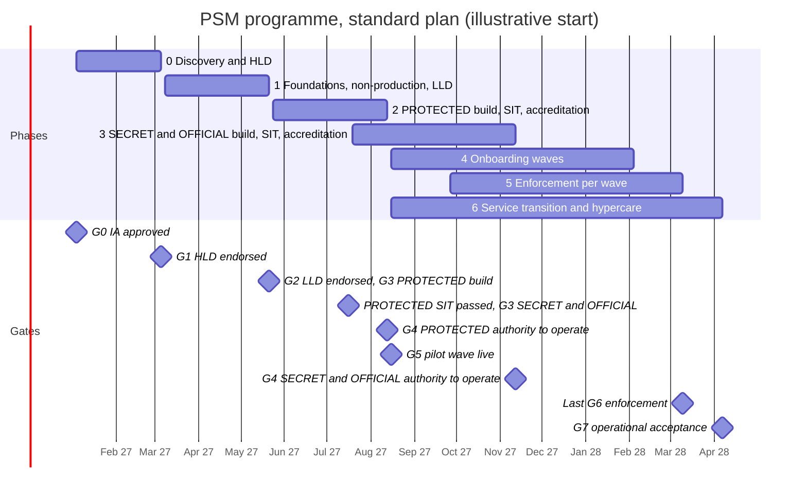

| Phase | Entry criteria | Content | Exit criteria | Rollback / back-out |
|---|---|---|---|---|
| 0. Discovery and HLD | G0 passed. | Attachment H inventories, user inventory, wave plan, HLD, decision records, procurement, security engagement. | G1 passed and orders for long-lead items raised. | No rollback is needed, because Phase 0 produces documents only. |
| 1. Foundations, non-production and LLD | G1 passed. | VMs, SOE, component flows, VIPs, AD, PKI, the Ansible environment, the non-production environment (WP30), the LLDs. | G2 passed; non-production accepted (KD23); infrastructure for PROTECTED accepted. | New objects are removed; users are not affected. |
| 2. PROTECTED build, SIT and accreditation | G2 and G3 (PROTECTED) passed. | PSM, PSMP, PTA, Vault administration VM; PKIPN on PVWA (WP33); ServiceNow; SIEM; monitoring; SIT, performance, HA and DR tests; penetration test. | G4 passed for PROTECTED, 4 weeks after SIT ends (accreditation lead time, Q45). | New components are disabled; users keep their current access. |
| 3. SECRET and OFFICIAL build, SIT and accreditation | PROTECTED SIT passed; G3 passed for each classification. | As Phase 2, with media transfer and offline automation in SECRET. | G4 passed for each classification, 4 weeks after SIT ends (accreditation lead time, Q45). | As Phase 2. |
| 4. Onboarding waves | G4 passed for the classification; G5 passed for the wave. | The pilot team first, then waves: platforms, Safes, accounts, break-glass accounts, application credentials, target flows, UAT. | Wave UAT passes; at least 98% of the wave's accounts are verified and rotated, and every remaining account has an owner-approved exception. | The wave is paused. Known passwords are restored from the Vault to the account owners under dual control, and direct access remains. |
| 5. Enforcement | G6 passed for the wave. | Bypass blocks, Windows target GPOs, Linux `sshd` restrictions, and retirement of the wave's jump hosts. | Every bypass test is blocked and alerted; detections are live. | A specific direct path is re-opened by emergency change, for no more than 5 business days, with Security's approval and a DSOC alert. |
| 6. Service transition and hypercare | The pilot passes G5. | Runbooks, support model, training, hypercare for each wave, operational acceptance. | G7 passed. | The Service Operations manager may extend hypercare in 2-week increments. |

**Wave entry criteria (G5):**
- G4 is passed for the classification;
- every account owner in the wave has signed the WP29 dependency checklist;
- the wave's target flows are implemented and tested (WP24);
- the wave's platforms and connection components pass the test matrix (KD8);
- users have received the announcement 4 weeks before go-live and training 2 weeks before ([Communications and training](#communications-and-training));
- the Service Desk is briefed;
- the CAB has approved the change; and
- for the pilot only, the core DSOC use cases are live (KD6), the offline procedure has been tested
  (KD27), and the privacy notice has been issued (KD21).

**Enforcement entry criteria (G6):**
- at least 98% of the wave's accounts are rotated;
- the full DSOC use case catalogue is live;
- users and account owners received the enforcement notice at least 4 weeks earlier;
- no critical or high incident caused by the wave is open;
- the consuming team lead agrees the enforcement date; and
- the CAB has approved the change.

**Hypercare exit criteria** (checked 4 weeks after each wave's go-live and again 4 weeks after its
enforcement):
- no critical or high incident caused by the change is open;
- the Service Desk resolves at least 70% of access queries at L1; and
- KB articles cover the ten most frequent query types.

**Operational acceptance criteria (G7):**
- every wave has exited hypercare;
- the runbooks (KD35), the as-built records (KD36), the automation (KD29) and the upgrade procedure (KD14)
  are accepted;
- monitoring and alerting reach the support groups (KD7);
- the support model, assignment groups and CMDB entries are in place (KD13, KD25);
- BAU funding and staffing for [Service operations and BAU run effort](#service-operations-and-bau-run-effort) are confirmed; and
- every open defect and concession has an owner in the registers.

#### Accelerated delivery option (recommended, approximately 10 months)

Most of the standard plan's duration comes from lead times in other workstreams: VMs, firewall changes,
SECRET media transfer, accreditation and ServiceNow. CyberArk effort is not the main driver. The
accelerated plan runs these lead times in parallel, limits the first release to the capabilities needed
for the outcome, and brings a pilot into production use early. It keeps every gate in [Governance and approval gates](#governance-and-approval-gates). It
changes the order of the work around the gates: in particular, all three classifications are built in
parallel, and accreditation evidence is prepared alongside the build.

| Lever | What changes | Saving |
|---|---|---|
| **L1. Pilot first** | One classification (PROTECTED) and one consuming team, with RDP and SSH, ServiceNow ticketing, recordings, and the core Splunk use cases (Vault, PSM and PSMP logs; the emergency path, break-glass, bypass and service-down use cases). The pilot runs on 2 PSM and 2 PSMP nodes of the consumer pool. | First production use after approximately **4 months**. The pilot proves capacity, the ticket path and the user guides before scale. |
| **L2. Build all three classifications in parallel** | One set of Ansible playbooks, proven in non-production. DCE, Network and Identity work on all three classifications at once. SECRET media transfer starts in Phase 0. | About **2–3 months** off the build. |
| **L3. Standard platforms and connection components first** | CyberArk's standard platforms and connectors are used first; custom ones are built only where a target needs one. The connectors marked "deferred" in Attachment F follow in a later wave. | About 25% less effort for WP21 and WP22, about 12–26 person-days. |
| **L4. Discovery-led onboarding** | CyberArk account discovery and automatic onboarding rules for Windows local administrator and Linux `root` accounts, and bulk REST onboarding for the rest. | WP23 falls from about 0.1 to about 0.05 person-days per account: about 100 person-days at the example volume. |
| **L5. Defer non-essentials** | PTA automatic responses (alerting runs from day one) and the connectors marked "deferred" in Attachment F move to a later wave. | Shorter critical path. |
| **L6. Fast Phase 0** | The preconditions below are met by week 4, and G1 is passed by week 5. | About 1 month. |
| **L7. Extra capacity** | CyberArk (Palo Alto Networks) Professional Services, engaged for builds and onboarding (Q14). | Removes the CyberArk team as a bottleneck (cost item, [Costs](#costs)). |

**Figure 11 — Accelerated schedule (start date illustrative)**

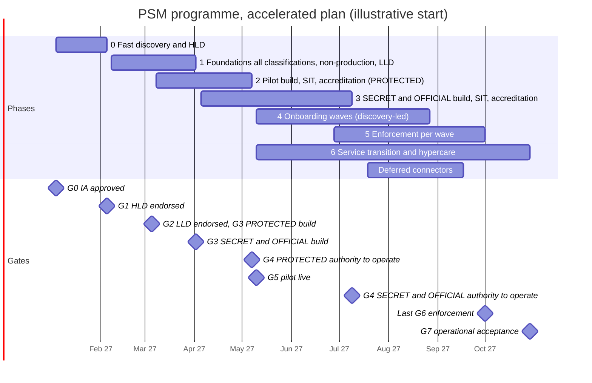

**How the accelerated plan keeps the gates.**
- **Infrastructure on the HLD.** Infrastructure requests (VMs, SOE, component flows) start after G1, on
  the HLD. The non-production VM request is raised in Phase 0, so that non-production is ready before
  the pilot's SIT. They do not wait for the LLD, because they do not depend on component configuration.
- **LLDs early.** The LLDs for all three classifications are endorsed together at G2, one month after
  G1.
- **Accreditation alongside the build.** For each classification, Security drafts the risk assessment
  and system security plan from the LLD while the build runs. The accreditation lead time is 4 weeks
  (Q45), so G4 follows the end of SIT by 4 weeks.
- **Onboarding waits for G4.** SECRET and OFFICIAL waves start only after their G4.

**Workstream changes under the accelerated plan**

| Team | Change from the standard plan |
|---|---|
| CyberArk team | Pilot in months 3–4; playbooks proven in non-production and reused across classifications; discovery and automatic onboarding; standard platforms first. Peak load needs 3–4 engineers or a partner (L7). |
| Data Centre Engineering | Non-production VMs are delivered first, then all 42 production VMs together, with the pilot VMs first. |
| Network | One firewall request in Phase 1 covers the component flows for all three classifications; target flows are batched per wave with standard rules. |
| Identity / AD | The AD change list for all three classifications goes in one change; enforcement GPOs are prepared in advance. |
| Windows / Linux Platform | The Windows Server 2022 SOE and the RHEL 8 SOE confirmation are completed in Phase 0. There is no schedule contingency for the SOEs: a delay moves the pilot date. |
| ServiceNow team | The validation logic is built once in non-production and deployed to the three instances in parallel, with the PROTECTED instance first. |
| SIEM / DSOC | Core use cases are ready for the pilot; the full catalogue is ready by the first enforcement. |
| Security and Accreditation | Assessment runs alongside the build; SECRET artefacts start in Phase 0. |
| Consuming teams | Attachment H is returned within the first 4 weeks; one team volunteers as the pilot; dependency checks (WP29) run ahead of each wave. |
| Procurement | CALs, licences and VM capacity are ordered in Phase 0. |

**Preconditions.** The accelerated plan is recommended (DEC-18) only if the following are met by the
point shown, which for most is week 4 of Phase 0. If they are not, the steering group moves to the standard plan at G1.

| Precondition | Owner | Needed by |
|---|---|---|
| CDS lead time per transfer to SECRET known (A10) | DevSecOps lead | Week 4 |
| Funding and CyberArk entitlement confirmed (Q14) | Steering group | G0 |
| PVWA and CPM load measured (Q36) | CyberArk lead | Week 4 |
| VM capacity and licences available to order | DCE manager; Procurement manager | Week 4 |
| The firewall and accreditation processes can take parallel requests | Network manager; Security accreditation lead | Week 4 |
| One consuming team commits to the pilot | Project manager | Week 4 |
| CyberArk Professional Services scope and start date agreed (L7) | Project manager | G1 |

**Effort.** The accelerated plan needs approximately 820–1,345 person-days, plus about 115 for
onboarding at the example volume. The standard plan needs approximately 860–1,400, plus about 215. The
difference comes from:
- L3: 12–26 person-days less for the CyberArk team;
- L4: about 100 person-days less for onboarding; and
- project management: about 26 person-days less, because the project is shorter.

The effort is compressed into fewer months, so peak demand on every team is higher.

**Added risks.**
- Peak load is higher on Network, DCE and the CyberArk team.
- There is less time to absorb lessons from the pilot before scale. The project manager mitigates this by sizing
  each wave at no more than 300 accounts or 60 users in the wave plan, before G1.
- Deferred items need their own changes.
- G4 follows SIT closely, so a significant penetration test finding delays that classification's waves.

### Production impact

**Rating: High.**
- About **540 users** change how they reach systems. Productivity is expected to dip in the early waves
  (R11).
- Privileged access now depends on PVWA, PSM/PSMP, the Vault, ServiceNow and the network paths. High
  availability, the ticketing failure mode and break-glass mitigate this dependency.
- Rotation has side effects. Any service, scheduled task, script or application configuration that
  holds a privileged password breaks when CPM rotates the password, unless WP29 finds it first (R19,
  R27).
- **Incident response.** During a major incident, responders use the same path with an Incident
  ticket.
  - If ServiceNow is down, the emergency path applies ([Ticketing (ServiceNow)](#ticketing-servicenow)).
  - If PSM or PSMP is down, break-glass check-out applies under the PSM outage runbook (R23).
  - If the Vault or PVWA is down, the offline emergency-access procedure applies (R13).
- The Vault (recordings and audit), DR replication and Splunk (ingest) carry added load.
- Direct access and jump hosts are removed for each wave at enforcement.

### Service operations and BAU run effort

**Rating: Medium–High.**
- Up to 53 new servers (including non-production) need to be monitored, patched, backed up and
  upgraded.
- **Upgrades.** The CyberArk upgrade order is Vault, then PVWA, then CPM, then PSM/PSMP, then PTA. The
  CyberArk team validates this order against the 14.6 upgrade guide in non-production before G7.
  - Nodes in a pool must run the same version [CA], so a load-balanced pool is upgraded as a whole. Two
    methods are possible:
    - **(a)** drain the pool and upgrade every node in one change window, during which that pool is
      unavailable for about 4 hours;
    - **(b)** build a parallel pool on the new version and cut over.

    The upgrade runbook (KD35) sets the method for each pool, and the CAB approves each upgrade.
  - Non-production is upgraded at least 2 weeks before production.
- **Monthly patching.** Operating system patching is done node by node with drain, followed by a
  hardening re-check.
- **Other recurring work:**
  - alignment of browser and WebDriver versions for web connectors;
  - client tool updates;
  - CAL and certificate renewals;
  - the uplift of PSMP and PTA from RHEL 8 to RHEL 9, before May 2029 (DEC-19);
  - the next Windows Server uplift, before October 2031.
- **Records and break-glass.** Recording retrieval, disposal and legal hold; break-glass reviews, and
  break-glass tests every six months.
- **Capacity management.** The scale-out trigger is in [Capacity](#capacity).

*Indicative BAU effort after G7.* Each team lead confirms these figures at operational acceptance. The
steering group approves indicative BAU funding at G0 and confirms it at G7.

| Team | Ongoing work | Indicative effort |
|---|---|---|
| CyberArk team | Onboarding new systems; platform and connector changes; upgrades (about 2 per year); PSM/PSMP/PTA operations; recording requests; break-glass reviews; keeping non-production current | 1.7–2.7 FTE |
| DSOC and Security Operations | Triage of the new use cases and PTA alerts; L2 support, 24x7 (Q46) | 0.3–0.7 FTE |
| Network | Target flows for new systems; load balancer changes | 0.1–0.2 FTE |
| Windows / Linux Platform | Monthly patching with drain for up to 53 servers (about 2–4 days a month) | 0.1–0.2 FTE |
| Monitoring and Control | Alert and dashboard maintenance | 0.05–0.1 FTE |
| Identity | Service accounts, GPOs and delegations for new systems | 0.05–0.1 FTE |
| ServiceNow team | Maintaining the eligibility logic and the integration in three instances and non-production | 0.05–0.1 FTE |
| SIEM | Maintaining Cribl routes and Splunk content | 0.1–0.2 FTE |
| PKI | Certificate renewals | 0.02–0.05 FTE |
| Records management | Disposal and legal hold requests | 0.02–0.05 FTE |
| Service Desk | L1 access questions | 0.2–0.4 FTE (0.4–0.8 FTE during hypercare) |
| **Total** | | **About 2.7–4.8 FTE** |

### Impact by team and persona

| Who | What changes for them | Impact |
|---|---|---|
| Consumer administrators | They log in to PVWA, enter a ticket and connect through PSM/PSMP. They no longer know passwords, and their sessions are recorded. | High |
| CND analysts | They use their own pools, under the same ticket and recording rules. | Medium |
| Auditors | They gain recording retrieval and session audit through the Auditor role. | Medium (positive) |
| Service Desk | New incident categories and L1 questions. | Medium |
| DSOC | New sources, use cases and PTA alerts to triage. | Medium–High |
| ServiceNow team | Integration and validation logic in three instances and non-production; ServiceNow uptime now affects privileged access. | Medium–High |
| Network team | A large firewall volume in Phases 1, 4 and 5. | High |
| Identity team | GPOs, delegations, break-glass accounts and enforcement GPOs. | Medium–High |
| Data Centre Engineering | Up to 53 VMs and storage growth. | Medium–High |
| Application owners | Credential rotation, dependency checks and possible concessions. | Medium |
| CyberArk team | Design, build, onboarding and a larger BAU estate. | High |

**What changes in the daily work of privileged users:**
- **Ticket rule.** Each session needs an eligible ticket ([Ticketing (ServiceNow)](#ticketing-servicenow)). Incidents, Problem tasks, Service
  Requests and Standard Change tasks are eligible (Q41), so routine administration can run under a
  Service Request or a Standard Change task.
- **Clipboard and file transfer.** The clipboard is disabled except on approved platforms, and files
  move only by the approved method for each platform ([Session policy](#session-policy)).
- **Session limits.** A session ends after 12 hours and disconnects after 60 minutes idle. Long-running
  jobs must run on the target (scheduled or detached), not in an open session.
- **Unsupported targets.** A target type without a PSM connection component (for example, a serial
  console or a thick client without a connector) is raised through Attachment H. The CyberArk team then
  proposes a connector, or the owner raises a concession.

### Communications and training

| When | Audience | What |
|---|---|---|
| Phase 0 | Team leads | Briefing on scope, commitments ([Requirements by workstream: workstream commitments](#requirements-by-workstream-workstream-commitments)) and Attachment H |
| Before the pilot | All privileged users | The workforce notice on session recording (KD21) |
| 4 weeks before each wave | Users in the wave | Announcement, user guide, dates and what changes |
| 2 weeks before each wave | Users in the wave | Practical training: PVWA *Connect*, PSMP syntax, ticket entry, break-glass (live, or a recorded session) |
| Go-live of each wave | Users in the wave | Floor-walking support and a hypercare channel |
| At least 4 weeks before enforcement | Users and account owners in the wave | Notice of the removal of direct access, with the date |
| Ongoing | All users | KB articles, FAQ and Service Desk scripts |

### Defects debt

| Item | Owner | Fix by | Status |
|---|---|---|---|
| A GPO places an internal sub-CA in Trusted Root on domain servers (found on PVWA); new PSM servers would inherit it. | Identity lead | G3 (KD26) | Open; to be fixed at source |
| The client-certificate revocation check was found disabled on the PVWA HTTPS binding. | CyberArk lead | G3 (KD26) | Open; to be re-enabled (*PVWA Certificate Authentication (PKIPN) Guide*, IIS client-certificate configuration) |
| PVWA certificate login relies on `ClientAuthTrustMode` = 2 as a workaround for the GPO defect. | CyberArk lead | G3, after the GPO fix (KD26) | Open until the GPO is fixed |

### Concessions debt

**Concession process.** The owner raises each concession in the concession register with the reason,
the compensating control and an expiry date no more than 12 months away. Security approves it. The
CyberArk lead and Security review the register every quarter, and every concession is renewed or
closed at expiry.

| Item | Owner | Status |
|---|---|---|
| PVWA PKIPN uses UPN (weak) certificate mapping rather than Microsoft strong certificate mapping. | Security accreditation lead | Decision by Security before G1 (*Certificate Login Options Analysis*) |
| Windows Server 2019 for PSM, only if the 2022 SOE is not ready in time | Windows Platform lead | Conditional (R8); uplift completed before G7 |
| PSMP and PTA on RHEL 8, whose maintenance support ends in May 2029 | Linux Platform lead | Accepted (DEC-19); uplift to RHEL 9 completed before May 2029 |
| Current PVWA login method for the first wave in a classification, only if PKIPN is late there | CyberArk lead | Conditional (R28); ends when KD39 is met |
| Applications whose local credentials cannot be rotated natively | Application owner (per application) | Raised during onboarding (R12) |
| Recording retention not yet set by the records authority | Records management | Recordings kept without purge until set (D13) |
| PTA without high availability | Security accreditation lead | Accepted (DEC-05); compensated by the Splunk use cases (R25) |

### Document debt

- The CyberArk architect updates the CyberArk HLD and LLD and the security documentation for every new
  component, before G1 (HLD) and G2 (LLD).
- Network updates the network diagrams after each enforcement wave; Windows Platform and Linux Platform
  update the SOE standards before G2; and Security updates the access policy before the first G6.
- The *PVWA Certificate Authentication (PKIPN) Guide* already documents PVWA certificate login; the PSM
  build applies its PKI lessons (R17).

---

## Resource effort and work packages

Effort is in person-days for all three classifications and non-production together. It is indicative
until each team confirms it before G1. Where more than one team works on a package, each team's share
is shown; [Requirements by workstream: workstream commitments](#requirements-by-workstream-workstream-commitments) adds up each team's shares. Consuming-team effort assumes 6–10 teams (A14).

| WP | Work package | Owner | Supporting | Depends on | Phase | Gate | Effort (d) |
|---|---|---|---|---|---|---|---|
| WP01 | Discovery: Attachment H inventories, user inventory, wave plan | CyberArk | Consuming teams, CND | — | 0 | G1 | CyberArk 15–25; consuming teams 2–3 per team (12–30); CND 2–3 |
| WP02 | HLD, LLDs, decision records, architecture forum submissions (KD16–KD18) | CyberArk | Security, Network | WP01 | 0–1 | G1, G2 | CyberArk 30–45 |
| WP03 | Security risk assessments, system security plans, privacy impact assessment, penetration test coordination, accreditation submissions, concession approvals (KD20, KD21, KD30, KD32) | Security | CyberArk | WP02 | 0–4 | G4 | Security 30–55; CyberArk 8–12 |
| WP04 | Procurement: capacity, CALs, licences, RHEL, client tools (KD24) | Procurement | CyberArk, DCE | WP02 | 0–1 | G3 | Procurement 6–12; CyberArk 2–3 |
| WP05 | VM provisioning (up to 53) and placement; Vault storage expansion | DCE | — | WP04, WP06 | 1 | G3 | DCE 35–60 |
| WP06 | Windows Server 2022 SOE readiness and SOE; confirmation of the RHEL 8 SOE for PSMP and PTA | Windows Platform | Linux Platform, CyberArk | WP02 | 0–1 | G1 (readiness), G3 | Windows 14–28; Linux 3–6; CyberArk 3–5 |
| WP07 | IP addresses, DNS, component firewall flows, including non-production (KD19) | Network | CyberArk | WP02 | 1 | G2, G3 | Network 16–24 |
| WP08 | Load balancing: VIPs, persistence, health checks, drain integration (KD2) | Network | Monitoring and Control, CyberArk | WP05, WP07 | 1–2 | G3 | Network 14–21 |
| WP09 | AD: OUs, GPOs, service accounts, delegations, RD Licensing, break-glass review (KD24) | Identity | CyberArk | WP02 | 1 | G3 | Identity 14–21 |
| WP10 | PKI certificates (PKI); the sub-CA GPO fix (Identity) and the PVWA certificate fixes (CyberArk) (KD26) | PKI | Identity, CyberArk | WP02 | 1 | G3 | PKI 7–12; Identity 2–3; CyberArk 1–2 |
| WP11 | Ansible environment (all classifications, offline in SECRET) and playbooks (KD29) | DevSecOps | CyberArk | WP06 | 1–2 | G3 | DevSecOps 20–32; CyberArk 5–8 |
| WP12 | PSM build and configuration: 18 nodes, plus contingency nodes when triggered (KD1, KD28) | CyberArk | DevSecOps | WP05–WP11, WP30 | 2–3 | G3 (start); G4 (complete) | CyberArk 28–42 |
| WP13 | PSMP build and configuration: 18 nodes (AD Bridge, MFA caching, host keys, ticket prompt) (KD1) | CyberArk | Identity | WP05–WP11, WP30 | 2–3 | G3 (start); G4 (complete) | CyberArk 22–35 |
| WP14 | Not used: the HTML5 Gateway is not included (DEC-06) | — | — | — | — | — | 0 |
| WP15 | PTA deployment and integration: 3 production nodes and 1 non-production (KD3) | CyberArk | Identity, SIEM | WP05, WP06, WP11 | 2–3 | G3 (start); G4 (complete) | CyberArk 14–28 |
| WP16 | ServiceNow integration in non-production and three instances, including validation logic and the PSMP ticket path (KD5) | ServiceNow | CyberArk, Security | WP02, WP30 | 1–3 | G4 | ServiceNow 25–40; CyberArk 12–18 |
| WP17 | Hardening, AppLocker, EDR exclusions, scanning | DevSecOps | CyberArk | WP06, WP11 | 1–3 | G4 | DevSecOps 14–21; CyberArk 4–6 |
| WP18 | SIEM: Cribl, Splunk, dashboards (KD6) | SIEM | CyberArk | WP12–WP15 | 2–3 | G4 | SIEM 28–50; CyberArk 4–6 |
| WP19 | DSOC use cases and runbooks (KD6) | DSOC | SIEM, CyberArk | WP18 | 2–5 | G5 (core), first G6 (full) | DSOC 14–28; CyberArk 2–4 |
| WP20 | Monitoring and alerting (KD7) | Monitoring and Control | CyberArk | WP12–WP15 | 2–3 | G4 | Monitoring and Control 11–21; CyberArk 2–4 |
| WP21 | Connection components and client tools (KD8): 15–25 components × 1–2 days | CyberArk | DevSecOps | WP12, WP30 | 2–4 | G5 | CyberArk 15–50 |
| WP22 | Platforms, Safes, RBAC, CPM and reconcile policies (KD8): 20–30 platform types × 1–1.5 days = 20–45, plus 10 for the Safe and RBAC model | CyberArk | Identity, account owners | WP02 | 1–4 | G2 (model), G5 | CyberArk 30–55 |
| WP23 | Account onboarding waves, including break-glass and native application credentials (KD9) | CyberArk | Account owners, Identity, Network | WP21, WP22, WP24, WP29 | 4 | G5 (start); G6 (complete) | CyberArk 0.05–0.15 per account (bulk) + 0.5–1 per non-standard application; account owners 1–2 per team (6–20); CND 1–2 |
| WP24 | Target firewall flows for each wave (KD19) | Network | CyberArk | WP01, WP07 | 4 (before each wave) | G5 | Network 22–42 |
| WP25 | Enforcement: bypass blocks and jump host retirement (Network), Windows target GPOs (Identity), Linux `sshd` restrictions (Linux Platform) (KD10) | Network | Identity, Linux Platform, CyberArk | WP23, WP18, WP19 | 5 | G6 | Network 14–24; Identity 8–14; Linux 6–12; CyberArk 4–6 |
| WP26 | Testing: SIT, security, HA/DR, performance, ticketing, logging, UAT (KD12, KD22, KD31) | Test | CyberArk, all teams | WP12–WP20, WP30 (SIT); WP23 (UAT) | 1–5 | G2, G4, G6 | Test 50–80; CyberArk 20–30; consuming teams 1–2 per team (6–20); CND 1–2 |
| WP27 | Service transition: runbooks, KB, training, communications, hypercare, CMDB, upgrade procedure, operational acceptance (KD13, KD14, KD25, KD27, KD34–KD37) | Service Operations | CyberArk | WP26 | 4–6 | G5, G7 | Service Operations 14–21; CyberArk 11–17 |
| WP28 | Vault administration VMs: 3 production and 1 non-production (KD15) | CyberArk | DCE, Network, DevSecOps | WP05, WP11 | 1–3 | G4 | CyberArk 6–10 |
| WP29 | Credential dependency discovery before each wave (services, scheduled tasks, scripts, application configuration files, agents; CPM usages) | CyberArk | Account owners | WP01 | 0, 4 | G5 | CyberArk 10–20; consuming teams 1–2 per team (6–20); CND 1–2 |
| WP30 | Non-production environment on the existing non-production Vault, PVWA and CPM: build, and maintenance until G7 (KD23) | CyberArk | DCE, Network, Identity, ServiceNow, SIEM | WP05, WP07, WP09, WP11 | 1–6 | Before PROTECTED SIT | CyberArk 15–25 |
| WP31 | Configuration backup of the new servers | Backup | CyberArk | WP05 | 1–3 | G4 | Backup 3–6 |
| WP32 | Recording lifecycle procedure: retention, archive, disposal, legal hold (KD11) | Records management | CyberArk, Security | WP02, D13 | 1–2 | G5 | Records 3–5; CyberArk 1–2 |
| WP33 | PVWA certificate login (PKIPN) in production: trust stores, IIS client-certificate configuration, revocation through the proxy, issuer settings and LDAP UPN mapping on the 12 production PVWA nodes and non-production, following the *PVWA Certificate Authentication (PKIPN) Guide* (KD39) | CyberArk | PKI, Network, Identity | WP10, D16 | 1–3 | G5 (first wave in each classification) | CyberArk 15–25; PKI 2–4; Network 2–4; Identity 1–2 |
| — | Project management, gates, registers, CAB submissions, closure (KD18, KD33, KD38) | Project manager | All | — | All | All | Accelerated about 139 (0.8 FTE × 9.5 months); standard about 165 (0.6 FTE × 15 months), at 18.3 working days a month |

**Onboarding example.** Replace these numbers with the Attachment H totals at G1. The example volume is
2,000 accounts and 20 non-standard applications.
- Standard plan: 2,000 accounts × 0.1 d = 200 d, plus 20 applications × 0.75 d = 15 d, for about
  **215 d**.
- Accelerated plan, discovery-led: 2,000 × 0.05 d = 100 d, plus 15 d, for about **115 d**.
- In both plans, account owners spend a further 1–2 days per team on verification.

**Critical path (accelerated plan):**
1. WP01 → WP02 (HLD, G1)
2. WP05, WP06, WP07 → WP30 (non-production, before PROTECTED SIT); WP02 (LLDs, G2) and WP33 (PKIPN)
   run in parallel
3. WP12, WP13 (PROTECTED) → WP26 (SIT) → WP03 (G4 PROTECTED, 4 weeks after SIT)
4. WP29 → WP24 → WP23 (pilot wave, G5) → further waves
5. WP25 (G6) → WP27 (G7)

In the standard plan, the SECRET and OFFICIAL builds also wait for PROTECTED SIT.

**RACI summary** (R responsible, A accountable, C consulted, I informed; one A per row):

| Activity | CyberArk | PM | DCE | Network | Identity / PKI | Platform | DevSecOps | ServiceNow | SIEM / DSOC | M&C | Security | Test | Service Ops | Records | Procurement | Consuming teams and CND |
|---|---|---|---|---|---|---|---|---|---|---|---|---|---|---|---|---|
| Design (HLD, LLD) | A/R | I | C | C | C | C | C | C | C | C | C | C | I | I | I | I |
| Procurement | C | C | C | — | — | — | — | — | — | — | — | — | — | — | A/R | — |
| VMs and storage | C | I | A/R | — | — | — | — | — | — | — | — | — | — | — | C | — |
| Network flows, load balancing and jump host retirement | C | I | — | A/R | — | — | — | — | — | C | C | — | — | — | — | C |
| PKIPN in production | A/R | I | — | R | R | — | — | — | — | — | C | C | — | — | — | I |
| AD and PKI | C | I | — | — | A/R | — | — | — | — | — | C | — | — | — | — | — |
| SOE and patching | C | I | — | — | — | A/R | C | — | — | — | C | — | I | — | — | — |
| Automation and hardening | R | I | — | — | — | C | A/R | — | — | — | C | — | I | — | — | — |
| Build and configuration | A/R | I | C | C | C | C | C | — | — | — | C | I | — | — | — | — |
| Non-production environment | A/R | I | R | R | R | C | C | R | R | C | I | C | I | — | — | C |
| Ticketing | R | I | — | C | — | — | — | A/R | I | — | C | C | I | — | — | I |
| Logging and use cases | C | I | — | — | — | — | — | — | A/R | — | C | C | I | — | — | — |
| Monitoring | C | I | — | C | — | — | — | — | — | A/R | — | C | C | — | — | — |
| Accreditation and privacy | C | I | — | — | — | — | — | — | — | — | A/R | C | I | C | — | I |
| Testing | R | I | C | C | C | C | C | R | R | C | R | A/R | C | — | — | R |
| Onboarding and rotation | A/R | I | — | R | R | — | — | — | I | — | I | C | I | — | — | R |
| Enforcement | R | I | — | A/R | R | R | — | — | C | — | C | C | I | — | — | C |
| Communications and training | R | C | — | — | — | — | — | — | — | — | C | — | A/R | — | — | I |
| Service transition and operational acceptance | R | C | — | — | — | — | — | C | C | C | I | I | A/R | — | — | I |
| Recording lifecycle procedure | R | I | — | — | — | — | — | — | — | — | C | — | C | A/R | — | — |
| Gates, registers, CAB submissions, closure | C | A/R | I | I | I | I | I | I | I | I | C | C | C | I | I | I |

---

## Attachments, appendix and references

### Attachment register

| # | Attachment | Owner | Needed by | Approver | Status |
|---|---|---|---|---|---|
| A | Firewall and flow matrix, for each classification and for non-production (KD19) | Network manager | Component flows at G1; complete at G2; target flows before each G5; bypass blocks before each G6 | Network design authority and Security | To be produced |
| B | Server inventory and build sheet | CyberArk architect | G2 | DCE manager; architecture forum | To be produced |
| C | Capacity model | CyberArk architect | G1; updated after the pilot | Architecture forum | To be produced |
| D | ServiceNow integration specification | CyberArk lead, with the ServiceNow team | G2 | ITSM process owner | To be produced |
| E | SIEM use case catalogue, with severity and triage target for each use case | SIEM lead, with the CyberArk lead and DSOC | G2 (draft); G4 (final) | DSOC manager | To be produced |
| F | Platform and connection component catalogue, recording for each item its client tool (SQL Server Management Studio and pgAdmin for databases), file transfer method, keystroke audit and deferral | CyberArk lead | G2 | Architecture forum | To be produced |
| G | Test strategy and test plans (KD22) | Test lead | G2 | Security accreditation lead; Service Operations manager | To be produced |
| H | Account inventory template | Consuming teams and CND return it | Phase 0 (within 4 weeks under the accelerated plan) | Project manager | Included below |
| I | Decision records: the full record behind each entry in [Decision log](#decision-log) | Project manager | Each gate | Body named in [Decision log](#decision-log) | Filed at each gate |
| J | Options considered | CyberArk architect | G1 | Architecture forum | Included below |
| K | Stakeholder review findings and resolution | CyberArk lead | G0 | Steering group | Included below |

### Attachment H — Account inventory template (for each consuming team and CND)

An account is one privileged login that CyberArk will store, rotate and use for sessions: a username,
plus its password or SSH key, on one target. Examples:
- the local `Administrator` on each Windows server;
- `root` on each Linux server;
- the local administrator on each network device;
- `sa` or `sys` on each database;
- the built-in administrator of each application;
- emergency domain administrator accounts.

For example, ten Linux servers, each with `root`, are 10 accounts. Personal day-to-day user accounts are
not onboarded, and application service accounts are out of scope ([Exclusions](#exclusions)).

| Team | Target type | Number of targets | Privileged account(s) per target | Accounts (= targets × accounts per target) | Break-glass? | Can the application rotate it natively? | Password used by services, tasks, scripts or agents? | Client tool needed on PSM | Test target for non-production | Owner |
|---|---|---|---|---|---|---|---|---|---|---|
| Example: Platform | Windows servers | 120 | local Administrator | 120 | Yes | n/a | Check services and tasks | RDP | `win-test-01` | Name |
| Example: Platform | Linux servers | 200 | root | 200 | Yes | n/a | Check scripts | SSH | `lnx-test-01` | Name |
| Example: Network | Switches and routers | 80 | local admin | 80 | Yes | Yes (CPM plugin) | No | SSH / web | Lab switch | Name |
| Example: DBA | SQL Server instances | 40 | sa | 40 | Yes | Yes | Check application configuration files | SQL Server Management Studio | `sql-test-01` | Name |
| Example: DBA | PostgreSQL instances | 20 | postgres | 20 | Yes | Yes | Check application configuration files | pgAdmin | `pg-test-01` | Name |
| Example: Application team | Application X | 1 | built-in admin | 1 | Yes | No (concession) | No | Browser | Test instance | Name |

**When to return it.** Return the template within 4 weeks of the start of Phase 0 under the accelerated
plan, or by the end of Phase 0 under the standard plan.

**How precise to be.** Estimates to the nearest 10 accounts are enough for sizing. Exact counts are
needed before each wave's G5. The returns set the onboarding effort (WP23), the platforms and connection
components needed, the target flows, and the firewall volume.

### Attachment J — Options considered (for the record)

**Direct RDP options.** DEC-01 chose N1.

| Option | How | Ticket enforced | Notes |
|---|---|---|---|
| N1. PVWA *Connect* with RDP file | Native client launched by PVWA after the ticket check | Every session | **Chosen** |
| N2. Access request, then native connection string | Approved request with a ticket, then mstsc directly | Once per request window, if PSM honours it (to be validated) | Not chosen |
| N3. Ticket in the connection string or PSM prompt | Ticket on the direct path | Every session, if supported (to be validated) | Not chosen |
| N4. Direct path with detection only | Splunk flags sessions without a ticket | After the fact | Not chosen |

**ITSM options.** DEC-02 chose I1.

| Option | Description | Status |
|---|---|---|
| I1. ServiceNow, using CyberArk's integration | Live validation at connect time | **Chosen** |
| I2. SM9, using CyberArk's HP Service Manager integration | Historical HPSM integration; support in 14.6 is unverified | Not chosen |
| I3. A mix for each classification | ServiceNow where available, SM9 elsewhere | Not chosen |
| I4. Custom plugin or broker | An internal service that answers "is ticket X valid for user Y and target Z" | Kept as the fallback for target CI matching ([Ticketing (ServiceNow)](#ticketing-servicenow)) |
| I5. ITSM-initiated access | ServiceNow grants time-boxed access through the CyberArk REST API | Not chosen |
| I6. Format check plus later reconciliation | No live lookup; reconciliation in Splunk | Not chosen |

**PSMP fallbacks.** These are used only if the non-production test of the PSMP ticket path fails; the
architecture forum selects one at G2.
- **P1:** an access request in PVWA first.
- **P2:** SSH launched from PVWA *Connect* through PSM-SSH. Users lose their native SSH client.
- **P3:** a reason only, reconciled in Splunk. This is a concession.

**Load balancing options.** DEC-13 proposes L-B.

| Option | Description | Status |
|---|---|---|
| L-A. DNS load balancing | Round-robin DNS across nodes, as CyberArk recommends [CA] | Not chosen: no health checks or drain |
| L-B. External load balancer, TCP pass-through | Health checks, monitoring-driven drain, source-IP persistence; no TLS termination | **Proposed** |

### Attachment K — Stakeholder review findings and resolution

An independent review of v0.8 read the document as each stakeholder group would. This table records the
main findings and where v0.9 resolves them.

| Stakeholder | Finding | Resolution in v0.9 |
|---|---|---|
| Architecture forum | There was no architecture approval path, and the key deliverables listed only built components. | Gates G1 and G2 ([Governance and approval gates](#governance-and-approval-gates)); HLD, LLD and endorsement records added as KD16–KD18 ([Key deliverables](#key-deliverables)). |
| Architecture forum | There was no non-production environment, so every test, upgrade and connector change would land in production first. | Non-production environment in PROTECTED ([Non-production environment](#non-production-environment), DEC-17, KD23, WP30); test environments in [Testing](#testing); residual production-only tests in R21. |
| Architecture forum | The design used a load balancer that differs from the DNS load balancing CyberArk recommends, with no decision record. | DEC-13 and Attachment J options L-A and L-B. |
| Architecture forum | Figure 2 showed CND bypassing PVWA and had no user-to-PSM path; figures disagreed with the text. | Figures 1–3 redrawn ([Solution summary](#solution-summary), [Logical architecture](#logical-architecture) and [Network zones and flows](#network-zones-and-flows)), with the CND trust boundary stated. |
| Architecture forum | Decisions had no approver or status; open design items had no identifiers. | Decision log with "Decided by" and "Status" columns ([Decision log](#decision-log)); open items listed with references in [Design impact](#design-impact). |
| Architecture forum | "Uplift from 2019" contradicted "no existing PSM". | PSM is a new build on Windows Server 2022 (DEC-03, [Versions and operating systems](#versions-and-operating-systems), Q6 in [Answered questions](#answered-questions)). |
| Infrastructure | VM counts excluded contingency, RD Licensing and possible PVWA/CPM nodes; specifications were ranges. | Planning ceiling of 63 VMs plus possible additions (53 in v0.10) ([Server inventory](#server-inventory)); build sheet in Attachment B; backup scope ([Backup](#backup)); PSMP administration port ([Linux Platform](#linux-platform)). |
| Infrastructure | Linux target `sshd` restrictions had no owner. | Linux Platform commitment ([Linux Platform](#linux-platform)); WP25 split by owner. |
| Network | The HTML5 Gateway VIP was described two ways; flows were missing; ports were open-ended; the idle timeout contradicted the session policy. | One HTML5 VIP model (the HTML5 Gateway was later removed, DEC-06, v0.10); complete flow table ([Network: firewall and DNS](#network-firewall-and-dns)); idle timeout of at least 65 minutes, health check values and source-IP handling ([High availability, load balancing and sites](#high-availability-load-balancing-and-sites)); firewall volume basis ([Network: firewall and DNS](#network-firewall-and-dns)). |
| Security and accreditation | There was no accreditation gate or privacy assessment; the pilot could run before accreditation; the emergency path was vague. | G4 for each classification; KD20, KD21, KD30, KD32; emergency path defined ([Ticketing (ServiceNow)](#ticketing-servicenow)); R24–R26; segregation of duties ([Security, RBAC, bypass prevention and break-glass](#security-rbac-bypass-prevention-and-break-glass)). |
| Security and accreditation | The incident-response logic for a PSM outage pointed to the emergency path. | Which path applies on each failure ([Security, RBAC, bypass prevention and break-glass](#security-rbac-bypass-prevention-and-break-glass) and [Production impact](#production-impact)); R23. |
| ServiceNow and ITSM | Eligible ticket types, the requester match, ServiceNow's service tier and a non-production instance were not defined. | [Ticketing (ServiceNow)](#ticketing-servicenow); Q41, Q42; R22; [ServiceNow team](#servicenow-team). |
| Project manager and funding approver | Effort totals could not be reproduced; there was no Test team row; there was no recommendation or decision sought. | Effort rebuilt from the work-package shares ([Requirements by workstream: workstream commitments](#requirements-by-workstream-workstream-commitments) and [Resource effort and work packages](#resource-effort-and-work-packages)); Test team row; decision sought and recommendation in the executive summary; DEC-18. |
| Project manager and funding approver | Schedules started phases before their gates and ended hypercare before the last enforcement. | Figures 10 and 11 rebuilt with gate milestones; durations restated (standard about 15 months; accelerated about 10 months). |
| Service Operations | There were no operational acceptance or hypercare exit criteria, and the BAU table was incomplete. | Criteria in [Standard plan (approximately 15 months)](#standard-plan-approximately-15-months); BAU table extended ([Service operations and BAU run effort](#service-operations-and-bau-run-effort)); support hours (Q46). |
| Test team | The test team was not a workstream; there were no entry or exit criteria and no test data. | [Test team](#test-team); entry and exit criteria and defect severity ([Testing](#testing)); KD22 and KD31. |
| Consuming teams | Accountability for dependency checks was unclear; the impact on daily work was not described. | Account owners are accountable ([Consuming teams and CND](#consuming-teams-and-cnd), R19, R27); daily-work impacts ([Impact by team and persona](#impact-by-team-and-persona)); concession process ([Concessions debt](#concessions-debt)). |
| All readers | Capacity contingency was one node short; the PSMP figure and storage estimate could not be reproduced. | DEC-09 revised to +3 PROTECTED and +2 SECRET; arithmetic shown ([Capacity](#capacity)). |
| All readers | Identifiers were orphaned or missing (Q10 and Q16–Q18, A5 and A6 links, glossary gaps). | Identifiers renumbered and cross-checked; glossary extended. |
| All readers | Many statements were fragments, without an actor or a deadline. | Rewritten as complete sentences with an owner and a needed-by gate. |
| All readers (v0.10) | Answers to the open questions. | Applied throughout in v0.10 (see the version history). |

### References

- CyberArk:
  - [PSM system requirements](https://docs.cyberark.com/pam-self-hosted/latest/en/content/pas%20sysreq/system%20requirements%20-%20psm.htm)
  - [PSM for SSH system requirements](https://docs.cyberark.com/pam-self-hosted/latest/en/content/pas%20sysreq/system%20requirements%20-%20psmp.htm)
  - [Recommended server specifications](https://docs.cyberark.com/pam-self-hosted/latest/en/content/pas%20sysreq/recommended%20server%20specifications.htm)
  - [PSM compatibility](https://docs.cyberark.com/pam-self-hosted/latest/en/content/pas%20sysreq/psm-compatibility.htm)
  - [AWS](https://docs.cyberark.com/pam-self-hosted/latest/en/content/pas%20cloud/aws-system-requirements.htm) and [Azure](https://docs.cyberark.com/pam-self-hosted/latest/en/content/pas%20cloud/azure-system-requirements.htm) system requirements (session tiers, 60-session ceiling)
  - [Version 14.6 what's new](https://docs.cyberark.com/pam-self-hosted/latest/en/content/release%20notes/rn-whatsnew14-6.htm)
  - [Known issues](https://docs.cyberark.com/pam-self-hosted/latest/en/content/release%20notes/rn-knownissues-general.htm)
- CyberArk:
  - [Install PSM in a load-balancing environment](https://docs.cyberark.com/pam-self-hosted/latest/en/content/pas%20inst/installing-psm-in-a-load-balancing-environment.htm)
  - [Install multiple PSM servers](https://docs.cyberark.com/pam-self-hosted/latest/en/content/pas%20inst/optional-installing-multiple-psm-servers.htm)
  - [Install PSM HTML5 Gateway](https://docs.cyberark.com/pam-self-hosted/latest/en/content/pas%20inst/install_psm_html5.htm)
- CyberArk:
  - [ServiceNow ticketing integration](https://docs.cyberark.com/pam-self-hosted/latest/en/content/pasimp/ticketingintegrationservicenow.htm)
  - [Integrate PSM for SSH with enterprise ticketing systems](https://docs.cyberark.com/pam-self-hosted/latest/en/content/pasimp/psmp-configureticketing.htm)
  - [Connect through PSM for SSH](https://docs.cyberark.com/pam-self-hosted/latest/en/content/pasimp/psso-pmsp.htm)
  - [Configure dual control with ticketing](https://docs.cyberark.com/pam-self-hosted/latest/en/content/pasimp/configuring-dual-control-together-with-ticketing-integration.htm)
  - [Version 10.6 what's new](https://docs.cyberark.com/pam-self-hosted/latest/en/content/release%20notes/rn-whatsnew10-6.htm) (requester match)
- CyberArk: [Integrating with SIEM applications](https://docs.cyberark.com/pam-self-hosted/latest/en/content/pasimp/integrating-with-siem-applications.htm)
- Microsoft lifecycle: [Windows Server 2019](https://learn.microsoft.com/en-us/lifecycle/products/windows-server-2019), [2022](https://learn.microsoft.com/en-us/lifecycle/products/windows-server-2022), [2025](https://learn.microsoft.com/en-us/lifecycle/products/windows-server-2025)
- Security Services PSD project kick-off notes, 9 November 2026 (internal; SIEM path CyberArk → Cribl → Splunk/DSOC)
- *PVWA Certificate Authentication (PKIPN) Guide*, including the *Certificate Login Options Analysis* (CyberArk team, November 2026)

### Glossary

| Term | Meaning |
|---|---|
| Accreditation authority | The person or body that issues the authority to operate for a classification |
| AD | Active Directory |
| AD Bridge | Software that lets a Linux server authenticate users against Active Directory |
| Architecture forum | The design authority that endorses the HLD (G1) and LLD (G2) |
| Authority to operate | The accreditation authority's approval to use a system in production at a classification (G4) |
| Break-glass | An emergency account for use when normal access fails |
| CAB | Change advisory board: approves production changes (G3, G5, G6) |
| CAL | Client Access Licence (RDS CAL: Remote Desktop Services CAL) |
| CDS | Cross-domain solution: the approved path for moving files into SECRET |
| CEF | Common Event Format, a log format that Splunk reads |
| CMDB | Configuration Management Database (ServiceNow) |
| CND | Computer Network Defence team |
| Connection component | How PSM opens a session to a target type (RDP, SSH, a database client, a web connector) |
| CPM | Central Policy Manager: rotates and verifies passwords |
| DCE | Data Centre Engineering |
| DR | Disaster recovery |
| DSOC | The security operations centre that triages SIEM alerts |
| EDR | Endpoint detection and response |
| F5 / BIG-IP | The load balancer platform used in every classification |
| FQDN | Fully qualified domain name |
| FTE | Full-time equivalent |
| Gate | A formal approval point (G0–G7, [Governance and approval gates](#governance-and-approval-gates)) |
| Go-live | The first production use: the pilot wave passing G5 |
| GPO | Group Policy Object |
| HA | High availability |
| Hypercare | Enhanced support for 4 weeks after a wave goes live and for 4 weeks after its enforcement |
| ITSM | IT service management (here, ServiceNow) |
| KB | Knowledge base (Service Desk articles) |
| L1 / L2 / L3 | First-, second- and third-line support |
| LB | Load balancer |
| LLD / HLD | Low-level design / high-level design |
| M&C | Monitoring and Control team |
| MFA | Multi-factor authentication |
| N-1 | Capacity with one node out of service |
| NLA | Network Level Authentication (RDP) |
| OOB | Out-of-band management (for example, iLO and iDRAC) |
| Operational acceptance | Service Operations' acceptance of the service into BAU (G7) |
| OU | Organisational unit (Active Directory) |
| PAM | Privileged Access Management |
| PARAgent | The CyberArk agent that allows remote control of the Vault service from PARClient |
| PKI | Public key infrastructure (the internal certificate authority) |
| PKIPN | PVWA certificate login using the Principal Name (UPN) in the certificate |
| Platform | A CyberArk policy for a type of account (rotation, connection and session settings) |
| PrivateArk Client / PARClient | CyberArk tools for administering the Vault and controlling the Vault service remotely |
| PSM | Privileged Session Manager: Windows servers that run privileged sessions on the user's behalf |
| PSMP | PSM for SSH: Linux servers that proxy SSH sessions |
| PTA | Privileged Threat Analytics |
| PVWA | Password Vault Web Access: the CyberArk web portal |
| RBAC | Role-based access control |
| RDSH | Remote Desktop Session Host (the Windows role that PSM uses) |
| RTO / RPO | Recovery time objective / recovery point objective |
| Safe | A Vault container for accounts, with its own permissions |
| Service life | From the pilot go-live to October 2031, the end of Windows Server 2022 extended support |
| SIEM | Security information and event management (Splunk) |
| SIT | System integration testing |
| SM9 / HPSM | HP (Micro Focus) Service Manager 9, an ITSM tool |
| SOE | Standard operating environment (hardened server build) |
| Steering group | The funding approver, CyberArk lead, project manager, and Security, Network and Service Operations leads |
| TLS | Transport Layer Security |
| UAT | User acceptance testing |
| UPN | User principal name |
| VIP | A virtual IP address on the load balancer that fronts a pool |
| Wave | A group of teams, targets and accounts onboarded and enforced together |
| WebDriver | The browser automation component that PSM web connectors use |
| XSL | The stylesheet language the Vault uses to format syslog output |

---

## Clarifications

### Answered questions

| # | Answer |
|---|---|
| Q1 / Q2 | Each classification has 4 PSM + 4 PSMP for consumers and 2 PSM + 2 PSMP for CND. Originally production only; a non-production environment in PROTECTED was added by Q47. |
| Q3 | Design to 14.6, including upgrade and lifecycle, with the same version in each load-balanced pool. |
| Q4 | All target types are in scope. Onboarding covers all accounts, platforms, Safes, CPM/reconcile, connection components and AD changes; break-glass accounts; and native rotation of application credentials where a CPM plugin or the application's API supports it. |
| Q5 | PVWA *Connect* (native RDP client after the ticket check) and native PSMP SSH; full load-balancing design. |
| Q6 | Build PSM new on Windows Server 2022, rather than Windows Server 2019 (DEC-03). |
| Q7 | Include the RDS CAL model and quantities. |
| Q8 | Full recording lifecycle; the records authority sets the retention period (D13). |
| Q9 | Files are transferred into SECRET through the cross-domain solution (CDS). |
| Q10 | PTA must be included (DEC-05). |
| Q11 | CyberArk → Cribl → Splunk → DSOC, with monitoring, dashboards, alerts and use cases. |
| Q12 | The change is Major. |
| Q13 | Withdrawn. |
| Q15 | The author adds the baseline documents to the baseline documentation section. |
| Q16 | The HTML5 Gateway was optional (DEC-06); Q20 then removed it from this change. |
| Q17 | Check-out and check-in for every break-glass account (DEC-10). |
| Q18 | Ansible automation where supported (DEC-11). |
| Q19 | 250 users in PROTECTED, 200 in SECRET and 90 in OFFICIAL, with 2–4 sessions each. |
| Q20 | The HTML5 Gateway is not required at the moment. There are 15 CND analysts, who use all three classifications. |
| Q21 | Database clients are needed for Microsoft SQL Server and PostgreSQL: SQL Server Management Studio and pgAdmin. |
| Q22 | There is no existing PSM; sizing is CyberArk-based. |
| Q23 | Each classification's PVWA can reach its ServiceNow instance. CMDB data must be verified before CI matching is used (Q50). |
| Q24 | PTA is a single node without high availability. |
| Q25 | Each classification has two sites, primary and secondary. |
| Q26 | Existing jump hosts are retired after enforcement. |
| Q27 (part) | There are more than 5 consuming teams. The exact number remains open ([Open questions](#open-questions)). |
| Q28 | F5 load balancers. |
| Q29 | OFFICIAL is in scope. |
| Q30 | ServiceNow is used in each classification. |
| Q31 | Option N1 (DEC-01). |
| Q32 | OFFICIAL has two sites, primary and secondary, and CND pools. |
| Q33 | Not known. The IA assumes that target CI matching is not available (A15). |
| Q34 | One Vault administration VM per classification, administering the Vault and the DR Vault. |
| Q35 | The current state is accurate, except that PVWA certificate login (PKIPN) has been tested only in development. Bringing it into production is in scope (DEC-20, WP33). |
| Q36 (part) | Each classification has 4 PVWA nodes (2 per site) and 2 CPM servers (1 per site). Current load remains open. |
| Q39 | The existing non-production Vault, PVWA and CPM are reused (A16). |
| Q41 | Eligible ticket types: Incidents, Problem tasks, Service Requests and Standard Change tasks. |
| Q43 | PSM servers are domain-joined in a dedicated OU, and AD Bridge is supported. The current Linux SOE is RHEL 8, which is used (DEC-19). |
| Q45 (part) | The accreditation lead time is 4 weeks. The project management team engages the accreditation authority. |
| Q46 | Support is 24x7; the Security Operations team provides L2. |
| Q47 | Build a non-production PSM/PSMP/PTA environment in PROTECTED (DEC-17). |
| Q48 | Name governance bodies by generic role; do not name an accreditation framework. |
| Q49 | Recommend the accelerated plan (DEC-18). |

### Open questions

| # | Question | Owner | Needed by |
|---|---|---|---|
| Q14 | What is the funding source, and what is the CyberArk licence entitlement (PSM, PSMP, PTA, non-production)? | Steering group | G0 |
| Q27 | What is the exact number of consuming teams, and what are the account counts (Attachment H)? | Project manager | G1 |
| Q36 | What is the current load on the PVWA and CPM servers in each classification? | CyberArk lead | Week 4 of Phase 0 (accelerated plan) or G1 (standard plan) |
| Q37 | PTA is new. Do its domain controller events come from the PTA agent on the domain controllers, or are they forwarded from the SIEM? | Security accreditation lead, with the CyberArk architect | G1 |
| Q38 | Can an existing RD Licensing server be used in each classification, or is a new VM needed? | DCE manager | G1 |
| Q40 | Does 14.6 support a ticket bypass for emergency roles natively, and how does the emergency path work for PSMP? This is tested in non-production. | CyberArk lead | G2 |
| Q42 | What service tier and availability does ServiceNow provide now that privileged access depends on it, and which non-production instance is used? | ServiceNow service owner | G1 |
| Q44 | Which archive system holds recordings if they outgrow Vault storage? | Records management, with Security | G2 |
| Q45 | Who is the accreditation authority for each classification? | Project management team | G0 |
| Q50 | Is the CMDB data good enough for target CI matching? Needed only if CI matching is added (A15). | ServiceNow team | G2 |
