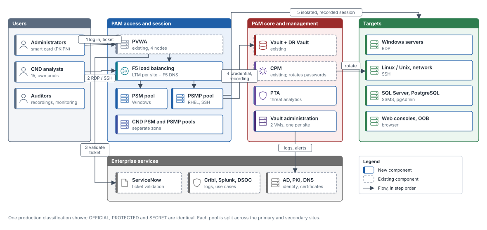
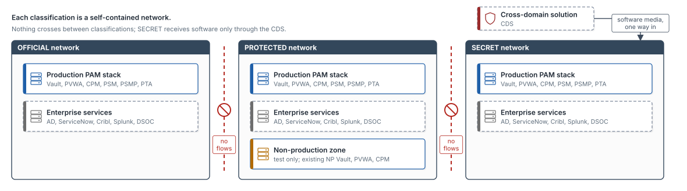
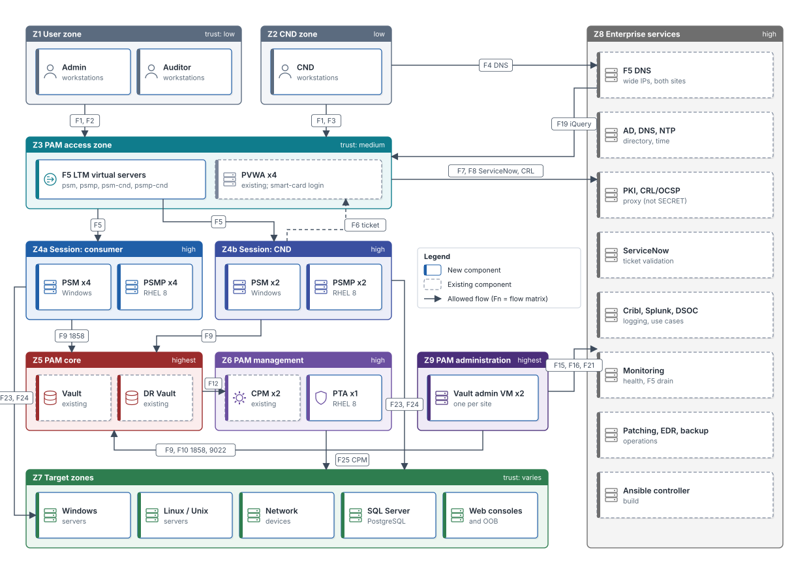
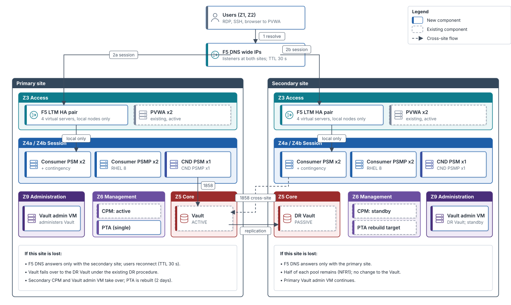
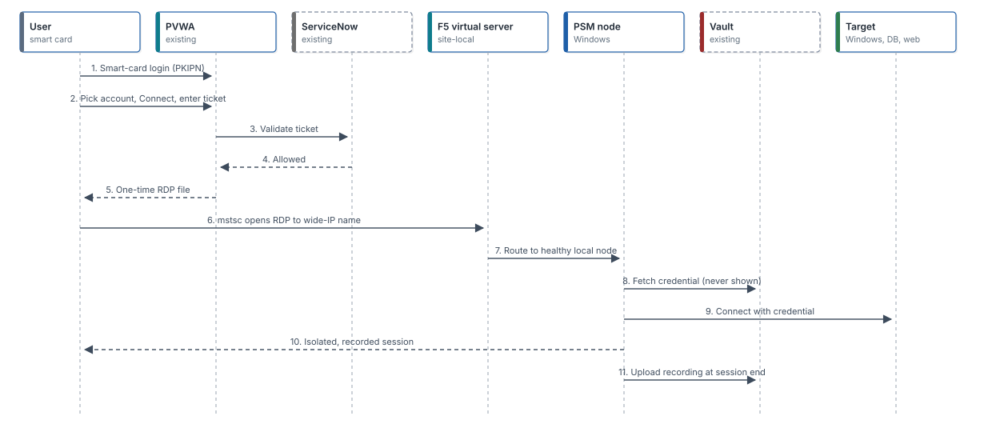
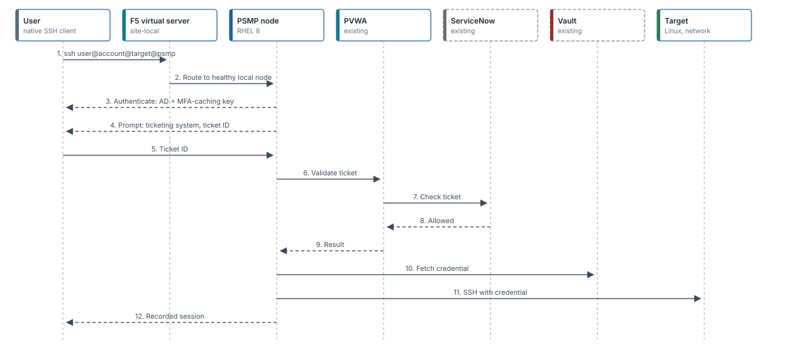
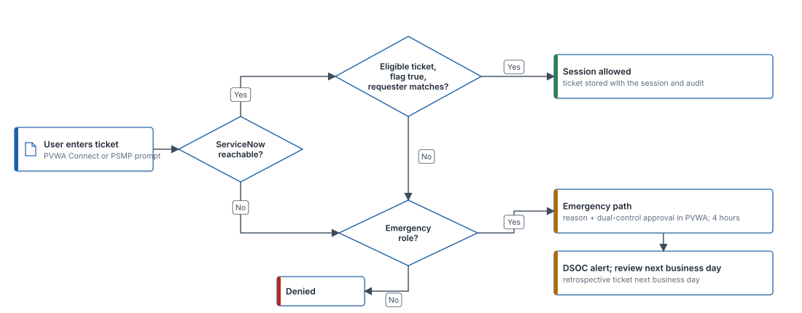
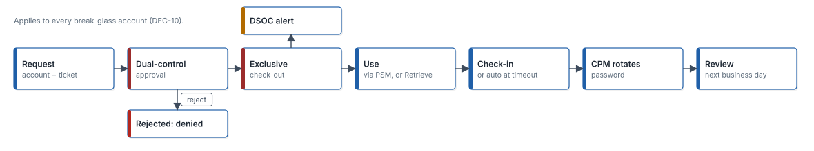
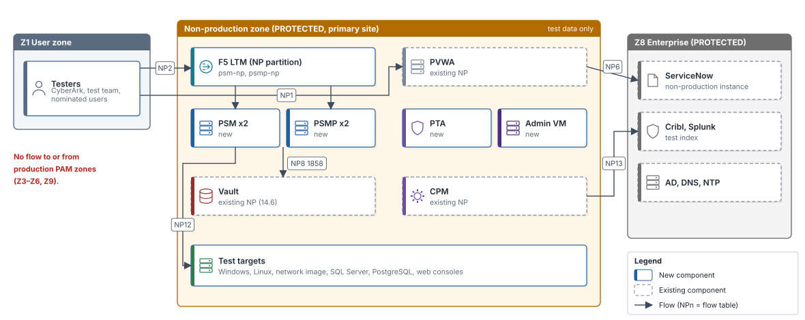
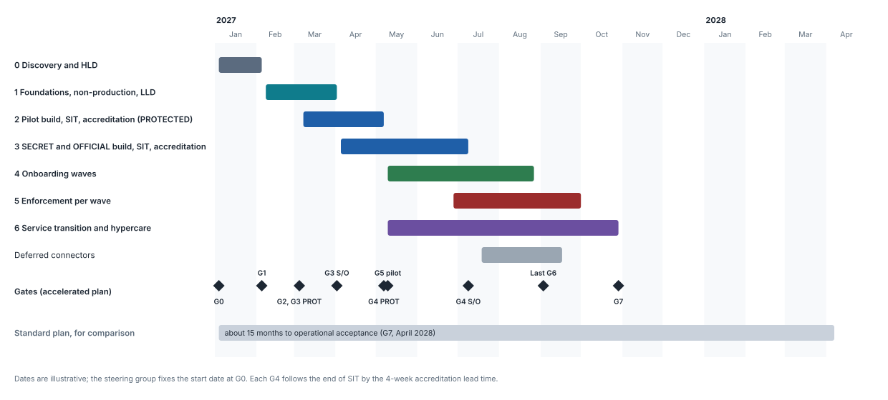

# Impact Assessment — CyberArk Privileged Session Manager (PSM, PSM for SSH, PTA)

| | |
|---|---|
| **Status** | DRAFT v0.12 for stakeholder review. Becomes v1.0 when approved at G0 |
| **Date** | 2026-11-25 |
| **Author** | CyberArk lead (name to be added before G0) |
| **Scope** | OFFICIAL, PROTECTED and SECRET production; PROTECTED non-production |
| **Platform** | CyberArk PAM Self-Hosted 14.6 |
| **Change type** | Major (confirmed by the sponsor) |
| **Decision sought** | Approve scope, gates, the accelerated plan and Phase 0–1 funding at G0 ([Executive summary](#executive-summary)) |

**How to read this document.** The main body is written to be read end to end in about 30 minutes.
The detailed reference material sits in the appendices: resource tables, firewall flows, workstream
detail, work packages, templates, the decision trail, the glossary and the version history. Each fact is
stated once and linked from everywhere else.

| Reader | Read | Approve at |
|---|---|---|
| Steering group, funding approver | Executive summary, [Delivery plan](#delivery-plan), [Costs](#costs) | G0 |
| Change authority, CAB | Executive summary, [Delivery plan](#delivery-plan) | G0, G3, G5, G6 |
| Architecture forum | [Scope](#scope), [Solution design](#solution-design), [Appendix 1](#appendix-1--resource-summary), [Appendix 2](#appendix-2--network-flows) | G1, G2 |
| Accreditation authority (each classification) | [Solution design](#solution-design) (security sections), [Risks](#risks), [Appendix 2](#appendix-2--network-flows) | G4 |
| Workstream leads | [Workstream commitments](#workstream-commitments), [Appendix 3](#appendix-3--workstream-detail), [Appendix 4](#appendix-4--work-packages-and-raci) | G1 (effort confirmed) |
| Service Operations, test lead | [Delivery plan](#delivery-plan), [Impact](#impact) | G2, G4, G7 |

**Conventions.** Every open item has one owner (a role) and the gate by which it is needed; calendar
dates are set at G0. **[CA]** marks a fact from the CyberArk documentation, which the CyberArk lead checks
against version 14.6 before G1. *(to be validated)* marks a statement that has not been confirmed yet,
and each one names the check that will confirm it. Identifiers: A assumption, R risk, D dependency, DEC
decision, KD key deliverable, G gate, WP work package, F/NP network flow, Q question.

**Signing** this document confirms that the signatory has read the sections for their role, accepts
their team's commitments and effort, and agrees the gate at which they approve next.

| Role | Name | Signature and date |
|---|---|---|
| Steering group chair (funding approver) | TBC | |
| Change authority | TBC | |
| Architecture forum chair | TBC | |
| Accreditation authority: OFFICIAL, PROTECTED, SECRET | TBC (Q45) | |
| CAB chair | TBC | |
| Service Operations manager | TBC | |
| Test lead | TBC | |
| Project manager | TBC | |
| CyberArk lead (author) | TBC | |
| Each workstream lead in [Workstream commitments](#workstream-commitments) | TBC | |

---

## Executive summary

**What.** This change adds CyberArk Privileged Session Manager to the existing CyberArk platform in
OFFICIAL, PROTECTED and SECRET. Privileged users reach Windows, database and web targets through PSM, and
SSH targets through PSM for SSH (PSMP), in isolated, recorded sessions that each need a valid ServiceNow
ticket. Privileged Threat Analytics (PTA) and Splunk use cases, triaged by the security operations
centre (DSOC), detect misuse and bypass. Every in-scope privileged account, including break-glass
accounts, is vaulted and rotated. PVWA smart-card login (PKIPN), so far proven only in development, is
brought into production. A non-production environment is built first to prove every change.

**Why.** Today most privileged access is direct from workstations or jump hosts. Administrators know or
can retrieve privileged passwords, and sessions are neither recorded nor tied to a ticket.

**Decision sought at G0.** The steering group is asked to:
1. approve the scope ([Scope](#scope)) and the gate model ([Governance and gates](#governance-and-gates));
2. approve the **accelerated plan** and its preconditions ([Delivery plan](#delivery-plan));
3. release funding for Phases 0 and 1, with the rest released at G2; and
4. approve indicative BAU funding ([Service operations](#service-operations)), confirmed at G7.

**Recommendation.** The CyberArk lead recommends the accelerated plan (DEC-18). It puts the pilot into
production after about **4 months** and reaches operational acceptance after about **10 months**, against
about 15 months for the standard plan, for slightly less effort. It needs the preconditions in
[Delivery plan](#delivery-plan) to be met in the first 4 weeks; otherwise the project moves to the
standard plan at G1.

| At a glance | |
|---|---|
| Users | 540 privileged users (250 PROTECTED, 200 SECRET, 90 OFFICIAL) and 15 CND analysts |
| New servers | 45 production VMs, up to 5 contingency PSM nodes, 6 non-production VMs: 592 vCPU, 1,296 GB RAM, about 10.6 TB disk in total ([Appendix 1](#appendix-1--resource-summary)) |
| Network | 9 security zones, 2 sites per classification, 26 F5 virtual servers, 12 F5 DNS wide IPs, 29 production flows ([Appendix 2](#appendix-2--network-flows)) |
| Effort | About **820–1,345 person-days** (accelerated) or 860–1,400 (standard), plus account onboarding; CyberArk team 269–460 of these ([Workstream commitments](#workstream-commitments)) |
| Duration | Pilot about 4 months; all waves enforced about 9 months; acceptance about 10 months ([Figure 10](#delivery-plan)) |
| Ongoing run cost | About 2.7–4.8 FTE across teams ([Service operations](#service-operations)) |
| Top risks | Firewall volume (R2), capacity at peak (R3), ServiceNow as a hard dependency (R5, R22), rotation breaking hard-coded passwords (R19, R27), accreditation timing (R15) |

*Figure 1 — Solution overview. Numbers show the order of a session.*

---

## Context

### Current state

The sponsor confirmed this current state on 2026-11-25 (Q35).

| Area | Today |
|---|---|
| CyberArk | Each classification has a Vault (primary site), a DR Vault (secondary site), 4 PVWA nodes (2 per site) and 2 CPM servers (active at the primary site, standby at the secondary). A non-production Vault, PVWA and CPM exist in PROTECTED. There is no PSM, PSMP or PTA. |
| Login | PVWA smart-card login (PKIPN) is proven only in development (*PVWA Certificate Authentication (PKIPN) Guide*). |
| Access | Most privileged access is direct RDP, SSH, database or web access from workstations or jump hosts; passwords are known or retrievable. |
| Sessions and detection | Sessions are not isolated, recorded or tied to tickets. Splunk correlates privileged activity only partly. |
| Break-glass | Break-glass accounts exist but are not consistently vaulted or checked out. |
| Known defects | A GPO puts an internal sub-CA in Trusted Root; the PVWA client-certificate revocation check is disabled. Both are fixed before G3 ([Debt and concessions](#debt-and-concessions)). |

### Outcomes and measures

The closure report (KD38) reports against these measures.

| Outcome | Measure |
|---|---|
| No standing knowledge of privileged passwords | In-scope accounts are used only through PSM/PSMP and rotated by CPM; end users do not hold *Retrieve*. |
| Every session is authorised | 100% of sessions carry an eligible ServiceNow ticket, or a logged and alerted emergency use. |
| Every session is recorded | Auditors can retrieve any recording for the retention period set by the records authority (D13). |
| Bypass is prevented and detected | Direct administrative access to onboarded targets is blocked, and attempts alert DSOC. |
| Resilient | No pool has a single point of failure; losing a node or a site does not stop new sessions. |
| Supportable | Supported operating systems for the service life (pilot go-live to October 2031); one version per pool; a documented upgrade path. |

---

## Scope

| In scope | Out of scope |
|---|---|
| PSM, PSMP, PTA and Vault administration VMs in OFFICIAL, PROTECTED and SECRET | Changes to the Vault, PVWA or CPM architecture beyond what this change needs (14.6 alignment is a dependency, A1) |
| PVWA smart-card login (PKIPN) in production | The PSM HTML5 Gateway (DEC-06) |
| A non-production environment in PROTECTED | Non-production in OFFICIAL and SECRET |
| ServiceNow ticket validation, SIEM integration, monitoring | RDP to PSM without PVWA (DEC-01) |
| Onboarding every in-scope account, platform and break-glass account | Application service accounts and moving application credentials to CyberArk credential providers (R27) |
| Bypass prevention and jump host retirement at enforcement | Application changes to make credentials rotatable (concessions, R12) |
| Handover to Service Operations (G7) | Workstation changes beyond user guides; access from outside the classification networks; cross-classification access |

**Targets.**

| Target type | Connects through | Client or connector |
|---|---|---|
| Windows servers | PSM (RDP) | PSM-RDP |
| Linux/Unix servers, network devices | PSMP (SSH); PSM-SSH as fallback | Native SSH client |
| Databases | PSM | SQL Server Management Studio (SQL Server), pgAdmin (PostgreSQL); no licence needed |
| Web consoles, virtualisation, out-of-band | PSM | Web connectors (Chromium or Edge with a pinned WebDriver) |

Onboarding covers every account listed through [Appendix 5](#appendix-5--account-inventory-template),
its platform, Safe, roles and CPM policy, and a break-glass account for each platform. Application
local credentials are rotated where a CPM plugin or the application's API allows; otherwise they are
vaulted and recorded, and the owner raises a concession.

### Assumptions

| # | Assumption | Status |
|---|---|---|
| A1 | The Vault, DR Vault, PVWA and CPM are healthy and on 14.6 before G3. | Open: load to be measured (Q36). CyberArk lead, G1 |
| A2 | PSM, PSMP and PTA are within the CyberArk entitlement or will be bought. | Open (Q14). Steering group, G0 |
| A4 | 540 users with 2–4 sessions each at peak. | Confirmed |
| A5, A6 | PSM servers are domain-joined in a dedicated OU; PSMP uses AD Bridge and PVWA MFA caching. | Confirmed |
| A7 | Each classification's PVWA can reach its ServiceNow instance. | Confirmed; CMDB quality open (Q50) |
| A9 | Each classification has a primary and a secondary site. | Confirmed |
| A10 | SECRET receives software only through the cross-domain solution (CDS). | Confirmed; transfer lead time to be confirmed by DevSecOps, G1 |
| A11 | Recording retention is not yet set; recordings are kept without purge until it is. | Open (D13). Records management, before the pilot |
| A13 | CND pools are reached only from CND networks. | Open. CND lead, G1 |
| A14 | There are 6–10 consuming teams (used for effort). | Open (Q27). Project manager, G1 |
| A15 | The 14.6 ServiceNow integration checks ticket fields only, not the target CI. | *Assumed*; tested in non-production in Phase 1. CyberArk lead, G2 |
| A16 | The existing non-production Vault, PVWA and CPM are in PROTECTED and on 14.6. | *Assumed*. CyberArk lead, G1 |

A3, A8 and A12 are confirmed and recorded in [Appendix 7](#appendix-7--decision-trail).

### Dependencies

| # | Dependency | Owner | Needed by |
|---|---|---|---|
| D1 | VMs to specification ([Appendix 1](#appendix-1--resource-summary)) | DCE | Non-production in Phase 1; production before G3 |
| D2 | Windows Server 2022 SOE; RHEL 8 SOE confirmed for PSMP and PTA | Windows and Linux Platform | Readiness at G1 |
| D3, D4 | IP addresses, DNS, F5 virtual servers; firewall flows ([Appendix 2](#appendix-2--network-flows)) | Network | Phase 1; target flows before each G5; blocks at each G6 |
| D5, D6 | AD objects and RD Licensing; certificates | Identity; PKI | Before G3 |
| D7 | Licences ([Appendix 1](#appendix-1--resource-summary), Table R6) | Procurement | Before G3 |
| D8 | ServiceNow integration and validation logic | ServiceNow team | Non-production in Phase 1; production before SIT |
| D9, D10 | SIEM routes, DSOC use cases; monitoring | SIEM, DSOC; Monitoring and Control | Core before the pilot; full before the first G6 |
| D11 | Ansible environment (offline in SECRET), EDR and AppLocker policy | DevSecOps | Phase 1 |
| D12 | Account inventories, test users and account owners | Consuming teams, CND | Week 4 of Phase 0; owners before each G5 |
| D13 | Recording retention period | Records management | Before the pilot |
| D14 | Risk assessment, privacy assessment, authority to operate | Security | G4 in each classification |
| D15 | Configuration backup | Backup | Before SIT |
| D16 | Proxy access from PVWA to the user-certificate CRL/OCSP addresses | Network | Before KD39 |

---

## Solution design

This section is the basis of the high-level design (KD16), which the architecture forum endorses at G1.
The low-level designs (KD17) follow at G2.

### Components

Each production classification has the same components.

| Component | Per classification | Sites | Purpose |
|---|---|---|---|
| Consumer PSM pool | 4 Windows Server 2022 nodes (+3 PROTECTED, +2 SECRET contingency) | 2 + 2 | Sessions to Windows, database and web targets |
| Consumer PSMP pool | 4 RHEL 8 nodes | 2 + 2 | SSH sessions to Linux/Unix and network devices |
| CND PSM and PSMP pools | 2 + 2 nodes | 1 + 1 each | CND sessions, kept apart from consumer pools (FR9) |
| PTA | 1 (no HA, DEC-05) | Primary | Threat analytics and bypass detection |
| Vault administration VM | 2 (DEC-07) | 1 + 1 | The only place from which the Vault and DR Vault are administered |
| F5 load balancing | 4 virtual servers per site; 4 wide IPs | Both | Site selection and local load balancing (DEC-21) |
| Existing, reused | Vault, DR Vault, 4 PVWA, 2 CPM, ServiceNow, Cribl, Splunk, AD, PKI | Both | Integrated, not rebuilt |

Sizes and totals are in [Appendix 1](#appendix-1--resource-summary). Each classification is
self-contained: no network flow crosses between classifications, and software reaches SECRET only
through the CDS (Figure 2).

*Figure 2 — Classification boundaries.*

### Network zones

Every component sits in one of nine security zones. A firewall separates every zone from every other,
and the default rule is deny; only the flows in [Appendix 2](#appendix-2--network-flows) are allowed.
The zone model is *proposed*: Network maps it to the existing zones, VLANs and firewalls before G1
(Q51).

| Zone | Contains | Trust | Accepts connections from |
|---|---|---|---|
| Z1 User | Administrator and auditor workstations | Low | — (users start connections) |
| Z2 CND | CND workstations | Low | — |
| Z3 PAM access | F5 virtual servers; PVWA (existing) | Medium | Z1, Z2; ticket checks from Z4; PTA and admin VMs; monitoring |
| Z4a Session, consumer | Consumer PSM and PSMP | High | F5 only; live monitoring (named group); monitoring, Ansible |
| Z4b Session, CND | CND PSM and PSMP | High | F5 CND virtual servers; administration from Z4a only |
| Z5 PAM core | Vault, DR Vault (existing) | Highest | 1858 from Z3, Z4, Z6, Z9; 9022 from Z9 |
| Z6 PAM management | CPM (existing), PTA | High | Vault audit syslog; DC events; administration through PSM |
| Z9 PAM administration | Vault administration VMs | Highest | Administration through PSM only |
| Z7 Targets | Windows, Linux/Unix, network, SQL Server, PostgreSQL, web consoles, OOB | Varies | Z4 sessions and Z6 CPM only, after enforcement |
| Z8 Enterprise services | AD, DNS, NTP, PKI, F5 DNS, ServiceNow, Cribl, Splunk, monitoring, patching, EDR, backup, Ansible | High | As each service needs |

*Figure 3 — Network zones and component placement (one production classification). Fn refers to the flow
matrix in [Appendix 2](#appendix-2--network-flows). Monitoring, drain, Ansible, administration, live
monitoring and AD, logging and operations flows are listed there but not drawn.*

### Sites, high availability and load balancing

The existing platform is active at the primary site and on standby at the secondary site. The new
session pools are active at both sites. Session nodes at either site use the active Vault, across sites
where necessary, and move to the DR Vault after a Vault failover.

*Figure 4 — Primary and secondary sites (one production classification).*

| Design point | Design |
|---|---|
| Site selection | An F5 DNS wide IP for each service (`psm`, `psmp`, `psm-cnd`, `psmp-cnd`) answers with both sites in proportion to their healthy nodes: active-active, 30-second TTL, no persistence. Listeners at both sites. Follows CyberArk's DNS load-balancing and pass-through recommendation [CA] (DEC-21). |
| Local load balancing | An F5 LTM pair at each site, with one virtual server per service that balances only local nodes, in TCP pass-through mode (no TLS or SSH termination). |
| Client address | SNAT is used, so firewalls stay the zone boundary. The F5 logs each connection's client address to Splunk, where it is joined to the session logs. |
| Persistence and timeouts | Source-address persistence and TCP idle timeout of at least 3,900 s (longer than the 60-minute idle disconnect). |
| Health and drain | TCP monitors every 10 s; monitoring disables a failed node through iControl REST with a role limited to the PAM partition (R9). |
| Failure | A node failure moves new sessions to the site's other nodes. A site failure drops that site from DNS answers, and the other site carries half of each pool (NFR1). |
| Fallback | If F5 DNS is not available (Q52), a static DNS name points at the primary site, whose pool includes secondary nodes; site failover is a manual DNS change (R29). |
| Consistency | Every node in a pool runs the same version [CA]; all PSMP nodes share one SSH host key; PSM certificates carry the wide-IP name. |

### Sessions and access

| Method | Ticket checked | In scope |
|---|---|---|
| PVWA *Connect*, then the native RDP client (Figure 5) | At PVWA | Yes (default) |
| Native SSH through PSMP (Figure 6) | PSMP prompts; PVWA validates [CA] | Yes |
| Break-glass *Retrieve* (Figure 8) | In the request | Break-glass accounts only |
| RDP straight to PSM; HTML5 Gateway | — | No |

*Figure 5 — RDP, database and web session.*

*Figure 6 — SSH session through PSMP. PSMP ticket IDs cannot contain `( ) = ,` [CA]. If the PSMP ticket
path fails its non-production test, the architecture forum chooses a fallback at G2
([Appendix 6](#appendix-6--options-considered)).*

### Ticketing

*Figure 7 — Ticket decision.*

| Item | Design |
|---|---|
| Integration | CyberArk's ServiceNow integration on PVWA in each classification (DEC-02). PSMP checks through PVWA, so PSMP needs only 443 to PVWA. |
| Eligible tickets | Incidents, Problem tasks, Service Requests and Standard Change tasks (Q41); Normal Changes in *Implement* inside their window (*Assumed*). The ITSM process owner fixes eligible states and the requester field in Attachment D before G2. |
| Validation logic | In ServiceNow (DEC-08): a computed flag is true only for an eligible type and state, inside the Change window, assigned to a person, with a CI set. A job refreshes it every 5 minutes. |
| Requester | The PVWA user must be the ticket's *Assigned to* user (supported since 10.6 [CA]). |
| Target CI | Not in the baseline (A15); can be added at G2 if the integration supports it and CMDB data is verified (Q50). |
| Failure | Unreachable, slow (over 10 s), error or invalid: denied. |
| Emergency path | Named emergency group (at most 10 per classification, approved by Security); reason plus dual-control approval in PVWA, so it works when ServiceNow is down; 4-hour limit; immediate DSOC alert; retrospective ticket and Security review next business day. Native 14.6 support is tested in Phase 1 (Q40); Security approves at G1 and confirms at G2 (DEC-14). |

### Security controls

| Control | Design |
|---|---|
| Authentication | PVWA by smart card (PKIPN); PSMP through AD and PVWA MFA caching. |
| Roles | Safes per team and classification. Roles: End user (*Use*, *List*; no *Retrieve*), Approver, Safe Manager, Auditor, CyberArk Administrator, CND. The Safe and RBAC model is endorsed at G2 (DEC-15). |
| Credentials | CPM rotates at onboarding, after dependency checks (WP29), then on each platform's schedule; one-time passwords for break-glass. |
| Platforms | *Connect through PSM*, ticket required, recording on. Exclusive access and dual control for break-glass and high-risk accounts. |
| Hardening | CyberArk hardening, SOE baseline, AppLocker. Only PSMConnect, PSMAdminConnect and administrators through PSM may log on to PSM/PSMP. |
| Bypass prevention | At each wave's enforcement: firewall blocks, Windows GPOs, Linux `sshd` restrictions, jump host retirement; PTA and Splunk detect attempts. |
| Segregation of duties | Administrators work only through PSM to the Vault administration VMs, cannot delete recordings or audit, and Security reviews a sample monthly (R26). |
| Session policy | 12-hour maximum; 60-minute idle disconnect; clipboard off except approved platforms; no drive, printer or USB redirection; file transfer only by each platform's logged method; NLA and TLS to targets; up to 4 sessions per user; video for PSM, keystrokes for SSH. Security approves at G1 (DEC-14). |

*Figure 8 — Break-glass check-out and check-in.*

**When something fails:**
- **ServiceNow down:** the emergency path.
- **PSM or PSMP down:** break-glass check-out, under the outage runbook (R23).
- **Vault or PVWA down:** the offline emergency procedure, tested every six months (KD27).

### Recording, logging and detection

| Item | Design |
|---|---|
| Recordings | Uploaded to recording Safes and replicated to the DR Vault. Retention is set by the records authority (D13); until then, no purge. Only the Auditor role retrieves recordings, and every retrieval is audited; requests are met within 5 business days. Purge at end of retention, a disposal register, and legal hold. Held at the classification and caveats of the session. If storage runs short, recordings go to an archive that Records management and Security name (Q44). A privacy impact assessment and workforce notice come before the pilot (KD21). |
| Logging | Vault audit (syslog via XSL), PSM/PSMP, PVWA, CPM, PTA, F5, ServiceNow validation and operating system logs go through Cribl to Splunk over TLS. DSOC triages the use cases. |
| Use cases (minimum) | Emergency path used; break-glass check-out; *Retrieve* outside break-glass; direct logon to an onboarded target from a non-PSM source; PTA high-risk alert; repeated failed authentication; CPM failure; recording upload failure; PSM/PSMP or PTA down; out-of-hours session; dormant account use; Safe permission change; Vault administration session. Core set before the pilot; full set before the first enforcement. |
| PTA | Vault audit (including session activity) and domain controller events (source decided at G1, Q37). Alert-only at first; each automatic response needs Security approval after 4 weeks of tuning. While PTA is down, the Splunk use cases continue (R25). |
| Monitoring | Service health, sessions per node (alert at 42), disk, certificates (60 days before expiry), F5 drain. |

### Capacity

| Item | Basis |
|---|---|
| Ceiling | No more than 60 concurrent sessions per PSM [CA]; design limit 42 (70%). PSMP is sized to 60 until the Phase 2 test measures it *(to be validated)*. |
| Demand | 30–40% of users active at peak, with 2–4 sessions each; 60% PSM and 40% PSMP. Peak PSM demand: PROTECTED 90–240, SECRET 72–192, OFFICIAL 32–86 sessions. |
| PSM nodes | Serving the top of the range with one node out of service needs 7 in PROTECTED, 6 in SECRET and 4 in OFFICIAL. Each classification starts with 4; the others are contingency (DEC-09). |
| Scale-out trigger | Any node above 42 sessions on 3 business days in a month: the CyberArk lead raises a change to build contingency nodes (KD28). |
| PVWA and CPM | Current load is measured in Phase 0 (Q36); the architecture forum decides at G1 whether to add nodes (R20). |
| Recordings | 1,000–2,000 sessions a day; 12–67 TB a year for each copy (Vault and DR Vault) at one-year retention; replication averages 3–17 Mbit/s. The pilot replaces these estimates. |

### Resilience and recovery

| Component | On failure | RTO | RPO |
|---|---|---|---|
| PSM/PSMP node or site | Remaining nodes and site continue | No loss of service for new sessions | Recording up to the point of failure (HA-04) |
| Vault | Failover to the DR Vault; all components hold both addresses and reconnect *(to be validated, DR-02)* | Existing Vault DR targets | Existing Vault DR targets |
| PTA | Rebuilt from automation and backup | 2 business days | Daily configuration backup |
| Vault administration VM | The other site's VM continues | No loss; rebuild in 1 business day | Daily configuration backup |
| ServiceNow | Deny by default; emergency path | ServiceNow's own targets (Q42) | — |
| Recording upload | Held on the PSM disk and retried, with an alert | — | No loss within disk capacity |

### Non-production environment

Non-production proves designs, integrations and upgrades before production, and stays in service for
upgrades, patches, connector changes and PTA tuning (DEC-17). It holds test data only, has no flow to
the production PAM zones, and runs the same versions and automation as production, upgraded at least 2
weeks earlier.

*Figure 9 — Non-production placement (PROTECTED). The flows NP1–NP15 are in
[Appendix 2](#appendix-2--network-flows).*

### Versions and lifecycle

| Item | Decision |
|---|---|
| CyberArk | 14.6 on every node (PSM 14.6.0.28, PSMP 14.6.0.13 [CA]). |
| Windows | Windows Server 2022 for PSM and the Vault administration VMs (DEC-03); 2025 is not supported for PSM [CA]. Extended support ends 14 October 2031. If the 2022 SOE is late, 2019 is used under a concession (R8). |
| Linux | PSMP and PTA on the existing RHEL 8 SOE, 8.8 or later (DEC-19). RHEL 8 maintenance ends May 2029 *(to be validated by Linux Platform before G1)*, so a concession records the uplift to RHEL 9 before then. |
| RDS CALs | Per User, same or newer version than the PSM operating system. |

### Decision log

*Agreed* decisions reflect the sponsor's answers and are endorsed at the gate shown. Withdrawn decisions
and the full history are in [Appendix 7](#appendix-7--decision-trail).

| # | Decision | Status |
|---|---|---|
| DEC-01 | PVWA *Connect* launches the native RDP client after the ticket check; direct RDP to PSM is disabled. | Agreed; G1 |
| DEC-02 | ServiceNow in each classification; PSMP users enter the ticket at PSMP and PVWA validates it. | Agreed; G1 |
| DEC-03 | PSM on Windows Server 2022, built new. | Agreed; G1 |
| DEC-04 | OFFICIAL in scope like the others; CND pools in all three. | Agreed; G1 |
| DEC-05 | PTA mandatory, one per classification, no HA. | Agreed; G1 |
| DEC-06 | HTML5 Gateway not included. | Agreed; G1 |
| DEC-07 | Two Vault administration VMs per classification, one per site. | Agreed; G1 |
| DEC-08 | Ticket validation logic lives in ServiceNow. | Agreed; G1 |
| DEC-09 | CyberArk-based sizing: 4 consumer PSM per classification, +3 PROTECTED and +2 SECRET contingency. | Agreed; G1 |
| DEC-10 | Check-out and check-in for every break-glass account; native rotation where possible, otherwise a concession. | Agreed; G1 |
| DEC-11 | Ansible for build and configuration wherever a validated role exists. | Agreed; G1 |
| DEC-12 | Retention set by the records authority; no purge until then. | Agreed; value pending |
| DEC-14 | Session policy and emergency path. | Pending; Security, G1 (emergency path confirmed at G2) |
| DEC-15 | Safe and RBAC model. | Pending; architecture forum, G2 |
| DEC-16 | Enforcement approach for each team. | Pending; CAB, each G6 |
| DEC-17 | Non-production in PROTECTED, reusing the existing non-production Vault, PVWA and CPM. | Agreed; G1 |
| DEC-18 | Accelerated plan recommended. | Proposed; steering group, G0 |
| DEC-19 | RHEL 8 for PSMP and PTA under a concession; RHEL 9 before May 2029. | Agreed; G1 |
| DEC-20 | PKIPN brought into production as part of this change (WP33). | Agreed; G1 |
| DEC-21 | F5 LTM per site with SNAT and logging; F5 DNS wide IPs, active-active, no persistence. | Proposed; architecture forum, G1 |

---

## Requirements and deliverables

### Requirements

| # | Requirement | Verified by |
|---|---|---|
| FR1 | Users shall start RDP, database and web sessions from PVWA *Connect* through PSM. | Functional, UAT |
| FR2 | Users shall start SSH sessions with their native client through PSMP, authenticated by AD and PVWA MFA caching. | Functional, UAT |
| FR3 | Every session shall require a valid ServiceNow ticket. | Ticketing |
| FR4 | Every session shall be recorded and retained for the approved period. | Recordings |
| FR5 | Authorised operators shall be able to monitor and end live sessions. | Functional |
| FR6 | Break-glass accounts shall use exclusive check-out, dual control, a ticket and rotation on check-in. | Break-glass |
| FR7 | CPM shall verify, change and reconcile onboarded credentials on each platform's schedule. | CPM |
| FR8 | PTA shall analyse Vault, session and AD activity and alert Splunk, DSOC and PVWA. | Logging |
| FR9 | CND shall use dedicated pools, Safes, roles and a dedicated zone. | Security |
| FR10 | The session policy shall apply to every session. | Security |
| NFR1 | No single point of failure in any pool; losing one site leaves at least half of each pool. | HA |
| NFR2 | Peak served with one node out of service, at no more than 60 sessions per PSM. | Performance |
| NFR3 | A session launches within 15 seconds of *Connect* (target confirmed by Service Operations at G1). | Performance |
| NFR4 | Hardened to CyberArk guidance and the SOE; no logon to PSM/PSMP outside sessions. | Security |
| NFR5 | Security events reach Splunk within 5 minutes (target confirmed by DSOC at G1). | Logging |
| NFR6 | One CyberArk version per pool, on an operating system supported for the service life. | Build checks |
| NFR7 | Components meet the RTO and RPO in [Resilience and recovery](#resilience-and-recovery). | DR |

### Key deliverables

Each deliverable has one owner and is approved at a gate. The work packages that produce them are in
[Appendix 4](#appendix-4--work-packages-and-raci).

| # | Deliverable | Owner | Approver | Gate | Accepted when |
|---|---|---|---|---|---|
| **Design and approval** | | | | | |
| KD16 | High-level design | CyberArk architect | Architecture forum | G1 | Endorsed, with conditions recorded (KD18) |
| KD17 | Low-level design for each classification and non-production | CyberArk architect | Architecture forum | G2 | Endorsed; G1 conditions closed |
| KD18 | Architecture forum endorsement records | Project manager | Forum chair | G1, G2 | Filed; conditions owned |
| KD19 | Firewall and flow matrix (Attachment A) | Network manager | Network design authority, Security | G1 (component), G5 (targets), G6 (blocks) | Approved; every rule flow-tested |
| KD20 | Security risk assessment and system security plan | Security | Accreditation authority | G4 | Accepted for assessment |
| KD21 | Privacy impact assessment and workforce notice | Security | Privacy officer | Pilot G5 | Approved; notice issued |
| KD22 | Test strategy and plans (Attachment G) | Test lead | Security, Service Operations | G2 | Signed; every test area planned |
| **Build and integration** | | | | | |
| KD23 | Non-production environment | CyberArk lead | Test lead | Before PROTECTED SIT | Built from Ansible; smoke tests pass |
| KD1 | 36 production PSM/PSMP nodes | CyberArk lead | Test lead | G4 | Build logs; no critical or high hardening finding; one version per pool |
| KD2 | F5 load balancing: 26 virtual servers, 12 wide IPs | Network manager | Test lead | G4 | HA-01 to HA-05 pass, including site loss |
| KD3 | PTA in each classification | CyberArk lead | Security | G4 | Each minimum detection fires and alerts |
| KD5 | ServiceNow ticketing and emergency path | ServiceNow service owner | Test lead, ITSM process owner | G4 | Every ticketing test passes |
| KD6 | SIEM integration and DSOC use cases | SIEM lead | DSOC manager | Pilot G5 (core); first G6 (all) | Each use case fires and is triaged |
| KD7 | Monitoring and alerting | Monitoring and Control lead | Service Operations | G4 | Each alert reaches its support group |
| KD8 | Platforms, Safes, roles, CPM policies, connectors | CyberArk lead | Architecture forum (model); test lead | G2; each G5 | Test matrix passes for the wave |
| KD9 | All in-scope accounts onboarded | CyberArk lead | Account owners | Each G6; G7 | At least 98% rotated per wave; the rest under approved exceptions |
| KD10 | Bypass prevention and jump host retirement | Network manager | CAB, Security | Each G6 | Every bypass attempt blocked and alerted |
| KD11 | Recording lifecycle procedure | CyberArk lead | Records management | Pilot G5 | Retrieval, purge and legal hold tested |
| KD15 | Vault administration VMs at both sites | CyberArk lead | Security | G4 | Administration only from these VMs |
| KD24 | RD Licensing and CALs active | Identity lead | Test lead | G3 | Licensing diagnostic clean on each PSM |
| KD25 | New servers in the CMDB | Service Operations | ServiceNow team | Pilot G5 | Every server registered with its support group |
| KD26 | Known PKI defects fixed | Identity lead; CyberArk lead | Security | G3 | No sub-CA in Trusted Root; revocation on; trust mode back to 0 |
| KD27 | Offline emergency procedure tested | CyberArk lead | Security | Pilot G5 | Tested end to end |
| KD28 | Contingency PSM nodes, when triggered | CyberArk lead | CAB | When triggered | As KD1 |
| KD29 | Ansible automation handed over | DevSecOps lead | Service Operations | G7 | Support team rebuilds a node of each role |
| KD39 | PKIPN in production on every PVWA node | CyberArk lead | Security | First G5 in each classification | Smart-card login works for every issuing CA; revoked certificate refused |
| **Assurance** | | | | | |
| KD12 | Test evidence | Test lead | Security | G4; each G6 (UAT) | Every test case has a result |
| KD30 | Penetration test report | Security | Accreditation authority | G4 | Critical and high findings closed or accepted |
| KD31 | Test completion report | Test lead | Security, Service Operations | G4; each G6 | Exit criteria met |
| KD32 | Authority to operate | Security | Accreditation authority | G4 | Issued for the classification |
| **Transition and closure** | | | | | |
| KD33 | CAB approvals (build, each wave, each enforcement) | Project manager | CAB | G3, G5, G6 | Approved change records |
| KD34 | User guides, communications, training | Service Operations | Team leads | Each G5 | At least 90% of the wave trained |
| KD13 | Service transition package and hypercare plan | Service Operations | Steering group | Pilot G5; G7 | Hypercare exit criteria met |
| KD35 | Operational runbooks | CyberArk lead | Service Operations | Drafts at pilot G5; final at G7 | Walked through with their users |
| KD14 | Upgrade procedure | CyberArk lead | Service Operations | G7 | Rehearsed in non-production |
| KD36 | As-built records | CyberArk lead | Service Operations | G7 | Match the LLD, or deviations approved |
| KD37 | Operational acceptance certificate | Project manager | Service Operations | G7 | Acceptance criteria met |
| KD38 | Closure report | Project manager | Steering group | G7 | Accepted; residual risks handed over |

KD4 (HTML5 decision) is closed by DEC-06.

**Supporting artefacts** (produced by the owner shown, approved at the gate shown):

| Ref | Artefact | Owner | Gate |
|---|---|---|---|
| A | Firewall and flow matrix (KD19) | Network manager | G1, G2, each wave |
| B | Build sheet | CyberArk architect | G2 |
| C | Capacity model | CyberArk architect | G1; after the pilot |
| D | ServiceNow integration specification | CyberArk lead, ServiceNow team | G2 |
| E | SIEM use case catalogue | SIEM lead | G2 draft; G4 final |
| F | Platform and connector catalogue | CyberArk lead | G2 |
| G | Test strategy and plans (KD22) | Test lead | G2 |
| — | Risk, decision, concession and defect registers | Project manager | G0 to G7, then Service Operations |

The author lists the baseline documents (HLD, LLD, security documentation, network diagrams, SOE
standards, ServiceNow and SIEM standards, PKIPN guide) with versions before G1 (Q15).

---

## Workstream commitments

Each workstream lead confirms these commitments and the effort in writing before G1. Effort is in
person-days for all three classifications and non-production, summed from the work packages in
[Appendix 4](#appendix-4--work-packages-and-raci). Detailed tasks and acceptance criteria are in
[Appendix 3](#appendix-3--workstream-detail).

| Team | Commits to | Needs (from, by) | Effort (d) | Phases |
|---|---|---|---|---|
| CyberArk team | Design; build and configuration; non-production; PKIPN; onboarding; runbooks; handover; inputs to every team | Answers to the open questions | 281–486 standard; 269–460 accelerated; plus onboarding | All |
| Data Centre Engineering | Up to 56 VMs across both sites; Vault storage growth; backup policy | Build sheet (CyberArk, G1) | 35–60 | 0–1 |
| Network | IPs, DNS, F5 (26 virtual servers, 12 wide IPs), component and target flows, bypass blocks, jump host retirement, CRL proxy access | Flow requirements (CyberArk, G1; each wave −4 weeks) | 68–115 | 1–2, 4, 5 |
| Windows Platform | Windows Server 2022 SOE with the RDSH role; patching with drain | PSM OS requirements (Phase 0) | 14–28 | 0–1 |
| Linux Platform | RHEL 8 SOE confirmation; `sshd` restrictions on targets; RHEL 9 uplift plan | OS requirements; target lists | 9–18 | 0–1, 5 |
| Identity | OUs, GPOs, service accounts, delegations, RD Licensing, break-glass review, target GPOs, sub-CA fix, UPN mapping | AD change list (G1) | 25–40 | 1, 4, 5 |
| PKI | Server certificates; CA certificates and CRL details for PKIPN | Certificate list (G1) | 9–16 | 1 |
| Procurement | Licences and capacity (Appendix 1, Table R6) | Quantities (G1) | 6–12 | 0–1 |
| ServiceNow team | Integration, validation logic, test tickets, emergency support, CMDB, assignment groups | Attachment D (draft G1, final G2) | 25–40 | 1–3 |
| SIEM | Cribl routes; Splunk indexes, add-on, dashboards | Sources and samples (Phase 1) | 28–50 | 1–3 |
| DSOC | Use cases, runbooks, PTA triage | Attachment E (G2) | 14–28 | 2–5 |
| Monitoring and Control | Health, capacity and certificate alerts; F5 drain | Monitoring specification (G1) | 11–21 | 1–3 |
| DevSecOps | Ansible (offline in SECRET), scanning, EDR and AppLocker, handover | Playbooks (Phase 1) | 34–53 | 1–3, 6 |
| Security | Risk assessments, privacy assessment, policies, penetration tests, accreditation | HLD, LLD, test evidence | 30–55 | 0–4 |
| Test team | Strategy, plans, test data, execution, completion reports | LLD (G2); non-production | 50–80 | 1–5 |
| Service Operations | Support model (L2 Security Operations, 24x7), KB, training, hypercare, acceptance | Runbooks, guides (before G5) | 14–21 | 2–6 |
| Records management | Retention, disposal, legal hold; archive (with Security) | Recording design (G2) | 3–5 | 1–2 |
| Backup | Configuration backup of the new servers | Backup scope (G2) | 3–6 | 1–3 |
| Consuming teams (6–10) and CND | Inventories, account owners, dependency checks, UAT, change windows | Templates (Phase 0); wave plan (G1) | 5–9 per team (30–90); CND 5–9 | 0, 4, 5 |
| Project management | Gates, registers, CAB submissions, reporting, closure | All teams | About 139 accelerated; 165 standard | All |
| **Total** | | | **About 820–1,345 accelerated; 860–1,400 standard**, plus onboarding (about 115 or 215 at the example volume) | |

---

## Delivery plan

### Governance and gates

A steering group (funding approver, CyberArk lead, project manager, and the Security, Network and
Service Operations leads) meets monthly. Work past a gate starts only when the gate is passed.

| Gate | When | Approved by | Evidence | Outcome |
|---|---|---|---|---|
| G0 | Before Phase 0 | Steering group, change authority | This document; cost envelope; plan; accreditation authorities named (Q45) | Scope, plan and Phase 0–1 funding |
| G1 | End of Phase 0 | Architecture forum | HLD; decisions; zone mapping (Q51); G1 answers; confirmed effort | HLD endorsed; effort re-baselined |
| G2 | Before the component build | Architecture forum | LLDs; firewall matrix; test strategy; RBAC model | LLD endorsed; remaining funding |
| G3 | Before each classification's build | CAB | Infrastructure accepted; KD24, KD26 | Build may start |
| G4 | Before production use in each classification | Accreditation authority | SIT report, penetration test, risk assessment | Authority to operate |
| G5 | Before the pilot and each wave | CAB with Service Operations | Wave entry criteria (below) | Wave goes live |
| G6 | Before each wave's enforcement | CAB | Enforcement entry criteria (below) | Direct paths closed |
| G7 | After the last hypercare | Service Operations; steering group | Acceptance criteria (below); closure report | Service in BAU; project closed |

### Recommended plan

The accelerated plan keeps every gate but runs other teams' lead times in parallel. All three
classifications are built together, accreditation evidence is prepared during the build, and a pilot
team goes live first.

*Figure 10 — Delivery schedule (accelerated plan, illustrative start date). Each G4 follows the end of SIT
by the 4-week accreditation lead time (Q45).*

| Phase | Content | Exit | Back-out |
|---|---|---|---|
| 0 Discovery and HLD | Inventories, wave plan, HLD, decisions, long-lead orders | G1 | Documents only |
| 1 Foundations | VMs, SOE, component flows, F5, AD, PKI, Ansible, non-production, LLDs | G2; non-production accepted | Remove new objects |
| 2 Pilot build (PROTECTED) | Components, PKIPN, ServiceNow, SIEM, monitoring; SIT, performance, HA, DR, penetration test | G4 (PROTECTED) | Disable new components |
| 3 SECRET and OFFICIAL build | As Phase 2, with CDS transfers and offline automation in SECRET | G4 for each | As Phase 2 |
| 4 Onboarding waves | Pilot team first; platforms, accounts, break-glass, target flows, UAT | 98% rotated; UAT passed | Pause; restore passwords to owners under dual control |
| 5 Enforcement | Blocks, GPOs, `sshd` restrictions, jump host retirement per wave | Bypass tests blocked and alerted | Reopen one path by emergency change, up to 5 days |
| 6 Transition | Runbooks, support model, training, hypercare | G7 | Extend hypercare in 2-week steps |

| Lever | Effect |
|---|---|
| Pilot first (one PROTECTED team, RDP and SSH, core use cases) | Production use after about 4 months |
| Build all classifications in parallel | About 2–3 months saved |
| Standard platforms and connectors first; niche connectors later | About 12–26 person-days saved |
| Discovery-led onboarding | Onboarding about 0.05 instead of 0.1 days per account |
| CyberArk (Palo Alto Networks) Professional Services | Removes the CyberArk team as the bottleneck |

**Preconditions (by week 4 of Phase 0 unless shown):** CDS transfer lead time known (DevSecOps);
funding and entitlement (steering group, G0); PVWA and CPM load measured (CyberArk lead); VM capacity and
licences orderable (DCE, Procurement); firewall and accreditation able to run in parallel (Network,
Security); one pilot team committed (project manager); Professional Services scope agreed (project
manager, G1). **Added risk:** higher peaks for Network, DCE and the CyberArk team. Waves are capped at
300 accounts or 60 users.

The standard plan runs the same phases in sequence and builds SECRET and OFFICIAL after PROTECTED SIT,
for about 15 months to G7.

### Wave, enforcement and acceptance criteria

| Gate | Criteria |
|---|---|
| G5 wave entry | G4 passed; dependency checklist signed by every account owner (WP29); target flows tested; platforms pass the test matrix; announcement 4 weeks and training 2 weeks before; Service Desk briefed; CAB approval. Pilot only: core use cases live, offline procedure tested, privacy notice issued. |
| G6 enforcement entry | At least 98% rotated; full use case catalogue live; 4 weeks' notice given; no open critical or high incident from the wave; team lead agrees the date; CAB approval. |
| Hypercare exit (4 weeks after go-live and after enforcement) | No open critical or high incident; Service Desk resolves at least 70% at first line; KB covers the top 10 queries. |
| G7 acceptance | All waves out of hypercare; runbooks, as-built records, automation and upgrade procedure accepted; alerts reach support groups; support model and CMDB in place; BAU funding confirmed; every open defect and concession owned. |

### Testing

Everything is tested in non-production first, except the tests that need production infrastructure.
Those run in approved windows before users are onboarded (R21).

| Area | Coverage | Where |
|---|---|---|
| Functional | Every connector against every target type | Non-production; smoke test in each classification |
| Ticketing | Every eligible type; wrong state, window, requester; ServiceNow down or slow; emergency path allowed and denied; PSMP entry | Non-production; each classification |
| Security | Bypass attempts; *Retrieve* denied; hardening; AppLocker breakout; RBAC; CND isolation; penetration test | Non-production; penetration and bypass tests in production |
| HA and DR | Node loss, drain, site loss, recording continuity, F5 failover (HA-01 to HA-05); rebuild (DR-01); Vault failover (DR-02) | Non-production; site and Vault failover in production |
| Performance | Peak with one node out; launch time; upload throughput; PVWA load | Production (PROTECTED), before the pilot |
| Other | Logging and use cases; break-glass and offline procedure; CPM and onboarding; recordings; upgrade rehearsal; UAT per wave | Non-production; UAT in production |

**SIT exit:** every case run; no critical or high defect open; every medium defect owned and dated; the
completion report issued (KD31). Defect severity: *critical* (service or control fails), *high* (no
workaround), *medium* (workaround), *low* (cosmetic).

---

## Impact

| Area | Rating | Why |
|---|---|---|
| Design | High | New tiers in three classifications and non-production; two architecture gates |
| Testing | High | Every connector and target type, ticketing, HA, DR, security, performance |
| Deployment | High | 56 VMs, CDS transfers, PKIPN, onboarding waves, enforcement |
| Production | High | 540 users change how they work; rotation can break hard-coded passwords |
| Service operations | Medium–High | 56 more servers; upgrades; RHEL 9 uplift |
| Documentation | Medium–High | About 50 deliverables and artefacts |

### People and ways of working

| Who | What changes | Impact |
|---|---|---|
| Administrators | PVWA login, a ticket for every session, no known passwords, sessions recorded | High |
| CND analysts | Own pools, same rules | Medium |
| Auditors | Recording retrieval and session audit | Positive |
| DSOC and Service Desk | New use cases, PTA alerts, L1 questions | Medium–High |
| Network, Identity, DCE | Firewall volume, GPOs, VMs and storage | High |
| Application owners | Rotation, dependency checks, possible concessions | Medium |

**Daily work.** Routine work can run under a Service Request or a Standard Change task. The clipboard is
off except on approved platforms, and files move only by each platform's logged method. Sessions end
after 12 hours and disconnect after 60 idle minutes, so long jobs must run on the target. A target type
with no connector is raised through the inventory, and either gets a connector or a concession.

**Incidents.** Responders use the same path with an Incident ticket. If ServiceNow, PSM or the Vault is
down, the failure paths in [Security controls](#security-controls) apply.

### Service operations

Upgrades follow CyberArk's order (Vault, PVWA, CPM, PSM/PSMP, PTA), are validated in non-production first,
and upgrade a pool as a whole, either by a drained window of about 4 hours or by a parallel pool. Each
upgrade needs CAB approval. Patching is node by node with drain. Recurring work includes WebDriver and
client updates, CAL and certificate renewals, the RHEL 9 uplift before May 2029, the next Windows uplift
before October 2031, recording requests, and break-glass reviews and six-monthly tests.

| Team | Ongoing effort after G7 (indicative; confirmed at G7) |
|---|---|
| CyberArk team | 1.7–2.7 FTE |
| DSOC and Security Operations (L2, 24x7) | 0.3–0.7 FTE |
| Service Desk (L1) | 0.2–0.4 FTE (0.4–0.8 during hypercare) |
| Network, Windows/Linux Platform, SIEM | 0.1–0.2 FTE each |
| Identity, ServiceNow, Monitoring and Control | 0.05–0.1 FTE each |
| PKI, Records management | 0.02–0.05 FTE each |
| **Total** | **About 2.7–4.8 FTE** |

### Communications and training

| When | Audience | What |
|---|---|---|
| Phase 0 | Team leads | Scope, commitments, inventory template |
| Before the pilot | All privileged users | Workforce notice on recording (KD21) |
| 4 weeks and 2 weeks before each wave | Wave users | Announcement and guide; practical training |
| Go-live | Wave users | Floor-walking and a hypercare channel |
| At least 4 weeks before enforcement | Users and account owners | Date direct access is removed |

### Debt and concessions

Concessions are raised in the concession register with a reason, a compensating control and an expiry
of no more than 12 months. Security approves them, and they are reviewed every quarter.

| Item | Owner | Status |
|---|---|---|
| Sub-CA in Trusted Root (GPO); PVWA revocation check off; `ClientAuthTrustMode` = 2 workaround | Identity lead; CyberArk lead | Defects; fixed before G3 (KD26) |
| PKIPN uses UPN mapping, not strong certificate mapping | Security | Decision before G1 (*Certificate Login Options Analysis*) |
| PSMP and PTA on RHEL 8 | Linux Platform | Accepted (DEC-19); RHEL 9 before May 2029 |
| Windows Server 2019, only if the 2022 SOE is late | Windows Platform | Conditional (R8) |
| Current PVWA login for a classification's first wave, only if PKIPN is late | CyberArk lead | Conditional (R28) |
| Credentials that applications cannot rotate | Application owners | Raised during onboarding (R12) |
| Retention not yet set | Records management | No purge until set (D13) |
| PTA without HA | Security | Accepted (DEC-05), compensated by Splunk (R25) |

The CyberArk architect updates the HLD, LLD and security documentation (G1, G2). Network updates its
diagrams after each enforcement, Windows and Linux Platform update the SOE standards (G2), and Security
updates the access policy before the first enforcement.

---

## Risks

Likelihood (L) and impact (I): H high, M medium, L low. Each risk has one accountable owner.

| # | Risk | L | I | Mitigation | Owner |
|---|---|---|---|---|---|
| R1 | VM delivery is delayed | M | H | Capacity requested in Phase 0; pilot VMs first | DCE manager |
| R2 | Firewall change volume across target networks | H | H | One matrix per classification; targets collected up front; batched per wave | Network manager |
| R3 | Peak demand exceeds 4 PSM nodes | M | H | Pilot measurement; scale-out trigger; contingency nodes | CyberArk lead |
| R4 | CAL shortfall stops PSM sessions | M | H | Quantities agreed at G1; licences active before G3 | Procurement |
| R5 | A ServiceNow outage blocks access | M | H | Deny by default; alerted emergency path | ServiceNow service owner |
| R6 | Recordings exhaust Vault storage or replication | M | H | Sizing, monitoring, archive (Q44) | CyberArk lead |
| R7 | Hardening or EDR blocks PSM or client tools | M | M | Exclusions proven in non-production | DevSecOps lead |
| R8 | Windows Server 2022 SOE is late | M | M | Readiness at G1; 2019 under concession | Windows Platform lead |
| R9 | Health check passes while PSM is broken | M | H | Monitoring-driven drain | Network manager |
| R10 | Access bypasses PSM | H | H | Rotation; enforcement; PTA and Splunk detection | CyberArk lead |
| R11 | Productivity drops or users resist | M | M | Pilot, guides, training, phased enforcement, hypercare | Project manager |
| R12 | Applications cannot rotate credentials | M | M | Vault and record; concession | Application owners |
| R13 | Break-glass unusable when CyberArk is down | L | H | Offline procedure tested six-monthly | CyberArk lead |
| R14 | Version drift within a pool | M | M | Pool-level upgrades, rehearsed in non-production | CyberArk lead |
| R15 | Accreditation delays production use | M | H | Security engaged from Phase 0; evidence drafted during build | Security |
| R16 | Splunk ingest exceeds licence | M | M | Volume measured in non-production; Cribl filtering | SIEM lead |
| R17 | Sub-CA GPO affects new servers | H | M | Fixed at source before G3 | Identity lead |
| R18 | Onboarding volume unknown | H | H | Inventories in Phase 0; unit rates; re-baseline at G1 | Project manager |
| R19 | Rotation breaks hard-coded passwords | H | H | Dependency discovery; owner sign-off before rotation | Account owners |
| R20 | PVWA or CPM capacity too low | M | M | Measure in Phase 0; decide at G1 | CyberArk lead |
| R21 | Production-only tests disrupt service | M | M | Approved windows before onboarding; everything else in non-production | Test lead |
| R22 | ServiceNow service tier too low for a hard dependency | M | H | Tier review before G1 (Q42); emergency path | ServiceNow service owner |
| R23 | Total pool outage overwhelms break-glass | L | H | Two sites; outage runbook approved before G5 | CyberArk lead |
| R24 | Recording raises privacy concerns | M | M | Privacy assessment and notice before the pilot; audited access | Security |
| R25 | Detection gap while PTA is down | M | M | Splunk use cases continue; 2-day rebuild | Security |
| R26 | Limited oversight of CyberArk administrators | M | H | Recorded admin sessions; alerts; monthly review | Security |
| R27 | Scripts and agents break at rotation or enforcement | H | M | Found by WP29; not rotated until moved or conceded | Account owners |
| R28 | PKIPN not ready for a classification's first wave | M | H | Started in Phase 1; tested in non-production; concession fallback | CyberArk lead |
| R29 | No F5 DNS, so site failover is manual | M | M | Confirmed in week 4 (Q52); manual DNS step in the runbook | Network manager |

---

## Costs

Amounts are not yet known. The project manager provides a budget envelope before G0 and firm amounts
before G2, from chargeback rates and quotes. Quantities are in [Appendix 1](#appendix-1--resource-summary).

| Item | Quantity | Amount |
|---|---|---|
| Funding source and CyberArk entitlement (PSM, PSMP, PTA, non-production) | — | TBC (Q14) |
| VMs: production, non-production, contingency | 45, 6, up to 5 | TBC |
| Vault and DR Vault storage for recordings | 12–67 TB a year for each copy | TBC |
| RDS CALs and Windows Server CALs | About 655 each | TBC |
| Windows Server and RHEL licences | 32 Windows VMs (440 cores if per VM); 24 RHEL | TBC |
| F5 virtual servers and the F5 DNS module | 26; 3 modules (Q52) | TBC |
| Splunk ingest, Cribl capacity, Ansible platform | Estimated by SIEM and DevSecOps before G2 | TBC |
| RD Licensing servers; extra PVWA or CPM nodes | 0–3; 0–9 (decided at G1) | TBC |
| CyberArk (Palo Alto Networks) Professional Services | Scope agreed before G1 | TBC |
| Penetration tests | 3 | TBC |
| Contingency | Capacity (5 PSM); 15% of onboarding; 10% of labour (recommended) | TBC |
| BAU run cost | 2.7–4.8 FTE | TBC |

---

## Open questions

| # | Question | Owner | Needed by |
|---|---|---|---|
| Q14 | Funding source; CyberArk entitlement including non-production | Steering group | G0 |
| Q45 | Accreditation authority for each classification | Project management team | G0 |
| Q27 | Number of consuming teams; account counts | Project manager | G1 |
| Q36 | Current PVWA and CPM load | CyberArk lead | Week 4 |
| Q37 | PTA domain controller events: agent or SIEM forwarding | Security with CyberArk architect | G1 |
| Q38 | Existing or new RD Licensing server | DCE manager | G1 |
| Q42 | ServiceNow service tier; non-production instance | ServiceNow service owner | G1 |
| Q51 | Mapping of Z1–Z9 to existing zones; F5 partition, SNAT and logging | Network manager | G1 |
| Q52 | F5 DNS licensed in each classification | Network manager | Week 4 |
| Q40 | Native emergency ticket bypass in 14.6; PSMP emergency path | CyberArk lead (non-production test) | G2 |
| Q44 | Archive system for recordings | Records management with Security | G2 |
| Q50 | CMDB quality for CI matching (only if CI matching is added) | ServiceNow team | G2 |

Answered questions are recorded in [Appendix 7](#appendix-7--decision-trail).

---

# Appendices

## Appendix 1 — Resource summary

Planning values, validated by the CyberArk architect before G2; the build sheet (Attachment B) is the
record of what is built. Totals are calculated from Tables R1 and R2.

**Table R1 — Build specification for each VM role**

| Role | Operating system | vCPU | RAM (GB) | OS disk (GB) | Data disk (GB) | NICs | Basis |
|---|---|---|---|---|---|---|---|
| PSM | Windows Server 2022 | 16 | 32 | 100 | 150, SSD tier (temporary recordings) | 1 | CyberArk 31–60 sessions tier [CA]; design limit 42 sessions per node |
| PSMP | RHEL 8 | 8 | 16 | 40 | 60 (temporary workspace) | 1 | Above CyberArk's minimum of 4 cores, 8 GB, 10 + 40 GB [CA] |
| PTA | RHEL 8, minimal | 8 | 32 | 100 | 400 | 1 | To be validated against CyberArk's PTA specification |
| Vault administration VM | Windows Server 2022 | 4 | 16 | 100 | — | 1 | Administration tools only |
| Non-production PSM | Windows Server 2022 | 8 | 16 | 100 | 80, SSD tier | 1 | CyberArk minimum for PSM [CA] |
| Non-production PSMP | RHEL 8 | 4 | 8 | 40 | 40 | 1 | CyberArk minimum for PSMP [CA] |
| Non-production PTA | RHEL 8, minimal | 4 | 16 | 100 | 200 | 1 | Reduced for test volumes |
| Non-production Vault administration VM | Windows Server 2022 | 4 | 16 | 100 | — | 1 | As production |

**Table R2 — Number of VMs by role, site and classification**

| Role | Primary site (each classification) | Secondary site (each classification) | Each classification | Production (3 classifications) | Non-production (PROTECTED) |
|---|---|---|---|---|---|
| Consumer PSM | 2 | 2 | 4 | 12 | 2 |
| Consumer PSMP | 2 | 2 | 4 | 12 | 2 |
| CND PSM | 1 | 1 | 2 | 6 | — |
| CND PSMP | 1 | 1 | 2 | 6 | — |
| PTA | 1 | — | 1 | 3 | 1 |
| Vault administration VM | 1 | 1 | 2 | 6 | 1 |
| **Firm total** | **8** | **7** | **15** | **45** | **6** |
| Contingency PSM, built only when triggered | PROTECTED 2, SECRET 1 | PROTECTED 1, SECRET 1 | PROTECTED 3, SECRET 2, OFFICIAL 0 | 5 | — |
| Possible additions decided before G1 | RD Licensing server: 0–1 per classification (Q38); PVWA or CPM nodes: 0–3 per classification (Q36) | | | Up to 3 + up to 9 | — |

**Table R3 — Total compute and storage**

| Group | VMs | vCPU | RAM (GB) | OS disk (GB) | SSD data disk (GB) | Other data disk (GB) | Total VM disk (GB) |
|---|---|---|---|---|---|---|---|
| Each production classification | 15 | 160 | 352 | 1,140 | 900 | 760 | 2,800 |
| Production, 3 classifications | 45 | 480 | 1,056 | 3,420 | 2,700 | 2,280 | 8,400 |
| Contingency PSM (if triggered) | 5 | 80 | 160 | 500 | 750 | — | 1,250 |
| Non-production | 6 | 32 | 80 | 480 | 160 | 280 | 920 |
| **Grand total** | **56** | **592** | **1,296** | **4,400** | **3,610** | **2,560** | **10,570 (≈ 10.6 TB)** |

| Recording storage (in addition to VM disk) | Per year, example one-year retention | Owner |
|---|---|---|
| Vault (primary site), all three classifications | 12–67 TB | DCE |
| DR Vault (secondary site), all three classifications | 12–67 TB | DCE |
| **Total recording storage** | **24–134 TB** | DCE |

**Table R4 — Network resources**

| Item | Each production classification | Production (3) | Contingency | Non-production | Total |
|---|---|---|---|---|---|
| NICs (one per VM) | 15 | 45 | 5 | 6 | **56** |
| IP addresses for VMs | 15 | 45 | 5 | 6 | **56** |
| F5 LTM virtual servers (one IP each): 4 services × 2 sites | 8 | 24 | — | 2 (single site) | **26** |
| **Total new IP addresses** | 23 | 69 | 5 | 8 | **82** |
| F5 DNS wide IPs (`psm`, `psmp`, `psm-cnd`, `psmp-cnd`) | 4 | 12 | — | — (plain DNS records) | **12** |
| DNS A records: VMs | 15 | 45 | 5 | 6 | 56 |
| DNS A records: virtual servers | 8 | 24 | — | 2 | 26 |
| DNS service names: F5 DNS wide IPs (non-production uses its virtual server records) | 4 | 12 | — | — | 12 |
| DNS delegation records: the wide-IP subdomain delegated to the F5 DNS listener at each site | 2 | 6 | — | — | 6 |
| **Total DNS records** | 29 | 87 | 5 | 8 | **100** |
| Firewall flow groups | F1–F28 once (F29 only in the fallback); F23–F26 for each wave | | | NP1–NP15 | — |
| Inter-site replication bandwidth (Vault to DR Vault) | — | 3–17 Mbit/s average, all classifications | — | — | Network confirms before G2 |

F5 self IP addresses, SNAT addresses, the F5 high-availability network, the F5 DNS listener addresses and
management addresses belong to Network and are not counted here.

**Table R5 — Certificates**

| Certificate | Production | Contingency | Non-production | Total | Issued by |
|---|---|---|---|---|---|
| PSM RDP (node name, plus the wide-IP name in production or the virtual server name in non-production, in the subject alternative names) | 18 | 5 | 2 | 25 | Internal CA |
| PTA | 3 | — | 1 | 4 | Internal CA |
| Syslog TLS (one per new server sending logs to Cribl; existing Vault, PVWA and CPM keep their current log transport) | 45 | 5 | 6 | 56 | Internal CA |
| **Total new certificates** | 66 | 10 | 9 | **85** | |
| PVWA (PKIPN) | Existing PVWA certificates are kept; PKIPN adds the issuing CAs' certificates to the PVWA trust stores (WP33) | | | | — |

**Table R6 — Licence quantities** (amounts are in [Costs](#costs))

| Licence | Production | Contingency | Non-production | Total | Note |
|---|---|---|---|---|---|
| Windows Server: VMs | 24 (18 PSM, 6 Vault administration) | 5 | 3 (2 PSM, 1 Vault administration) | 32 | — |
| Windows Server: core licences if licensed per VM (minimum 8 per VM) | 336 | 80 | 24 | 440 | Procurement confirms the licensing model (per VM or per host) before G1 |
| RHEL subscriptions | 21 (18 PSMP, 3 PTA) | — | 3 (2 PSMP, 1 PTA) | 24 | — |
| RDS CALs (Per User) | 645 | — | 10 | ≈ 655 | 292 PROTECTED, 237 SECRET, 116 OFFICIAL, each including 17 for CND |
| Windows Server CALs | 645 | — | 10 | ≈ 655 | Procurement confirms enterprise agreement coverage |
| F5 LTM virtual servers | 24 | — | 2 | 26 | — |
| F5 DNS module | 1 per classification (12 wide IPs) | — | — | 3 | Availability to be confirmed (Q52) |
| CyberArk PSM, PSMP, PTA entitlement | Per licence model | — | Non-production use | — | Q14 |

## Appendix 2 — Network flows

### Zone-to-zone flow matrix

Every allowed flow between zones. Attachment A turns this into firewall rules (KD19). "Both sites" means
from either site to either site.

| # | From zone | To zone | Ports | Initiated by | Purpose | When |
|---|---|---|---|---|---|---|
| F1 | Z1, Z2 | Z3 (PVWA) | TCP 443 | User | PVWA portal, PVWA *Connect* | Phase 1 |
| F2 | Z1 | Z3 (F5 consumer virtual servers) | TCP 3389, 22 | User | Sessions to the consumer pools | Phase 1 |
| F3 | Z2 | Z3 (F5 CND virtual servers) | TCP 3389, 22 | User | Sessions to the CND pools | Phase 1 |
| F4 | Z1, Z2 | Z8 (enterprise DNS resolvers), which forward the delegated wide-IP subdomain to the F5 DNS listeners | UDP/TCP 53 | Workstation, then resolver | Resolve wide IPs | Phase 1 |
| F5 | Z3 (F5) | Z4a, Z4b, same site | TCP 3389, 22 | F5 (pass-through, SNAT) | Load-balanced sessions to local nodes | Phase 1 |
| F6 | Z4a, Z4b (PSMP) | Z3 (PVWA), both sites | TCP 443 | PSMP | Ticket validation for SSH sessions [CA] | Phase 1 |
| F7 | Z3 (PVWA) | Z8 (ServiceNow) | TCP 443 | PVWA | Ticket validation | Phase 1 |
| F8 | Z3 (PVWA) | Z8 (proxy, then the CAs' CRL/OCSP; in SECRET, the internal CRL distribution point) | Proxy port, then TCP 80 | PVWA | PKIPN revocation checks (D16) | Phase 1 |
| F9 | Z3 (PVWA), Z4a, Z4b, Z6 (CPM, PTA), Z9, both sites | Z5 (Vault and DR Vault), cross-site | TCP 1858 | Component | Vault protocol | Phase 1 |
| F10 | Z9 (Vault administration VMs), both sites | Z5 (Vault and DR Vault), cross-site | TCP 9022 (to be validated) | Vault administration VM | PARAgent remote administration | Phase 1 |
| F11 | Z5 (Vault) | Z5 (DR Vault), cross-site | TCP 1858 | Vault | Replication (existing) | Existing |
| F12 | Z5 | Z6 (PTA) | TCP 6514 (syslog over TLS; TCP 514 only with a Security-approved exception) | Vault | Vault audit, including PSM/PSMP session activity, for analytics | Phase 1 |
| F13 | Z8 (domain controllers, or SIEM) | Z6 (PTA) | As decided at G1 (Q37) | Source | Domain controller events for analytics | Phase 1 |
| F14 | Z6 (PTA) | Z3 (PVWA) | TCP 443 (to be validated) | PTA | PTA alerts in PVWA | Phase 1 |
| F15 | Z4a, Z4b, Z6, Z9 | Z8 (AD) | TCP/UDP 53, TCP/UDP 88, TCP/UDP 389, TCP 464, TCP 636, TCP 445 | Component | Name resolution, Kerberos, DC locator and Group Policy, password change, LDAPS, AD Bridge | Phase 1 |
| F16 | Z3, Z4a, Z4b, Z5, Z6, Z9 | Z8 (Cribl) | TCP 6514 (syslog over TLS), or TCP 9997 (Splunk forwarder) | Component | Logging | Phase 1 |
| F17 | Z8 (monitoring) | Z3, Z4a, Z4b, Z6, Z9 | Monitoring tool ports (Attachment A) | Monitoring | Health | Phase 1 |
| F18 | Z8 (monitoring) | Z3 (F5 management) | TCP 443 (iControl REST), using an F5 Operator role limited to the PAM partition (enable and disable pool members only) | Monitoring | Drain a failed node (R9) | Phase 1 |
| F19 | Z8 (F5 DNS) | Z3 (F5 LTM), both sites | TCP 4353 (iQuery) | F5 DNS | Site health for global load balancing (DEC-21) | Phase 1 |
| F20 | Z8 (Ansible controller) | Z4a, Z4b, Z6, Z9 | TCP 5986 (WinRM), TCP 22 (2222 on PSMP) | Ansible | Build and configuration | Phase 1 |
| F21 | Z4a, Z4b, Z6, Z9 | Z8 (patching, NTP, CRL/OCSP, EDR, backup) | Each service's ports (Attachment A) | Component | Operations. Z5 reaches only NTP and backup | Phase 1 |
| F22 | Z4a (consumer PSM, CyberArk administrators only) | Z4a, Z4b, Z6, Z9 | TCP 3389 (PSM, Vault administration VMs), TCP 2222 (PSMP), TCP 22 (PTA) | CyberArk administrator, through PSM | Server administration | Phase 1 |
| F23 | Z4a, Z4b (PSM) | Z7 | TCP 3389; TCP 1433 (SQL Server); TCP 5432 (PostgreSQL); TCP 443 (web consoles); other ports from Appendix 5 | PSM | Sessions to targets | Before each wave (G5) |
| F24 | Z4a, Z4b (PSMP) | Z7 | TCP 22 | PSMP | SSH sessions to targets | Before each wave (G5) |
| F25 | Z6 (CPM) | Z7, and Z8 (AD, for domain accounts such as PSMConnect) | The ports each platform needs (for example TCP 445 and RPC for Windows, TCP 22, database ports, LDAPS 636) | CPM | Verify, change and reconcile passwords | Before each wave (G5) |
| F26 | Z1, jump hosts | Z7 | Administrative ports | — | **Denied**, then jump hosts retired | At each wave's enforcement (G6) |
| F27 | Z1 (named monitoring group: auditors and CyberArk operators); Z2 (named CND monitoring group, to Z4b only) | Z4a, Z4b node addresses | TCP 3389 | Operator, through PVWA *Monitor* | Live monitoring connects to the node that runs the session, not the virtual server [CA] | Phase 1 |
| F28 | Z9 (Vault administration VMs) | Z3 (PVWA) | TCP 443 | Vault administration VM | PVWA administration | Phase 1 |
| F29 | Z3 (primary-site F5) | Z4a, Z4b at the secondary site | TCP 3389, 22 | F5 | **Only in the fallback without F5 DNS** (R29): the primary virtual servers also balance the secondary nodes | Only if Q52 shows F5 DNS is not available |

No user or session flow runs between Z4a and Z4b, or between Z6 and Z9. The only flow from Z4a to Z4b is
F22, server administration by CyberArk administrators. No flow runs from Z1 or Z2 to Z5, Z6 or Z9, or,
after enforcement, from Z1 or Z2 to Z7.

### Security controls at each trust boundary

| Boundary | Authentication | Encryption | Inspection | Logging |
|---|---|---|---|---|
| Z1/Z2 → Z3 (PVWA) (F1) | Smart card (PKIPN), with revocation checking | TLS 1.2 or later | Not inspected (TLS end to end to PVWA) | PVWA and F5 logs to Splunk |
| Z1/Z2 → Z3 → Z4 (sessions) (F2, F3, F5) | RDP: one-time token from PVWA in the RDP file. SSH: AD plus the PVWA MFA-caching key | RDP TLS (NLA to targets); SSH | F5 pass-through, no decryption | F5 connection log with the client address; PSM/PSMP session log and recording |
| Z1/Z2 → Z4 nodes (live monitoring) (F27) | PVWA *Monitor* permission and the PSMAdminConnect session | RDP TLS | None | PVWA audit; Vault audit |
| Z4/Z6 → Z3 (PVWA) (F6, F14) and Z9 → Z3 (F28) | Component credentials; CyberArk administrator smart-card login | TLS | None | PVWA logs |
| Z3, Z4, Z6, Z9 → Z5 (Vault) (F9, F10) | CyberArk component or administrator credentials | Vault protocol encryption (1858); PARAgent (9022) | Vault firewall | Vault audit to PTA and Splunk |
| Z5 → Z6 (PTA) (F12) | Certificate (syslog TLS) | TLS (6514) | None | PTA and Splunk |
| Z4/Z6 → Z7 (targets) (F23–F25) | Vaulted privileged credential, never shown to the user | RDP TLS, SSH, and TLS for web and database where the target supports it | None | Target logs; bypass use cases in Splunk |
| Z4a → Z4b, Z6, Z9 (administration) (F22) | CyberArk administrator through PSM, with a ticket | RDP TLS, SSH | None | Recorded PSM session; DSOC use case "Vault administration session" |
| Z3 → Z8 (ServiceNow) (F7) | Dedicated integration account, vaulted | TLS | None | ServiceNow validation log to Splunk |
| Z8 → PAM zones (monitoring, Ansible, iControl) (F17, F18, F20) | Service accounts with least privilege (F5 Operator role on the PAM partition only) | TLS, WinRM over HTTPS, SSH | None | Change and access logs to Splunk |
| All PAM zones → Z8 (Cribl) (F16) | Certificate (syslog TLS) or forwarder token | TLS | None | Cribl and Splunk |
| Between classifications | None: no flows | — | — | — |
| Into SECRET (media only) | CDS approval process | As the CDS defines | CDS content checks | CDS records |

### Non-production flows

All within PROTECTED. Non-production is a single zone holding test data only. It uses a dedicated F5
partition and route domain with no route to the production PAM partition.

| # | From | To | Ports | Purpose |
|---|---|---|---|---|
| NP1 | Z1 (testers) | Non-production PVWA | TCP 443 | Portal, PVWA *Connect* |
| NP2 | Z1 (testers) | Non-production F5 virtual servers | TCP 3389, 22 | Test sessions |
| NP3 | Non-production F5 | Non-production PSM and PSMP | TCP 3389, 22 | Load-balanced sessions |
| NP4 | Z1 (named testers) | Non-production PSM and PSMP node addresses | TCP 3389 | Live monitoring tests |
| NP5 | Non-production PSMP | Non-production PVWA | TCP 443 | Ticket validation |
| NP6 | Non-production PVWA | Z8 non-production ServiceNow (Q42) | TCP 443 | Ticket validation |
| NP7 | Non-production PVWA | Z8 proxy, then the CAs' CRL/OCSP | Proxy port, then TCP 80 | PKIPN revocation checks (WP33 tests here first) |
| NP8 | Within the zone: PSM, PSMP, PVWA, CPM, PTA, Vault administration VM | Non-production Vault | TCP 1858; TCP 9022 from the Vault administration VM | Vault protocol, PARAgent |
| NP9 | Within the zone: non-production Vault | Non-production PTA | TCP 6514 | Vault audit for analytics |
| NP10 | Z8 (domain controllers, or SIEM) | Non-production PTA | As decided at G1 (Q37) | Domain controller events |
| NP11 | Within the zone: PTA | Non-production PVWA | TCP 443 | PTA alerts |
| NP12 | Within the zone: PSM, PSMP, CPM | Test targets | As F23–F25 | Test sessions and rotation |
| NP13 | All non-production servers | Z8 (AD, Cribl, NTP, patching, EDR, backup) | As F15, F16 and F21 | Directory, logging to the Splunk test index, operations |
| NP14 | Z8 (monitoring, Ansible) | All non-production servers | As F17 and F20 | Health, build and configuration |
| NP15 | Within the zone: Vault administration VM (through non-production PSM) | Non-production servers | As F22 | Server administration |

## Appendix 3 — Workstream detail

What each team does, and how its work is accepted. The summary is in
[Workstream commitments](#workstream-commitments).

| Team | Tasks | Accepted when |
|---|---|---|
| Data Centre Engineering | Provide 15 VMs per classification (6 PSM, 6 PSMP, 1 PTA at the primary site, 2 Vault administration VMs, one per site) and 6 non-production VMs within 4 weeks of Phase 1 (requested in Phase 0); hold capacity for 5 contingency PSM; split pools across sites with host anti-affinity; expand Vault and DR Vault storage and state the lead time before G1; apply the backup policy. | VMs to the build sheet; placement evidence; backups configured |
| Network | Provide IP addresses and DNS records; implement F1–F28 (component flows approved at G1, full matrix at G2), target flows before each wave, bypass blocks and jump host retirement at each enforcement; build the F5 LTM virtual servers (TCP pass-through, SNAT, client-address logging, persistence and idle timeout of at least 3,900 s, 10-second monitors) and the F5 DNS wide IPs with delegation from enterprise DNS; confirm replication bandwidth before G2. Firewall effort assumes 30–60 target networks and is re-based on the inventory at G1. | Every rule flow-tested; HA-01 to HA-05 pass; bypass tests blocked and alerted |
| Windows Platform | Provide the Windows Server 2022 SOE in all three classifications (readiness confirmed at G1); allow the RDSH role, CyberArk hardening and AppLocker, recording each deviation for Security; patch monthly with drain. | PSM installs and hardens on the SOE in non-production |
| Linux Platform | Confirm the RHEL 8 SOE (8.8 or later, minimal for PTA) before G1 and raise the RHEL 8 concession; plan the RHEL 9 uplift before May 2029; allow PSMP's `sshd` changes, with server administration on port 2222 from PSM and Ansible only; apply target `sshd` restrictions at each enforcement; patch monthly with drain. | PSMP and PTA install cleanly; SSH bypass attempts rejected |
| Identity | Create the PSM OU and link the hardening GPO, filtering conflicting GPOs; create PSMConnect and PSMAdminConnect as domain accounts rotated by CPM (choice confirmed by G2); provide RD Licensing in Per User mode (Q38); confirm UPN mapping for PKIPN; create LDAP bind, CPM and PTA accounts; delegate password reset and unlock to CPM; align and hand over emergency accounts under a break-glass standard issued before G2; apply target GPOs at each enforcement; fix the sub-CA GPO before G3. | AD changes tested in non-production and each classification before G3; GPOs pass bypass tests |
| PKI | Issue server certificates (PSM RDP with node and wide-IP names, PTA, syslog TLS); provide the CA certificates and CRL/OCSP addresses for every issuing CA used for smart cards; provide the renewal procedure; support the sub-CA fix. | Chains validate; no non-root certificate in Trusted Root on new servers |
| Procurement | Confirm quantities and licence models before G1; order long-lead items before G1 and the rest before G2; confirm Windows Server CAL coverage and CyberArk entitlement (Q14). | Every licence delivered and registered before G3 |
| ServiceNow team | In non-production, then each instance: integration user and ACLs; eligibility flag and 5-minute job; test tickets in every state; emergency support and retrospective tickets; CMDB registration, assignment groups, incident categories; a standard change template for waves. Confirm the service tier (Q42) and the API load (one call per session launch, 540 users). CI matching and CMDB verification only if added at G2. | Every ticketing test passes in non-production and each classification |
| SIEM and DSOC | Build Cribl routes and Splunk indexes, sourcetypes and the CyberArk add-on (SECRET copy through the CDS), TLS on every hop; build dashboards before the pilot. DSOC writes a runbook for each use case with severity, triage target and 24x7 or business-hours handling (approved at G4). | Each use case fires and is triaged |
| Monitoring and Control | Monitor PSM, RDS, PSMP (`psmpsrv`, `sshd`, AD Bridge), PTA, Vault administration VMs and non-production; sessions per node (alert at 42), CPU, RAM, disks; F5 drain; certificate expiry 60 days ahead. | Each alert reaches its support group |
| DevSecOps | Provide the Ansible environment (offline in SECRET), using CyberArk's published roles once the CyberArk team validates them against 14.6; support bulk onboarding through the REST API; provide EDR exclusions, AppLocker policy, scanning and patching that keeps hardening intact; hand over automation at G7. | Any node rebuilds from automation; scans clean or exceptions approved |
| Security | Review the HLD and LLD; complete the risk assessment and system security plan for each classification before SIT ends; complete the privacy assessment and notice before the pilot; approve the session policy, emergency path and emergency membership at G1 (confirmed at G2); commission a penetration test in each classification before G4; approve concessions and PTA automatic responses; review a sample of administrator sessions monthly. | Authority to operate before each classification's first wave; critical and high findings closed or accepted |
| Test team | Write the strategy and plans before G2; define test users, targets and tickets; run or coordinate every test area, in non-production first; provide load-generation tooling; issue a completion report for each classification. | Exit criteria met |
| Service Operations and Records management | Define the support model (L1 Service Desk, L2 Security Operations 24x7, L3 CyberArk team); create assignment groups, categories and KB articles; deliver training; run hypercare; register servers in the CMDB; accept the service at G7. Records management approves the recording procedure, names the archive with Security (Q44) and obtains the retention period (D13). | Hypercare exit and acceptance criteria met |
| Backup | Back up the configuration of every new server, including non-production (CyberArk configuration, PTA configuration, administration tools), with 30-day retention. | A configuration restore is tested for each role |
| Consuming teams and CND | Return the inventory (Appendix 5) within 4 weeks; name an accountable owner for every account and sign the dependency checklist before rotation; nominate UAT testers; agree change windows; raise concessions. | UAT passes; checklists signed |
| Project management | Run the gates; keep the registers; prepare CAB submissions; report monthly to the steering group and fortnightly to leads; re-baseline effort at G1; deliver the closure report. | Closure report accepted |
| CyberArk team | Design; build every CyberArk component; onboard accounts; support testing; write runbooks and as-built records; supply every other team's inputs on time. Peak demand of 3–4 engineers is met with Professional Services. | Its key deliverables accepted |

## Appendix 4 — Work packages and RACI

Effort in person-days for all three classifications and non-production; where several teams work on a
package, each team's share is shown.

| WP | Work package | Owner | Supporting | Depends on | Phase | Gate | Effort (d) |
|---|---|---|---|---|---|---|---|
| WP01 | Discovery: Appendix 5 inventories, user inventory, wave plan | CyberArk | Consuming teams, CND | — | 0 | G1 | CyberArk 15–25; consuming teams 2–3 per team (12–30); CND 2–3 |
| WP02 | HLD, LLDs, decision records, architecture forum submissions (KD16–KD18) | CyberArk | Security, Network | WP01 | 0–1 | G1, G2 | CyberArk 30–45 |
| WP03 | Security risk assessments, system security plans, privacy impact assessment, penetration test coordination, accreditation submissions, concession approvals (KD20, KD21, KD30, KD32) | Security | CyberArk | WP02 | 0–4 | G4 | Security 30–55; CyberArk 8–12 |
| WP04 | Procurement: capacity, CALs, licences, RHEL, client tools (KD24) | Procurement | CyberArk, DCE | WP02 | 0–1 | G3 | Procurement 6–12; CyberArk 2–3 |
| WP05 | VM provisioning (up to 56) and placement; Vault storage expansion | DCE | — | WP04, WP06 | 1 | G3 | DCE 35–60 |
| WP06 | Windows Server 2022 SOE readiness and SOE; confirmation of the RHEL 8 SOE for PSMP and PTA | Windows Platform | Linux Platform, CyberArk | WP02 | 0–1 | G1 (readiness), G3 | Windows 14–28; Linux 3–6; CyberArk 3–5 |
| WP07 | IP addresses, DNS, component firewall flows, including non-production (KD19) | Network | CyberArk | WP02 | 1 | G2, G3 | Network 16–24 |
| WP08 | Load balancing: VIPs, persistence, health checks, drain integration (KD2) | Network | Monitoring and Control, CyberArk | WP05, WP07 | 1–2 | G3 | Network 14–21 |
| WP09 | AD: OUs, GPOs, service accounts, delegations, RD Licensing, break-glass review (KD24) | Identity | CyberArk | WP02 | 1 | G3 | Identity 14–21 |
| WP10 | PKI certificates (PKI); the sub-CA GPO fix (Identity) and the PVWA certificate fixes (CyberArk) (KD26) | PKI | Identity, CyberArk | WP02 | 1 | G3 | PKI 7–12; Identity 2–3; CyberArk 1–2 |
| WP11 | Ansible environment (all classifications, offline in SECRET) and playbooks (KD29) | DevSecOps | CyberArk | WP06 | 1–2 | G3 | DevSecOps 20–32; CyberArk 5–8 |
| WP12 | PSM build and configuration: 18 nodes, plus contingency nodes when triggered (KD1, KD28) | CyberArk | DevSecOps | WP05–WP11, WP30 | 2–3 | G3 (start); G4 (complete) | CyberArk 28–42 |
| WP13 | PSMP build and configuration: 18 nodes (AD Bridge, MFA caching, host keys, ticket prompt) (KD1) | CyberArk | Identity | WP05–WP11, WP30 | 2–3 | G3 (start); G4 (complete) | CyberArk 22–35 |
| WP14 | Not used: the HTML5 Gateway is not included (DEC-06) | — | — | — | — | — | 0 |
| WP15 | PTA deployment and integration: 3 production nodes and 1 non-production (KD3) | CyberArk | Identity, SIEM | WP05, WP06, WP11 | 2–3 | G3 (start); G4 (complete) | CyberArk 14–28 |
| WP16 | ServiceNow integration in non-production and three instances, including validation logic and the PSMP ticket path (KD5) | ServiceNow | CyberArk, Security | WP02, WP30 | 1–3 | G4 | ServiceNow 25–40; CyberArk 12–18 |
| WP17 | Hardening, AppLocker, EDR exclusions, scanning | DevSecOps | CyberArk | WP06, WP11 | 1–3 | G4 | DevSecOps 14–21; CyberArk 4–6 |
| WP18 | SIEM: Cribl, Splunk, dashboards (KD6) | SIEM | CyberArk | WP12–WP15 | 2–3 | G4 | SIEM 28–50; CyberArk 4–6 |
| WP19 | DSOC use cases and runbooks (KD6) | DSOC | SIEM, CyberArk | WP18 | 2–5 | G5 (core), first G6 (full) | DSOC 14–28; CyberArk 2–4 |
| WP20 | Monitoring and alerting (KD7) | Monitoring and Control | CyberArk | WP12–WP15 | 2–3 | G4 | Monitoring and Control 11–21; CyberArk 2–4 |
| WP21 | Connection components and client tools (KD8): 15–25 components × 1–2 days | CyberArk | DevSecOps | WP12, WP30 | 2–4 | G5 | CyberArk 15–50 |
| WP22 | Platforms, Safes, RBAC, CPM and reconcile policies (KD8): 20–30 platform types × 1–1.5 days = 20–45, plus 10 for the Safe and RBAC model | CyberArk | Identity, account owners | WP02 | 1–4 | G2 (model), G5 | CyberArk 30–55 |
| WP23 | Account onboarding waves, including break-glass and native application credentials (KD9) | CyberArk | Account owners, Identity, Network | WP21, WP22, WP24, WP29 | 4 | G5 (start); G6 (complete) | CyberArk 0.05–0.15 per account (bulk) + 0.5–1 per non-standard application; account owners 1–2 per team (6–20); CND 1–2 |
| WP24 | Target firewall flows for each wave (KD19) | Network | CyberArk | WP01, WP07 | 4 (before each wave) | G5 | Network 22–42 |
| WP25 | Enforcement: bypass blocks and jump host retirement (Network), Windows target GPOs (Identity), Linux `sshd` restrictions (Linux Platform) (KD10) | Network | Identity, Linux Platform, CyberArk | WP23, WP18, WP19 | 5 | G6 | Network 14–24; Identity 8–14; Linux 6–12; CyberArk 4–6 |
| WP26 | Testing: SIT, security, HA/DR, performance, ticketing, logging, UAT (KD12, KD22, KD31) | Test | CyberArk, all teams | WP12–WP20, WP30 (SIT); WP23 (UAT) | 1–5 | G2, G4, G6 | Test 50–80; CyberArk 20–30; consuming teams 1–2 per team (6–20); CND 1–2 |
| WP27 | Service transition: runbooks, KB, training, communications, hypercare, CMDB, upgrade procedure, operational acceptance (KD13, KD14, KD25, KD27, KD34–KD37) | Service Operations | CyberArk | WP26 | 4–6 | G5, G7 | Service Operations 14–21; CyberArk 11–17 |
| WP28 | Vault administration VMs: 6 production (one per site in each classification) and 1 non-production (KD15) | CyberArk | DCE, Network, DevSecOps | WP05, WP11 | 1–3 | G4 | CyberArk 8–13 |
| WP29 | Credential dependency discovery before each wave (services, scheduled tasks, scripts, application configuration files, agents; CPM usages) | CyberArk | Account owners | WP01 | 0, 4 | G5 | CyberArk 10–20; consuming teams 1–2 per team (6–20); CND 1–2 |
| WP30 | Non-production environment on the existing non-production Vault, PVWA and CPM: build, and maintenance until G7 (KD23) | CyberArk | DCE, Network, Identity, ServiceNow, SIEM | WP05, WP07, WP09, WP11 | 1–6 | Before PROTECTED SIT | CyberArk 15–25 |
| WP31 | Configuration backup of the new servers | Backup | CyberArk | WP05 | 1–3 | G4 | Backup 3–6 |
| WP32 | Recording lifecycle procedure: retention, archive, disposal, legal hold (KD11) | Records management | CyberArk, Security | WP02, D13 | 1–2 | G5 | Records 3–5; CyberArk 1–2 |
| WP33 | PVWA certificate login (PKIPN) in production: trust stores, IIS client-certificate configuration, revocation through the proxy, issuer settings and LDAP UPN mapping on the 12 production PVWA nodes and non-production, following the *PVWA Certificate Authentication (PKIPN) Guide* (KD39) | CyberArk | PKI, Network, Identity | WP10, D16 | 1–3 | G5 (first wave in each classification) | CyberArk 15–25; PKI 2–4; Network 2–4; Identity 1–2 |
| — | Project management, gates, registers, CAB submissions, closure (KD18, KD33, KD38) | Project manager | All | — | All | All | Accelerated about 139 (0.8 FTE × 9.5 months); standard about 165 (0.6 FTE × 15 months), at 18.3 working days a month |

**Onboarding example.** Replace these numbers with the Appendix 5 totals at G1. The example volume is
2,000 accounts and 20 non-standard applications.
- Standard plan: 2,000 accounts × 0.1 d = 200 d, plus 20 applications × 0.75 d = 15 d, for about
  **215 d**.
- Accelerated plan, discovery-led: 2,000 × 0.05 d = 100 d, plus 15 d, for about **115 d**.
- In both plans, account owners spend a further 1–2 days per team on verification.

**Critical path (accelerated plan):**
1. WP01 → WP02 (HLD, G1)
2. WP05, WP06, WP07 → WP30 (non-production, before PROTECTED SIT); WP02 (LLDs, G2) and WP33 (PKIPN)
   run in parallel
3. WP12, WP13 (PROTECTED) → WP26 (SIT) → WP03 (G4 PROTECTED, 4 weeks after SIT)
4. WP29 → WP24 → WP23 (pilot wave, G5) → further waves
5. WP25 (G6) → WP27 (G7)

In the standard plan, the SECRET and OFFICIAL builds also wait for PROTECTED SIT.

**RACI** (R responsible, A accountable, C consulted, I informed; one A per row):

| Activity | CyberArk | PM | DCE | Network | Identity / PKI | Platform | DevSecOps | ServiceNow | SIEM / DSOC | M&C | Security | Test | Service Ops | Records | Procurement | Consuming teams and CND |
|---|---|---|---|---|---|---|---|---|---|---|---|---|---|---|---|---|
| Design (HLD, LLD) | A/R | I | C | C | C | C | C | C | C | C | C | C | I | I | I | I |
| Procurement | C | C | C | — | — | — | — | — | — | — | — | — | — | — | A/R | — |
| VMs and storage | C | I | A/R | — | — | — | — | — | — | — | — | — | — | — | C | — |
| Network flows, load balancing and jump host retirement | C | I | — | A/R | — | — | — | — | — | C | C | — | — | — | — | C |
| PKIPN in production | A/R | I | — | R | R | — | — | — | — | — | C | C | — | — | — | I |
| AD and PKI | C | I | — | — | A/R | — | — | — | — | — | C | — | — | — | — | — |
| SOE and patching | C | I | — | — | — | A/R | C | — | — | — | C | — | I | — | — | — |
| Automation and hardening | R | I | — | — | — | C | A/R | — | — | — | C | — | I | — | — | — |
| Build and configuration | A/R | I | C | C | C | C | C | — | — | — | C | I | — | — | — | — |
| Non-production environment | A/R | I | R | R | R | C | C | R | R | C | I | C | I | — | — | C |
| Ticketing | R | I | — | C | — | — | — | A/R | I | — | C | C | I | — | — | I |
| Logging and use cases | C | I | — | — | — | — | — | — | A/R | — | C | C | I | — | — | — |
| Monitoring | C | I | — | C | — | — | — | — | — | A/R | — | C | C | — | — | — |
| Accreditation and privacy | C | I | — | — | — | — | — | — | — | — | A/R | C | I | C | — | I |
| Testing | R | I | C | C | C | C | C | R | R | C | R | A/R | C | — | — | R |
| Onboarding and rotation | A/R | I | — | R | R | — | — | — | I | — | I | C | I | — | — | R |
| Enforcement | R | I | — | A/R | R | R | — | — | C | — | C | C | I | — | — | C |
| Communications and training | R | C | — | — | — | — | — | — | — | — | C | — | A/R | — | — | I |
| Service transition and operational acceptance | R | C | — | — | — | — | — | C | C | C | I | I | A/R | — | — | I |
| Recording lifecycle procedure | R | I | — | — | — | — | — | — | — | — | C | — | C | A/R | — | — |
| Gates, registers, CAB submissions, closure | C | A/R | I | I | I | I | I | I | I | I | C | C | C | I | I | I |

## Appendix 5 — Account inventory template

Each consuming team and CND returns this within 4 weeks of the start of Phase 0.

An account is one privileged login that CyberArk will store, rotate and use for sessions: a username,
plus its password or SSH key, on one target. Examples:
- the local `Administrator` on each Windows server;
- `root` on each Linux server;
- the local administrator on each network device;
- `sa` or `sys` on each database;
- the built-in administrator of each application;
- emergency domain administrator accounts.

For example, ten Linux servers, each with `root`, are 10 accounts. Personal day-to-day user accounts are
not onboarded, and application service accounts are out of scope ([Exclusions](#scope)).

| Team | Target type | Number of targets | Privileged account(s) per target | Accounts (= targets × accounts per target) | Break-glass? | Can the application rotate it natively? | Password used by services, tasks, scripts or agents? | Client tool needed on PSM | Test target for non-production | Owner |
|---|---|---|---|---|---|---|---|---|---|---|
| Example: Platform | Windows servers | 120 | local Administrator | 120 | Yes | n/a | Check services and tasks | RDP | `win-test-01` | Name |
| Example: Platform | Linux servers | 200 | root | 200 | Yes | n/a | Check scripts | SSH | `lnx-test-01` | Name |
| Example: Network | Switches and routers | 80 | local admin | 80 | Yes | Yes (CPM plugin) | No | SSH / web | Lab switch | Name |
| Example: DBA | SQL Server instances | 40 | sa | 40 | Yes | Yes | Check application configuration files | SQL Server Management Studio | `sql-test-01` | Name |
| Example: DBA | PostgreSQL instances | 20 | postgres | 20 | Yes | Yes | Check application configuration files | pgAdmin | `pg-test-01` | Name |
| Example: Application team | Application X | 1 | built-in admin | 1 | Yes | No (concession) | No | Browser | Test instance | Name |

**When to return it.** Return the template within 4 weeks of the start of Phase 0 under the accelerated
plan, or by the end of Phase 0 under the standard plan.

**How precise to be.** Estimates to the nearest 10 accounts are enough for sizing. Exact counts are
needed before each wave's G5. The returns set the onboarding effort (WP23), the platforms and connection
components needed, the target flows, and the firewall volume.

## Appendix 6 — Options considered

**Direct RDP options.** DEC-01 chose N1.

| Option | How | Ticket enforced | Notes |
|---|---|---|---|
| N1. PVWA *Connect* with RDP file | Native client launched by PVWA after the ticket check | Every session | **Chosen** |
| N2. Access request, then native connection string | Approved request with a ticket, then mstsc directly | Once per request window, if PSM honours it (to be validated) | Not chosen |
| N3. Ticket in the connection string or PSM prompt | Ticket on the direct path | Every session, if supported (to be validated) | Not chosen |
| N4. Direct path with detection only | Splunk flags sessions without a ticket | After the fact | Not chosen |

**ITSM options.** DEC-02 chose I1.

| Option | Description | Status |
|---|---|---|
| I1. ServiceNow, using CyberArk's integration | Live validation at connect time | **Chosen** |
| I2. SM9, using CyberArk's HP Service Manager integration | Historical HPSM integration; support in 14.6 is unverified | Not chosen |
| I3. A mix for each classification | ServiceNow where available, SM9 elsewhere | Not chosen |
| I4. Custom plugin or broker | An internal service that answers "is ticket X valid for user Y and target Z" | Kept as the fallback for target CI matching ([Ticketing](#ticketing)) |
| I5. ITSM-initiated access | ServiceNow grants time-boxed access through the CyberArk REST API | Not chosen |
| I6. Format check plus later reconciliation | No live lookup; reconciliation in Splunk | Not chosen |

**PSMP fallbacks.** These are used only if the non-production test of the PSMP ticket path fails; the
architecture forum selects one at G2.
- **P1:** an access request in PVWA first.
- **P2:** SSH launched from PVWA *Connect* through PSM-SSH. Users lose their native SSH client.
- **P3:** a reason only, reconciled in Splunk. This is a concession.

**Load balancing options.** DEC-13 proposes L-B.

| Option | Description | Status |
|---|---|---|
| L-A. DNS load balancing | Round-robin DNS across nodes, as CyberArk recommends [CA] | Not chosen: no health checks or drain |
| L-B. External load balancer, TCP pass-through | Health checks, monitoring-driven drain, source-IP persistence; no TLS termination | **Proposed** |

## Appendix 7 — Decision trail

### Answered questions

| # | Answer |
|---|---|
| Q1 / Q2 | Each classification has 4 PSM + 4 PSMP for consumers and 2 PSM + 2 PSMP for CND. Originally production only; a non-production environment in PROTECTED was added by Q47. |
| Q3 | Design to 14.6, including upgrade and lifecycle, with the same version in each load-balanced pool. |
| Q4 | All target types are in scope. Onboarding covers all accounts, platforms, Safes, CPM/reconcile, connection components and AD changes; break-glass accounts; and native rotation of application credentials where a CPM plugin or the application's API supports it. |
| Q5 | PVWA *Connect* (native RDP client after the ticket check) and native PSMP SSH; full load-balancing design. |
| Q6 | Build PSM new on Windows Server 2022, rather than Windows Server 2019 (DEC-03). |
| Q7 | Include the RDS CAL model and quantities. |
| Q8 | Full recording lifecycle; the records authority sets the retention period (D13). |
| Q9 | Files are transferred into SECRET through the cross-domain solution (CDS). |
| Q10 | PTA must be included (DEC-05). |
| Q11 | CyberArk → Cribl → Splunk → DSOC, with monitoring, dashboards, alerts and use cases. |
| Q12 | The change is Major. |
| Q13 | Withdrawn. |
| Q15 | The author adds the baseline documents to the baseline documentation section. |
| Q16 | The HTML5 Gateway was optional (DEC-06); Q20 then removed it from this change. |
| Q17 | Check-out and check-in for every break-glass account (DEC-10). |
| Q18 | Ansible automation where supported (DEC-11). |
| Q19 | 250 users in PROTECTED, 200 in SECRET and 90 in OFFICIAL, with 2–4 sessions each. |
| Q20 | The HTML5 Gateway is not required at the moment. There are 15 CND analysts, who use all three classifications. |
| Q21 | Database clients are needed for Microsoft SQL Server and PostgreSQL: SQL Server Management Studio and pgAdmin. |
| Q22 | There is no existing PSM; sizing is CyberArk-based. |
| Q23 | Each classification's PVWA can reach its ServiceNow instance. CMDB data must be verified before CI matching is used (Q50). |
| Q24 | PTA is a single node without high availability. |
| Q25 | Each classification has two sites, primary and secondary. |
| Q26 | Existing jump hosts are retired after enforcement. |
| Q27 (part) | There are more than 5 consuming teams. The exact number remains open ([Open questions](#open-questions)). |
| Q28 | F5 load balancers. |
| Q29 | OFFICIAL is in scope. |
| Q30 | ServiceNow is used in each classification. |
| Q31 | Option N1 (DEC-01). |
| Q32 | OFFICIAL has two sites, primary and secondary, and CND pools. |
| Q33 | Not known. The IA assumes that target CI matching is not available (A15). |
| Q34 | One Vault administration VM per classification, administering the Vault and the DR Vault. Superseded on 2026-11-25: two per classification, one at each site (DEC-07). |
| Q35 | The current state is accurate, except that PVWA certificate login (PKIPN) has been tested only in development. Bringing it into production is in scope (DEC-20, WP33). |
| Q36 (part) | Each classification has 4 PVWA nodes (2 per site) and 2 CPM servers (1 per site). Current load remains open. |
| Q39 | The existing non-production Vault, PVWA and CPM are reused (A16). |
| Q41 | Eligible ticket types: Incidents, Problem tasks, Service Requests and Standard Change tasks. |
| Q43 | PSM servers are domain-joined in a dedicated OU, and AD Bridge is supported. The current Linux SOE is RHEL 8, which is used (DEC-19). |
| Q45 (part) | The accreditation lead time is 4 weeks. The project management team engages the accreditation authority. |
| Q46 | Support is 24x7; the Security Operations team provides L2. |
| Q47 | Build a non-production PSM/PSMP/PTA environment in PROTECTED (DEC-17). |
| Q48 | Name governance bodies by generic role; do not name an accreditation framework. |
| Q49 | Recommend the accelerated plan (DEC-18). |

### Superseded and withdrawn items

| Item | Was | Now |
|---|---|---|
| DEC-13 | External load balancer instead of DNS load balancing | Withdrawn; replaced by DEC-21 |
| DEC-07 (original) | One Vault administration VM per classification | Two, one per site (revised 2026-11-25) |
| DEC-06 (original) | HTML5 Gateway optional, decided at G1 | Not included (Q20) |
| KD4 | HTML5 Gateway decision and build | Closed by DEC-06; WP14 unused |
| A3, A8, A12 | No existing PSM; Cribl and Splunk per classification; jump hosts retired at enforcement | Confirmed (Q22, Q11, Q26) |

### Stakeholder review record

An independent review of v0.8, read as each stakeholder group would, and an architect-level review of
v0.11 found the following. Each is resolved in the document.

| Group | Finding | Resolution |
|---|---|---|
| Architecture forum | No design approval path; no non-production; load balancing without a decision; figures disagreed with the text | Gates G1, G2; KD16–KD18; non-production (DEC-17); DEC-21; figures redrawn |
| Network and security architects | Zones, sites and flows unclear; F5 as gateway; resolver-keyed persistence; Vault administration co-located with CPM | Zones Z1–Z9; site placement; flows F1–F29; SNAT with logging; no persistence; Z9 |
| Security and accreditation | No accreditation gate; privacy; emergency path vague; segregation of duties | G4; KD20, KD21, KD30, KD32; emergency path defined; R24–R26 |
| ServiceNow | Eligible tickets, requester, service tier undefined | Ticketing section; Q41, Q42; R22 |
| Funding approver | Totals not reproducible; no recommendation; schedules ignored gates | Effort rebuilt from work packages; DEC-18; schedules rebuilt with gates |
| Service Operations, test team, consuming teams | No acceptance, hypercare or test criteria; unclear accountability | Delivery plan criteria; test approach; account owners accountable |
| All readers | Too long; repeated facts; fragments | v0.12: main body for decisions and design, detail in appendices, each fact stated once |

## Appendix 8 — Version history, glossary and references

### Version history

| Version | Date | Change |
|---|---|---|
| 0.1–0.8 | 2026-11-20 to 23 | Outline; sponsor answers; restructure; effort build-up; accelerated option; tone review |
| 0.9 | 2026-11-24 | Stakeholder review: gates, design and assurance deliverables, non-production, recommendation, effort and schedule rebuilt |
| 0.10 | 2026-11-25 | Answers applied: no HTML5, 15 CND users, F5, two sites, RHEL 8, PKIPN in scope, eligible tickets, 4-week accreditation lead time |
| 0.11 | 2026-11-25 | Network and security design: zones, sites, flow matrix, trust boundaries, F5 LTM and DNS, second Vault administration VM, resource summary |
| 0.12 | 2026-11-25 | Baseline rewrite for review: main body cut to decisions and design with detail in appendices; each fact stated once; professional diagrams generated from `tools/build_diagrams.py` |

### Glossary

| Term | Meaning |
|---|---|
| Accreditation authority | The person or body that issues the authority to operate for a classification |
| AD | Active Directory |
| AD Bridge | Software that lets a Linux server authenticate users against Active Directory |
| Architecture forum | The design authority that endorses the HLD (G1) and LLD (G2) |
| Authority to operate | The accreditation authority's approval to use a system in production at a classification (G4) |
| Break-glass | An emergency account for use when normal access fails |
| CAB | Change advisory board: approves production changes (G3, G5, G6) |
| CAL | Client Access Licence (RDS CAL: Remote Desktop Services CAL) |
| CDS | Cross-domain solution: the approved path for moving files into SECRET |
| CEF | Common Event Format, a log format that Splunk reads |
| CMDB | Configuration Management Database (ServiceNow) |
| CND | Computer Network Defence team |
| Connection component | How PSM opens a session to a target type (RDP, SSH, a database client, a web connector) |
| CPM | Central Policy Manager: rotates and verifies passwords |
| DCE | Data Centre Engineering |
| DR | Disaster recovery |
| DSOC | The security operations centre that triages SIEM alerts |
| EDR | Endpoint detection and response |
| F5 / BIG-IP | The load balancer platform used in every classification |
| FQDN | Fully qualified domain name |
| FTE | Full-time equivalent |
| GTM / F5 DNS | F5's DNS-based global load balancing; a *wide IP* is a DNS name it answers with the healthy site's virtual server |
| Gate | A formal approval point (G0–G7, [Governance and gates](#governance-and-gates)) |
| Go-live | The first production use: the pilot wave passing G5 |
| GPO | Group Policy Object |
| HA | High availability |
| Hypercare | Enhanced support for 4 weeks after a wave goes live and for 4 weeks after its enforcement |
| ITSM | IT service management (here, ServiceNow) |
| KB | Knowledge base (Service Desk articles) |
| L1 / L2 / L3 | First-, second- and third-line support |
| LB | Load balancer |
| LLD / HLD | Low-level design / high-level design |
| M&C | Monitoring and Control team |
| MFA | Multi-factor authentication |
| N-1 | Capacity with one node out of service |
| NLA | Network Level Authentication (RDP) |
| OOB | Out-of-band management (for example, iLO and iDRAC) |
| Operational acceptance | Service Operations' acceptance of the service into BAU (G7) |
| OU | Organisational unit (Active Directory) |
| PAM | Privileged Access Management |
| PARAgent | The CyberArk agent that allows remote control of the Vault service from PARClient |
| PKI | Public key infrastructure (the internal certificate authority) |
| PKIPN | PVWA certificate login using the Principal Name (UPN) in the certificate |
| Platform | A CyberArk policy for a type of account (rotation, connection and session settings) |
| PrivateArk Client / PARClient | CyberArk tools for administering the Vault and controlling the Vault service remotely |
| PSM | Privileged Session Manager: Windows servers that run privileged sessions on the user's behalf |
| PSMP | PSM for SSH: Linux servers that proxy SSH sessions |
| PTA | Privileged Threat Analytics |
| PVWA | Password Vault Web Access: the CyberArk web portal |
| RBAC | Role-based access control |
| RDSH | Remote Desktop Session Host (the Windows role that PSM uses) |
| RTO / RPO | Recovery time objective / recovery point objective |
| Safe | A Vault container for accounts, with its own permissions |
| Service life | From the pilot go-live to October 2031, the end of Windows Server 2022 extended support |
| SIEM | Security information and event management (Splunk) |
| SIT | System integration testing |
| SM9 / HPSM | HP (Micro Focus) Service Manager 9, an ITSM tool |
| SOE | Standard operating environment (hardened server build) |
| Steering group | The funding approver, CyberArk lead, project manager, and Security, Network and Service Operations leads |
| TLS | Transport Layer Security |
| UAT | User acceptance testing |
| UPN | User principal name |
| VIP | A virtual IP address on the load balancer that fronts a pool |
| Virtual server (F5 LTM) | An address and port on the F5 that receives connections and balances them over a pool of nodes |
| Wave | A group of teams, targets and accounts onboarded and enforced together |
| WebDriver | The browser automation component that PSM web connectors use |
| Zone | A network segment with its own trust level, separated from other zones by firewalls (Z1–Z9) |
| XSL | The stylesheet language the Vault uses to format syslog output |

### References

- CyberArk:
  - [PSM system requirements](https://docs.cyberark.com/pam-self-hosted/latest/en/content/pas%20sysreq/system%20requirements%20-%20psm.htm)
  - [PSM for SSH system requirements](https://docs.cyberark.com/pam-self-hosted/latest/en/content/pas%20sysreq/system%20requirements%20-%20psmp.htm)
  - [Recommended server specifications](https://docs.cyberark.com/pam-self-hosted/latest/en/content/pas%20sysreq/recommended%20server%20specifications.htm)
  - [PSM compatibility](https://docs.cyberark.com/pam-self-hosted/latest/en/content/pas%20sysreq/psm-compatibility.htm)
  - [AWS](https://docs.cyberark.com/pam-self-hosted/latest/en/content/pas%20cloud/aws-system-requirements.htm) and [Azure](https://docs.cyberark.com/pam-self-hosted/latest/en/content/pas%20cloud/azure-system-requirements.htm) system requirements (session tiers, 60-session ceiling)
  - [Version 14.6 what's new](https://docs.cyberark.com/pam-self-hosted/latest/en/content/release%20notes/rn-whatsnew14-6.htm)
  - [Known issues](https://docs.cyberark.com/pam-self-hosted/latest/en/content/release%20notes/rn-knownissues-general.htm)
- CyberArk:
  - [Install PSM in a load-balancing environment](https://docs.cyberark.com/pam-self-hosted/latest/en/content/pas%20inst/installing-psm-in-a-load-balancing-environment.htm)
  - [Install multiple PSM servers](https://docs.cyberark.com/pam-self-hosted/latest/en/content/pas%20inst/optional-installing-multiple-psm-servers.htm)
  - [Install PSM HTML5 Gateway](https://docs.cyberark.com/pam-self-hosted/latest/en/content/pas%20inst/install_psm_html5.htm)
- CyberArk:
  - [ServiceNow ticketing integration](https://docs.cyberark.com/pam-self-hosted/latest/en/content/pasimp/ticketingintegrationservicenow.htm)
  - [Integrate PSM for SSH with enterprise ticketing systems](https://docs.cyberark.com/pam-self-hosted/latest/en/content/pasimp/psmp-configureticketing.htm)
  - [Connect through PSM for SSH](https://docs.cyberark.com/pam-self-hosted/latest/en/content/pasimp/psso-pmsp.htm)
  - [Configure dual control with ticketing](https://docs.cyberark.com/pam-self-hosted/latest/en/content/pasimp/configuring-dual-control-together-with-ticketing-integration.htm)
  - [Version 10.6 what's new](https://docs.cyberark.com/pam-self-hosted/latest/en/content/release%20notes/rn-whatsnew10-6.htm) (requester match)
- CyberArk: [Integrating with SIEM applications](https://docs.cyberark.com/pam-self-hosted/latest/en/content/pasimp/integrating-with-siem-applications.htm)
- Microsoft lifecycle: [Windows Server 2019](https://learn.microsoft.com/en-us/lifecycle/products/windows-server-2019), [2022](https://learn.microsoft.com/en-us/lifecycle/products/windows-server-2022), [2025](https://learn.microsoft.com/en-us/lifecycle/products/windows-server-2025)
- Security Services PSD project kick-off notes, 9 November 2026 (internal; SIEM path CyberArk → Cribl → Splunk/DSOC)
- *PVWA Certificate Authentication (PKIPN) Guide*, including the *Certificate Login Options Analysis* (CyberArk team, November 2026)

