# Impact Assessment — CyberArk Privileged Session Manager (PSM, PSM for SSH, PTA)

## Document control

| | |
|---|---|
| **Document status** | DRAFT v0.8, for review with every workstream named in section 4.6 |
| **Date** | 2026-11-23 |
| **Author** | CyberArk team (TBC) |
| **Environments** | OFFICIAL, PROTECTED and SECRET (production) |
| **Target platform** | CyberArk PAM Self-Hosted **14.6** |
| **Change type** | Major technical change (section 1.4) |
| **Planning horizon** | 12 months |

| Version | Date | Change |
|---|---|---|
| 0.1 | 2026-11-20 | First outline from the template |
| 0.2–0.5 | 2026-11-20 | Answers to Q1–Q34 added: OFFICIAL in scope, ServiceNow per classification, PTA mandatory, Vault administration VM, CyberArk-based sizing, CyberArk documentation facts |
| 0.6 | 2026-11-23 | Restructured to read top to bottom: executive summary, current state, new Solution design section with 10 figures, decision log, impact by team and persona, BAU run effort, rollback, communications; stale text fixed; rejected options moved to Attachment J |
| 0.7 | 2026-11-23 | CyberArk team effort corrected from the work-package build-up (280–460 d); accelerated delivery option (section 6.5.2, Figure 11) |
| 0.8 | 2026-11-23 | Tone and language review: formal register, neutral source labels, requirements in "shall" form, consistent terminology, extended glossary |

| Role | Name | Sign-off |
|---|---|---|
| CyberArk lead / author | TBC | |
| Security & Accreditation | TBC | |
| Each workstream lead in section 4.6 | TBC | |
| Change authority | TBC | |

### How to read this document

| Reader | Recommended sections |
|---|---|
| Decision-maker | Executive summary, then sections 1, 5 and 6.1 |
| Workstream lead | Section 4.6 (the relevant workstream), section 7 (its work packages) and section 6.8 (impact on the workstream) |
| Architect or reviewer | Sections 2 and 3 |
| Contributor to open questions | Section 9 |

- **TBC (Qn)**: awaiting the answer to open question *n* (section 9). *Assumed*: a working assumption,
  to be corrected where it is inaccurate. Effort and cost figures are indicative until confirmed by each
  workstream.
- **[CA]**: source is the CyberArk PAM Self-Hosted documentation (latest release). These statements are to
  be validated against the version 14.6 documentation before the document is baselined.
  **(to be validated)**: not yet confirmed against vendor documentation.
- Identifiers: A assumption, R risk, D dependency, DEC decision, FR/NFR functional/non-functional
  requirement, KD key deliverable, WP work package, Q question. Figures are drawn as Mermaid diagrams.

---

## Executive summary

**Purpose.** This change adds CyberArk Privileged Session Manager to the existing CyberArk Privileged
Access Management (PAM) platform in the OFFICIAL, PROTECTED and SECRET classifications. It provides
isolated, recorded and ticket-controlled privileged sessions through PSM (RDP, database and web targets)
and PSM for SSH (SSH targets), supported by Privileged Threat Analytics (PTA), ServiceNow ticket
validation, Splunk monitoring by the security operations centre (DSOC), and onboarding of every
in-scope privileged account, including break-glass accounts.

**Rationale.** Currently, most privileged access is made directly from user workstations to target
systems. Privileged credentials are known to, or retrievable by, administrators; sessions are not
recorded; and sessions are not linked to an authorising ticket.

**Scale.**

| Item | Quantity |
|---|---|
| Privileged users | 540 (250 PROTECTED, 200 SECRET, 90 OFFICIAL) |
| New VMs | **42 firm** (36 PSM/PSMP, 3 PTA, 3 Vault administration), **up to 48** with the optional HTML5 Gateway, **+4** PSM if the pilot shows peak demand |
| Load balancer VIPs | 12 (15 with HTML5) |
| RDS CALs (Per User) | ≈ 594 plus CND users |
| Project effort (all teams) | approximately **700–1,200 person-days** (team totals in section 4.6 plus project management), of which the CyberArk team **280–460**; plus account onboarding (WP23), which depends on account counts (Attachment H) |
| Duration | 12 months, 7 phases (Figure 10); **accelerated option 7–9 months** with a pilot in operation after approximately 3 months (section 6.5.2, Figure 11) |

**Decisions to date** (section 3.15): PVWA *Connect* launches the user's native RDP client
after the ticket check (no direct RDP to PSM); native SSH through PSMP with the ticket entered at PSMP;
ServiceNow in each classification with validation logic in ServiceNow; Windows Server 2022 for PSM;
PTA mandatory, no HA; HTML5 Gateway optional; one Vault administration VM per classification.

**Principal risks** (section 2.3): PSM capacity at the top of the demand estimate (R3), firewall change volume
(R2), ServiceNow outage blocking access (R5), credential rotation breaking hard-coded uses (R19),
unknown onboarding volume (R18), SECRET accreditation timing (R15).

**Requirements of other workstreams:** the summary table in section 4.6 and the work packages in section 7.

---

## 1. Overview

### 1.1 Summary

This change introduces isolated, recorded, ticket-controlled privileged sessions in all three
classifications:

| Component | Purpose |
|---|---|
| PSM (Windows, Remote Desktop Session Host) | Sessions to Windows/RDP targets, databases, web applications and other client-based targets |
| PSM for SSH (PSMP) (Linux) | SSH sessions to Linux/Unix servers and network devices |
| **PSM HTML5 Gateway** | **Optional.** Browser-based PSM sessions without an RDP client; decided in Phase 0 (section 3.5.3) |
| Privileged Threat Analytics (PTA) | **Mandatory.** Detects risky privileged activity and PSM bypass; feeds the SIEM |
| Vault administration VM | One per classification; the only place the Vault and DR Vault are administered from |
| ServiceNow ticketing | Every session or credential use needs a valid Incident or Change |
| SIEM integration | CyberArk → Cribl → Splunk → DSOC: logs, dashboards, alerts, use cases |
| Load balancing | Highly available PSM and PSMP pools with health checks and site distribution |
| Onboarding | All in-scope accounts, platforms, Safes, CPM/reconcile policies, connection components, break-glass accounts, and application local credentials where natively rotatable |
| Bypass prevention | Network, credential, platform and detection controls so privileged access cannot circumvent PSM/PSMP |

**Figure 1 — Target state at a glance**

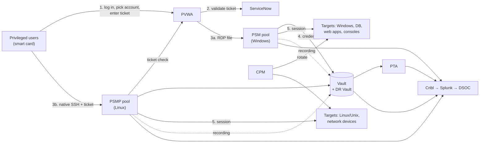

### 1.2 Current state

*To confirm (Q35).*

| Area | Current state |
|---|---|
| CyberArk | Vault, DR Vault, PVWA and CPM in each classification (14.6 alignment is a dependency, A1). PVWA login by smart card (PKIPN; *PVWA Certificate Authentication (PKIPN) Guide*) |
| Privileged access | Mostly direct RDP, SSH, database and web access from user workstations or jump hosts. Privileged credentials are known to, or retrievable by, administrators |
| Sessions | Not isolated, not recorded, not linked to tickets |
| Detection | No PTA; limited correlation of privileged activity in Splunk |
| Break-glass | Accounts exist per platform, but are not consistently vaulted or checked out |
| Known issues | Sub-CA pushed into Trusted Root by a GPO; PVWA binding revocation check found disabled (section 6.10) |

### 1.3 Drivers and outcomes

| Outcome | Measure of success |
|---|---|
| No standing knowledge of privileged passwords | In-scope accounts used through PSM/PSMP only; passwords rotated by CPM; *Retrieve* not granted to end users |
| Every privileged session is authorised by a ticket | 100% of PSM/PSMP sessions carry a valid ServiceNow Incident/Change, or a logged and alerted emergency bypass |
| Every privileged session is recorded and auditable | Recordings retrievable by authorised auditors for the retention period (TBD, Defence) |
| Bypass is prevented and detected | Direct RDP/SSH/DB/admin-web access to in-scope targets blocked from user networks; attempts alerted in Splunk/DSOC |
| Resilient service | No single point of failure in PSM/PSMP pools; node loss does not stop new sessions |
| Supportable for its lifetime | Windows Server 2022, version-aligned pools, documented upgrade path |

### 1.4 Change type: Major technical change

| Criterion | Assessment |
|---|---|
| New infrastructure | Yes: 42 firm VMs (36 PSM/PSMP, 3 PTA, 3 Vault administration), up to 48 with HTML5; 12–15 VIPs |
| Changes how people work | Yes: about 540 privileged users change how they reach Windows, Linux, network, database and web targets |
| Network | Yes: new flows in all three classifications; direct administrative paths removed (enforcement) |
| Identity | Yes: AD OUs, GPOs, service accounts, delegations; break-glass account changes |
| Enterprise integrations | Yes: ServiceNow, Cribl/Splunk/DSOC, monitoring, backup |
| Security / accreditation | Yes: new components and new data (recordings) in OFFICIAL, PROTECTED and SECRET |
| Licensing / procurement | Yes: RDS CALs, CyberArk PSM/PSMP/PTA entitlement, RHEL, client tools, Splunk ingest |
| Operating system lifecycle | Yes: PSM on Windows Server 2022 (uplift from 2019) |

**Classification: Major.** Confirm against the change framework's criteria (Q12).

---

## 2. Scope

### 2.1 Description

#### 2.1.1 What is in scope

Deploy and integrate PSM, PSMP, PTA, the Vault administration VM and (optionally) the HTML5 Gateway in each of
OFFICIAL, PROTECTED and SECRET; integrate ServiceNow ticketing, SIEM and monitoring; onboard all in-scope
accounts; prevent bypass; hand over to operations. Design detail is in section 3.

#### 2.1.2 Server inventory

Per classification (identical in OFFICIAL, PROTECTED and SECRET):

| Pool / server | Role | Nodes | Users | VIP |
|---|---|---|---|---|
| Consumer PSM | PSM (Windows) | 4 | Consuming teams | `psm-<env>` (RDP 3389; 443 if HTML5) |
| Consumer PSMP | PSM for SSH (Linux) | 4 | Consuming teams | `psmp-<env>` (SSH 22) |
| CND PSM | PSM (Windows) | 2 | CND only | `psm-cnd-<env>` |
| CND PSMP | PSM for SSH (Linux) | 2 | CND only | `psmp-cnd-<env>` |
| PTA | Privileged Threat Analytics (mandatory) | 1, no HA (DEC-05) | Security / DSOC | — |
| Vault administration VM | Windows Server 2022; administers Vault and DR Vault | 1 (DEC-07) | CyberArk team | — |
| HTML5 Gateway | Optional (DEC-06) | 2 | Consumers (and CND if required) | `psm-gw-<env>` (443) |

**Totals:** 36 PSM/PSMP + 3 PTA + 3 Vault administration = **42 firm**; **48** with HTML5; plus up to **4**
scale-out PSM nodes held in contingency (section 3.12). CND pools are separate from consumer pools
(VIPs, Safes, RBAC). OFFICIAL has fewer users; its consumer pools could be right-sized to 3 + 3 after the
performance test.

#### 2.1.3 Targets and onboarding in scope

| Target type | Connection | Typical connection components / plugins |
|---|---|---|
| Windows servers | PSM (RDP) | PSM-RDP |
| Linux / Unix servers | PSMP (SSH); PSM-SSH as a fallback | PSMP; PSM-SSH (PuTTY-based) |
| Network devices | PSMP (SSH); PSM for HTTPS management UIs | PSMP; web connectors |
| Databases | PSM, through a client on the PSM server | e.g. SSMS, SQL Developer, Toad, pgAdmin (client list TBC Q21) |
| Web applications / admin consoles | PSM, browser-based | PSM web application connection components (Chromium/Edge + web driver) |
| Virtualisation / out-of-band (vCenter, ESXi, iLO/iDRAC, storage, backup) | PSM web or SSH | Web connectors, SSH |

Onboarding includes: all in-scope accounts (definition and template: Attachment H); platforms
(password policy, CPM change/verify/reconcile, session settings); Safes and RBAC; reconcile accounts;
connection components and plugins; AD changes for CPM and PSM; break-glass accounts for every
in-scope platform under check-out/check-in; and application local credentials rotated natively
wherever a CPM plugin or the application's API supports it. Where an application cannot be rotated
natively, its accounts are still vaulted, used through PSM and recorded, and the gap is recorded as
concession debt with an owner.

### 2.2 Assumptions

| # | Assumption | Status |
|---|---|---|
| A1 | Vault, DR Vault, PVWA and CPM in all three classifications are healthy and on 14.6, or will be before PSM goes live | Q3 (confirm) |
| A2 | PSM, PSMP and PTA are within the current CyberArk licence entitlement, or will be bought | Q14 |
| A3 | No existing PSM to match: sizing is CyberArk-based (section 3.12), confirmed by the Phase 2 performance test | Decided |
| A4 | Privileged users 250 PROTECTED, 200 SECRET, 90 OFFICIAL; peak 2–4 sessions per active user | Answered |
| A5 | PSM servers are domain-joined, in a dedicated OU with the CyberArk PSM hardening GPO | Q6 |
| A6 | PSMP authenticates users against AD (AD Bridge) and uses PVWA MFA caching (SSH key), so SSH access inherits PVWA's smart-card authentication | Q6 |
| A7 | ServiceNow in each classification; PVWA in each classification can reach its instance | Decided; connectivity Q23 |
| A8 | Each classification has its own Cribl workers and Splunk indexes, feeding DSOC | Q11 |
| A9 | Two data centres (sites) per classification; pools split evenly across sites | Q25, Q32 |
| A10 | SECRET has no internet access; media, plugins, Ansible collections and client tools come in through the approved transfer process | Q9 |
| A11 | Session recording retention is TBD (Defence); the design supports any retention period | D13 |
| A12 | Existing jump hosts stay until enforcement (Phase 5), then are retired or restricted | Q26 |
| A13 | CND pools are reached only from CND networks | Q20 |

### 2.3 Risks

Likelihood (L) and impact (I): H high, M medium, L low.

| # | Risk | L | I | Mitigation | Owner |
|---|---|---|---|---|---|
| R1 | Up to 48 VMs across three classifications delayed by procurement or capacity | M | H | Capacity request in Phase 0; build PROTECTED first | DCE / Procurement |
| R2 | Firewall changes across many target networks take longer than planned | H | H | One consolidated firewall matrix per classification; target inventory up front; waves | Network |
| R3 | Capacity: above CyberArk's 60-sessions-per-PSM ceiling, 4 consumer PSM nodes do not cover the top of the PROTECTED/SECRET estimate | M | H | Pilot measurement; scale-out trigger; +2/+2 PSM contingency (section 3.12) | CyberArk / DCE |
| R4 | RDS CAL shortfall, or no RD Licensing server: PSM refuses sessions after the grace period | M | H | Licence model and quantities agreed in Phase 0 (section 5) | Procurement / Identity |
| R5 | ServiceNow outage blocks all privileged access | M | H | Deny by default with controlled emergency path, alerted (section 3.6) | ServiceNow team / Security |
| R6 | Vault storage (and DR Vault replication) exhausted by recordings | M | H | Sizing and replication estimate (section 3.12); monitoring; archive option | CyberArk / DCE |
| R7 | Hardening, AppLocker or EDR blocks PSM components or client tools | M | M | Exclusions and AppLocker rules agreed before build (WP17) | DevSecOps |
| R8 | Windows Server 2022 SOE not ready in time | M | M | Phase 0 gate; fallback to 2019 with concession and dated uplift | Windows Platform |
| R9 | Load balancer health checks pass while PSM is broken (port open, service down) | M | H | Monitoring-driven node drain plus LB checks (section 3.4) | Network / M&C |
| R10 | Privileged access circumvents PSM through known passwords or other paths | H | H | Rotate on onboarding; block direct paths; detection in PTA and Splunk | CyberArk / Network / DSOC |
| R11 | Reduced productivity and adoption challenges with the new access method | M | M | Pilot team, user guides, support sessions, phased enforcement, hypercare (section 6.9) | CyberArk / Service Ops |
| R12 | Application local credentials cannot be rotated natively | M | M | Vault + PSM + recording; concession with owner and date | App owners |
| R13 | Break-glass unusable when CyberArk is down | L | H | Documented offline procedure for CyberArk's own emergency access; tested twice a year | CyberArk / Security |
| R14 | Version drift inside a load-balanced pool after partial upgrades | M | M | Pool-level upgrade procedure (section 6.7) | CyberArk |
| R15 | Accreditation of new components at SECRET delays go-live | M | H | Security engaged from design; artefacts per phase | Security |
| R16 | Splunk ingest cost or licence exceeded by new sources | M | M | Volume estimate from the pilot; Cribl filtering | SIEM |
| R17 | Sub-CA pushed into Trusted Root by GPO affects new servers | H | M | Fix the GPO at source; apply the lessons recorded in the *PVWA Certificate Authentication (PKIPN) Guide* | Identity / PKI |
| R18 | Onboarding volume unknown, so effort cannot be confirmed | H | H | Attachment H returns; unit rates (section 7) | CyberArk / target owners |
| R19 | Rotation breaks hard-coded uses of privileged passwords (Windows services, scheduled tasks, scripts, application configs) | H | H | Dependency discovery before each wave (WP29); CPM-managed usages; rotate only after owners confirm | CyberArk / target owners |
| R20 | PVWA or CPM capacity insufficient for 540 users and full onboarding | M | M | Capacity check in Phase 0 (section 3.12); add PVWA/CPM nodes if needed | CyberArk |

### 2.4 Dependencies

| # | Dependency | Owner | Needed by |
|---|---|---|---|
| D1 | Capacity and VMs (up to 48) to spec | DCE | Phase 1 |
| D2 | Windows Server 2022 SOE and RHEL 9 SOE in all three classifications | Windows / Linux Platform | Phase 0 gate |
| D3 | IP addresses, DNS records, VIPs, health checks | Network | Phase 1 |
| D4 | Firewall rules: component flows (Phase 1), target flows (per wave), bypass blocks (Phase 5) | Network | Phases 1, 4, 5 |
| D5 | AD: OUs, GPOs, service accounts, CPM delegations, RD Licensing | Identity / AD | Phase 1 |
| D6 | Certificates for PSM RDP, HTML5 Gateway, VIP names, PTA, syslog TLS | PKI | Phase 1 |
| D7 | RDS CALs, CyberArk licences, RHEL, client tool licences | Procurement | Phase 1 |
| D8 | ServiceNow instance access, integration user, validation logic | ServiceNow team | Phase 2 |
| D9 | Cribl routes, Splunk indexes and add-on, DSOC use cases | SIEM / DSOC | Phase 2 |
| D10 | Monitoring and alerting | M&C | Phase 2 |
| D11 | Ansible execution environment (offline in SECRET), scanning, EDR/AppLocker | DevSecOps | Phase 1 |
| D12 | Account inventories (Attachment H), test users, account owners per team | Consuming teams, CND | Phase 0 (inventory), Phase 4 |
| D13 | Recording retention period | Defence | Before go-live (design supports TBD) |
| D14 | Security assessment and accreditation | Security | Phases 2 and 3 |
| D15 | Configuration backup of new servers | Backup team | Phase 2 |

### 2.5 Exclusions

- Non-production PSM environments.
- Changes to Vault, PVWA or CPM architecture beyond what PSM, ticketing, onboarding and capacity need
  (14.6 alignment is a dependency, not part of this change).
- RDP sessions started on PSM without PVWA (connection string) (DEC-01).
- Remote access from outside the classification networks.
- Endpoint (user workstation) changes beyond publishing guides and, if needed, the RDP client setting.
- Application changes needed to make credentials rotatable (recorded as concessions, R12).
- Application service accounts, unless a team lists them separately in Attachment H.
- Cross-classification access (each classification is self-contained).

---

## 3. Solution design

### 3.1 Logical architecture

**Figure 2 — Logical architecture (one classification; identical in all three)**

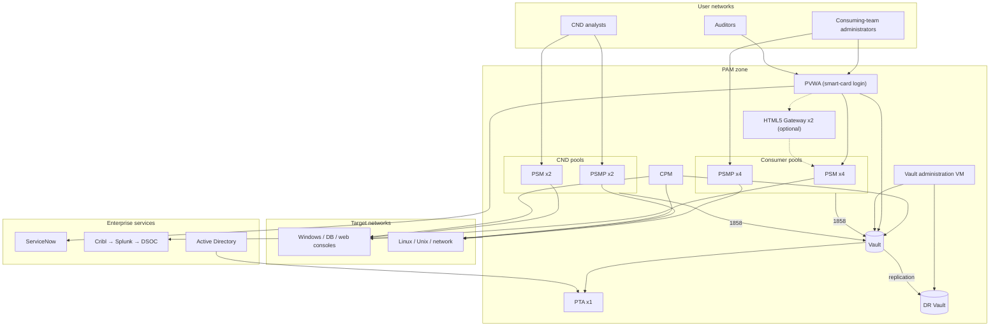

### 3.2 Network zones and flows

**Figure 3 — Zones and main flows**

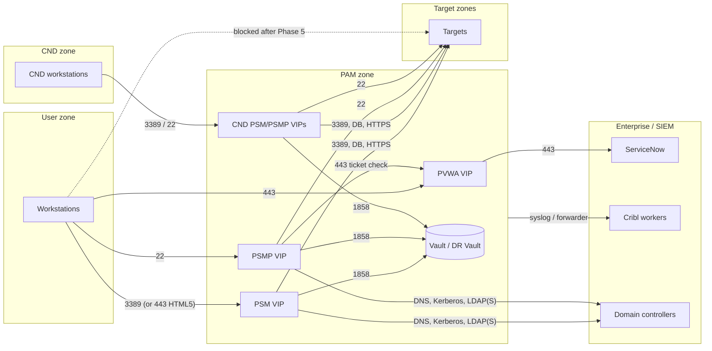

The full flow list is in section 4.6.2; the firewall matrix is Attachment A.

### 3.3 Session flows

**Figure 4 — RDP, database and web sessions through PVWA and PSM**

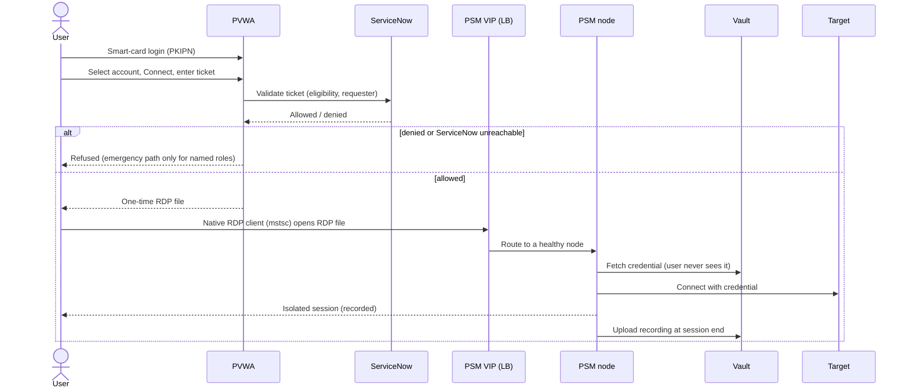

**Figure 5 — SSH sessions through PSMP**

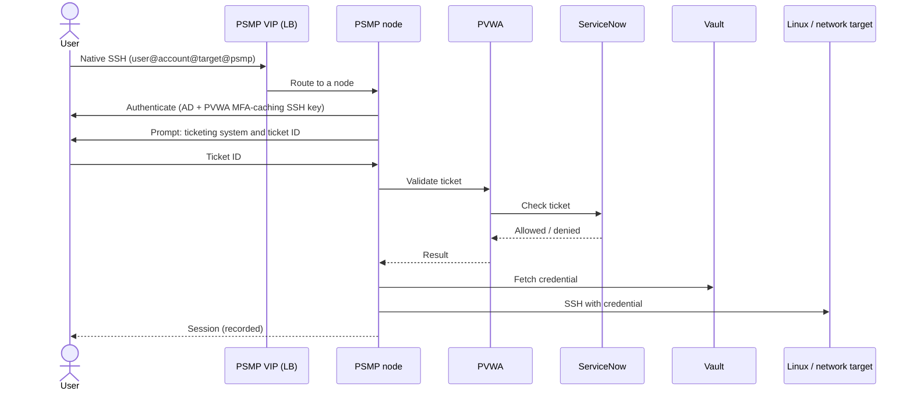

Access methods (DEC-01, DEC-02):

| Method | Ticket checked | In scope |
|---|---|---|
| PVWA *Connect* → RDP file, opened in the user's native RDP client | Yes, at PVWA, before the session | Yes (default) |
| PVWA *Connect* → HTML5 Gateway (browser) | Yes, at PVWA | If the gateway is approved |
| Native SSH through PSMP | Yes: PSMP asks for the ticketing system and ticket ID and passes them to PVWA [CA] | Yes |
| RDP client straight to PSM with a connection string (never visits PVWA) | Not by PVWA | No (disabled) |
| Password *Show/Copy* (*Retrieve*) | — | Break-glass only (section 3.7) |

PSMP ticket details: ticket IDs cannot contain `( ) = ,` [CA]; the ticket can also be given in the PSMP
connection string [CA]. Fallbacks if the Phase 2 test fails are in Attachment J.

### 3.4 High availability, load balancing and sites

**Figure 6 — Pools split across two sites**

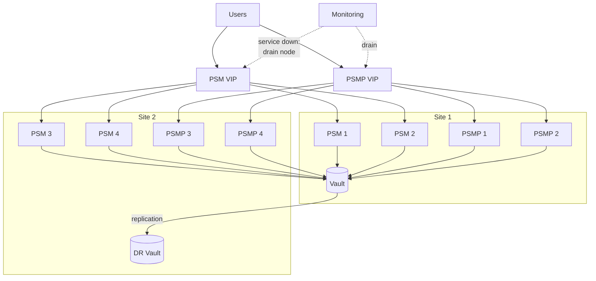

| Design item | Design |
|---|---|
| Pools | Consumer PSM (4), consumer PSMP (4), CND PSM (2), CND PSMP (2), HTML5 GW (2, if approved), per classification |
| CyberArk configuration | External load balancer presents the pool as one address; CyberArk recommends DNS load balancing and SSL pass-through [CA]. Every PSM in the pool runs the same version [CA]. Each PSM keeps its own server ID (`PSMServer`, then `PSM-<computer name>`); platforms reference the PSM server ID [CA] |
| Mode | TCP pass-through for RDP and SSH; no termination on the LB |
| Persistence | Source-IP affinity for RDP (reconnects land on the same node); none needed for SSH |
| Idle timeouts | Longer than the longest allowed session (section 3.14) |
| Health checks | TCP 3389 / 22 plus monitoring-driven drain: if the PSM or PSMP service fails while the port stays open, monitoring disables the node (R9) |
| Live monitoring | Uses the PSMAdminConnect user of the node running the session, so monitoring reaches that node directly, not the VIP [CA] |
| Site distribution | Pools split across both sites; site loss leaves half the capacity |
| Failover behaviour | Sessions on a failed node end; users reconnect to a healthy node; recordings kept up to the failure point (test case) |
| PSMP host keys | All PSMP nodes in a pool present the same SSH host key |
| Certificates | PSM RDP certificate on each node includes the VIP FQDN; HTML5 Gateway certificate on the VIP name |

### 3.5 Platform and versions

#### 3.5.1 Versions and operating systems

| Item | Decision |
|---|---|
| CyberArk version | **14.6** on every node (PSM 14.6.0.28, PSMP 14.6.0.13 [CA]) |
| Windows Server for PSM and Vault administration VM | **Windows Server 2022** (DEC-03). PSM and CPM are **not supported on Windows Server 2025** [CA]; the TLS 1.3 option needs PSM on 2022 [CA]. Microsoft lifecycle (checked 20 Nov 2026): 2019 extended support ends 9 Jan 2029 (inside the service life); 2022 mainstream ended 13 Oct 2026, extended ends **14 Oct 2031**; 2025 extended ends 14 Nov 2034. Revisit 2025 once CyberArk supports it (before 2031) |
| Uplift feasibility | Phase 0 gate (WP06): 2022 SOE in all three classifications, hardening baseline, AppLocker and EDR support, RDS role tested with PSM 14.6. Fallback: 2019 with concession and dated uplift |
| Linux | PSMP: RHEL 8 or 9 (all minor versions), Rocky 8; SLES 15 and Ubuntu 22.04/24.04 also listed (Ubuntu needs PVWA and PTA 14.6) [CA]; dedicated machine [CA]. PTA: minimal English RHEL 8.8+ or 9.3+ [CA]; RHEL 9.0 with SELinux fails to install (9.1+ fine) [CA]. Recommendation: RHEL 9 (current minor) for PSMP, PTA and HTML5 Gateway |
| RDS CAL version | Same or newer than the PSM OS; buy the newest available, because newer CALs also license older servers |

#### 3.5.2 Connection components and client tools

Each connection component needs its client installed on every PSM node of the pool, an AppLocker rule,
and (for web connectors) a pinned browser and WebDriver version on all nodes, updated together in a
change. Commercial clients (e.g. Toad) need licences for PSM use (Q21). Catalogue: Attachment F.

#### 3.5.3 HTML5 Gateway decision (Phase 0)

| Include it if… | Leave it out if… |
|---|---|
| Workstations cannot run the native RDP client from PVWA *Connect* | All users have a supported RDP client and *Connect* works |
| Firewall policy prefers 443 from user networks over 3389 | 3389 from user networks to the PSM VIP is acceptable |
| Clipboard/file controls are needed at the gateway | PSM-side controls are sufficient |

Gateway facts: Linux, Apache Guacamole-based, tiered hardware guidance; browsers need TLS 1.2 [CA].
Decision owner: CyberArk architect and Security, end of Phase 0.

### 3.6 Ticketing (ServiceNow)

**Figure 7 — Ticket decision**

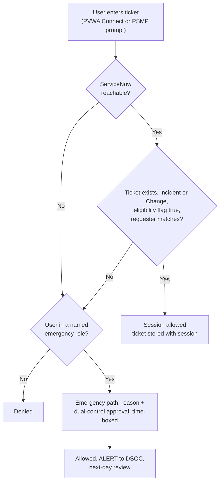

| Item | Design |
|---|---|
| Integration | CyberArk's ServiceNow ticketing integration on PVWA, in each classification (DEC-02). PSMP sessions are validated by PVWA too [CA], so **PSMP needs 443 to PVWA, not to ServiceNow** |
| Validation logic | Lives in ServiceNow (DEC-08): business rules keep a computed "CyberArk access allowed" flag on each Incident and Change, true only when the type and state are allowed (proposal: Incident *In Progress*, Change *Implement*), now is inside the Change window, the ticket is assigned and a CI is set. A scheduled job flips it at window start and end |
| Requester match | Supported by the integration (since 10.6) [CA] |
| Target CI match | Only if the 14.6 integration can send the target (Q33). If not: ServiceNow Scripted REST API + small custom ticketing plugin, or ticket-level checks only |
| Integration account | Dedicated ServiceNow user, read-only on the fields needed (ACLs); credential vaulted and rotated |
| Failure | ServiceNow unreachable, slow, error or invalid ticket: deny by default |
| Emergency path | Named emergency roles only; reason and dual-control approval; time-boxed; always alerted to DSOC; reviewed next business day |
| Audit | Ticket stored with the session and in the Vault audit; ServiceNow logs each validation call; both in Splunk |

Options not chosen (SM9 and others): Attachment J.

### 3.7 Security, RBAC, bypass prevention and break-glass

| Control | Design |
|---|---|
| Authentication | PVWA by smart card (PKIPN; *PVWA Certificate Authentication (PKIPN) Guide*); PSMP via AD + PVWA MFA caching |
| RBAC | Safes per team and per classification; roles: End user (*Use*, *List*; no *Retrieve*), Approver, Safe Manager, Auditor, CyberArk Admin, CND (separate); LDAP group mapping |
| Credential controls | CPM rotation at onboarding (after dependency checks, WP29); periodic change; reconcile on failure; one-time passwords for break-glass |
| Platform controls | *Connect through PSM* enforced; *Require ticket*; recording on; exclusive access and dual control for high-risk and break-glass |
| Hardening | CyberArk PSM/PSMP hardening; SOE baseline; AppLocker; no interactive logons outside sessions |
| Bypass prevention | Network blocks (section 4.6.2); target GPOs and `sshd` restrictions (section 4.6.6); passwords unknown to users; detection in PTA and Splunk |
| Certificates | Section 4.6.7 |

**Figure 8 — Break-glass check-out and check-in**

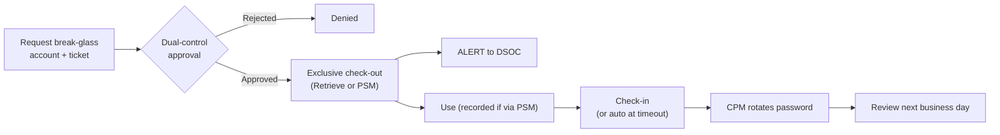

CyberArk's own emergency access (Vault down) is a documented offline procedure, tested twice a year (R13).

### 3.8 Session recording lifecycle

| Stage | Design |
|---|---|
| Storage | Uploaded from PSM/PSMP to recording Safes in the Vault; PSM keeps a temporary copy until upload succeeds |
| Sizing | Vault storage = sessions per day × average hours × size per hour × retention days; measured in the pilot (section 3.12) |
| Replication | Recording Safes replicate to the DR Vault: same storage there, plus replication bandwidth (section 3.12) |
| Retention | Safe-level retention set to the Defence period (TBD, D13) |
| Archive | If retention outgrows Vault storage: periodic export to an approved archive at the same classification, with an index (session, user, target, ticket, date) |
| Retrieval | Dedicated *Auditor* role; every retrieval audited and in Splunk |
| Disposal | Automatic purge at end of retention; disposal recorded per records management; legal hold suspends purge |
| Classification | Recordings are held at the classification of the environment |

### 3.9 Logging and monitoring

**Figure 9 — Logging and monitoring paths**

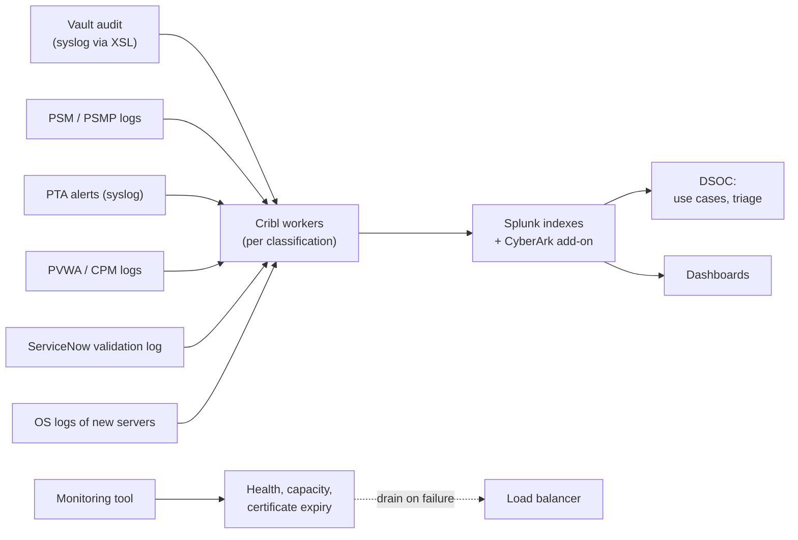

SIEM detail (sources, use cases) is in section 4.6.10; monitoring detail in section 4.6.11.

### 3.10 PTA

| Item | Design |
|---|---|
| Deployment | 1 per classification, no HA (DEC-05); recovery by rebuild from automation plus configuration backup |
| OS | Minimal RHEL 9.3+ (section 3.5.1) |
| Data sources | Vault audit (syslog from the Vault); PSM/PSMP session activity; domain controller security events, via either the PTA Windows agent on DCs or forwarding from the SIEM (decide in Phase 0, Q37) |
| Outputs | Alerts to PVWA and, via syslog, to Cribl/Splunk/DSOC |
| Detections to enable (minimum) | Privileged access bypassing PSM; suspected credential theft; unmanaged privileged accounts; risky commands in sessions; unusual times/volumes (exact names per PTA 14.6, to be validated) |
| Automatic responses | Start in alert-only mode; enable automatic responses (e.g. session suspension, credential rotation) after tuning |

### 3.11 Vault administration VM

| Item | Design |
|---|---|
| Purpose | The only place Vault administration runs: PrivateArk Client, PARClient (remote Vault service control), Vault/DR Vault health and backup tools, installers and scripts. No interactive logons to Vault servers |
| Count | **1 per classification**, administers the Vault and the DR Vault (DEC-07). If unavailable, rebuilt from automation; Vault administration waits |
| Build | Windows Server 2022, hardened SOE, no internet, email or browsing; AppLocker allow-list of admin tools; EDR; monthly patching |
| Access | Named CyberArk administrators only, through PSM (recorded) with a ticket and vaulted credentials. No direct RDP |
| Network | To Vault and DR Vault on 1858 and the PARAgent port (9022, to be validated); to PVWA 443; otherwise only patching and logging |
| Logging | To Cribl/Splunk; DSOC use case "Vault administration session" |
| Acceptance | Vault administration works only from this VM; direct logon to Vault servers blocked and alerted |

### 3.12 Capacity

**PSM and PSMP.** CyberArk's floor for PSM is 8 cores, 8 GB RAM, 80 GB system + 80 GB temporary
workspace; sizing tiers 1–5, 6–30 and 31–60 sessions; **no more than 60 concurrent sessions per PSM**
[CA]. PSMP floor: quad-core, 8 GB, 10 GB + 40 GB temporary workspace, dedicated machine [CA].

| Input | PROTECTED | SECRET | OFFICIAL |
|---|---|---|---|
| Privileged users | 250 | 200 | 90 |
| Active at peak (*Assumed* 30–40%) | 75–100 | 60–80 | 27–36 |
| Sessions per active user | 2–4 | 2–4 | 2–4 |
| Peak concurrent sessions | 150–400 | 120–320 | 54–144 |
| PSM share (*Assumed* 60%) | 90–240 | 72–192 | 32–86 |
| PSMP share (40%) | 60–160 | 48–128 | 22–58 |
| **Consumer PSM per node, N-1 (3 serving)** | **30–80** | **24–64** | **11–29** |
| Consumer PSMP per node, N-1 | 20–55 | 16–43 | 7–20 |

With one node down, 3 consumer PSM nodes carry at most **180** sessions (3 × 60). The top of the
PROTECTED (240) and SECRET (192) estimates exceeds that. With a 70% design margin (≈ 42 per node),
PROTECTED could need **6–7** consumer PSM nodes and SECRET **5–6** at the top of the range; OFFICIAL fits
in 3–4. **Decision (DEC-09):** build 4 per classification, measure in the pilot, and hold **+2 PSM in
PROTECTED and +2 in SECRET** in contingency. Scale-out trigger: 70% of 60 sessions per node at peak.

**PVWA.** All 540 users log in, launch sessions and validate tickets through PVWA, and PSMP ticket checks
also go through PVWA. Check the existing PVWA node count and load per classification in Phase 0 (Q36);
add a PVWA node behind the existing PVWA load balancer if peak load needs it (R20).

**CPM.** Onboarding all in-scope accounts multiplies CPM verify/change/reconcile jobs. Size from the
Attachment H totals against CyberArk's CPM sizing guidance (to be validated); plan an extra CPM, or split
by platform, if needed (R20).

**Vault and DR Vault storage and replication.** Recordings are the dominant new data. First estimate,
to replace with pilot measurements:

| Input (*Assumed*) | Value |
|---|---|
| Sessions per day (all classifications) | 1,000–2,000 |
| Average session length | 1 hour |
| Size per hour | RDP/web video 50–150 MB; SSH text < 5 MB (measure in pilot) |
| Retention | TBD (example: 1 year) |
| Storage per year (example) | approximately **15–80 TB** across the three classifications, doubled for the DR Vault copy |

The same volume replicates to the DR Vault, so check replication bandwidth between sites. These
figures are placeholders to show scale; the pilot measurement replaces them, and the archive option
(section 3.8) caps Vault growth.

**Build specification**

| Role | vCPU | RAM | Disks | NICs | Notes |
|---|---|---|---|---|---|
| PSM (Windows) | 8 (floor) – 16 | 16–32 GB | 80+ GB OS; 80+ GB temporary recordings (fast storage) | 1 | RAM is usually the limit |
| PSMP (Linux) | 4 (floor) – 8 | 8 (floor) – 16 GB | 10 GB + 40 GB floor [CA]; 80 GB proposed | 1 | Dedicated machine [CA] |
| PTA (Linux) | per CyberArk recommended specifications (figures to be validated) | | | 1 | Sized by event volume |
| HTML5 Gateway (Linux) | per CyberArk tiered guidance (figures to be validated) | | | 1 | Only if approved |
| Vault administration VM (Windows) | 4 | 8–16 GB | 100 GB | 1 | Admin tools only |

### 3.13 Disaster recovery and resilience

| Component | Failure | Behaviour / recovery | Proposed target |
|---|---|---|---|
| PSM / PSMP node | Node down | Pool continues on remaining nodes; sessions on that node reconnect elsewhere | No service loss for new sessions |
| PSM / PSMP site | Site down | Half the pool remains | Reduced capacity until site returns |
| Vault | Failover to DR Vault | PSM, PSMP, PTA and the Vault administration VM list both Vault addresses in their Vault configuration and reconnect to the DR Vault (to be validated); recordings resume uploading | Follows the existing Vault DR RTO/RPO |
| PTA | Server down | No analytics until rebuilt; Vault and sessions unaffected | RTO 2 business days (*proposed*) |
| Vault administration VM | Server down | Rebuild from automation; Vault administration waits | RTO 1 business day (*proposed*) |
| ServiceNow | Unavailable | Deny by default; emergency path (section 3.6) | Per ServiceNow's own targets |
| Recording upload | Fails | Kept on PSM temporary disk and retried; alert | No recording loss within PSM disk capacity |

### 3.14 Session policy

*Proposed defaults, to agree with Security in Phase 0.*

| Setting | Proposed |
|---|---|
| Maximum session length | 12 hours |
| Idle disconnect | 60 minutes |
| Clipboard | Disabled by default; text-only to the target for approved platforms |
| Drive, printer and USB redirection | Disabled |
| File transfer | Only through an approved, logged method per platform |
| RDP to targets | NLA and TLS required |
| Concurrent sessions per user | Up to 4 (A4) |
| Recording | Video for PSM; keystrokes/commands for SSH and supported clients |

### 3.15 Decision log

| # | Date | Decision |
|---|---|---|
| DEC-01 | 2026-11-20 | **N1:** PVWA *Connect* launches the native RDP client after the ticket check; direct connection-string RDP to PSM disabled |
| DEC-02 | 2026-11-20 | ServiceNow in each classification (I1); PSMP users enter the ticket at PSMP, validated by PVWA |
| DEC-03 | 2026-11-20 | **Windows Server 2022** for PSM (2025 unsupported by PSM [CA]) |
| DEC-04 | 2026-11-20 | OFFICIAL in scope, same pattern as PROTECTED and SECRET; CND pools in all three |
| DEC-05 | 2026-11-20 | PTA mandatory, one per classification, no HA |
| DEC-06 | 2026-11-20 | **HTML5 Gateway optional**, decided in Phase 0 |
| DEC-07 | 2026-11-20 | One Vault administration VM per classification, administers Vault and DR Vault |
| DEC-08 | 2026-11-20 | Ticket validation logic in ServiceNow (eligibility flag) |
| DEC-09 | 2026-11-20 | CyberArk-based sizing; 4 consumer PSM per classification with +2/+2 contingency |
| DEC-10 | 2026-11-20 | Check-out/check-in for all break-glass accounts; native rotation of application local credentials where possible |
| DEC-11 | 2026-11-20 | Ansible automation for build and configuration where supported |
| DEC-12 | 2026-11-20 | Recording retention TBD pending Defence; design supports any period |

---

## 4. Requirements

### 4.1 Key deliverables

| # | Deliverable | Acceptance |
|---|---|---|
| KD1 | 36 PSM/PSMP servers built from automation, hardened, registered to the Vault, version-aligned | Build evidence; hardening scan; pool version check |
| KD2 | Load-balanced pools (12 VIPs, 15 with HTML5) with health checks and site distribution | Failover tests passed (section 6.4) |
| KD3 | PTA (mandatory) deployed and integrated | Detections fire in test; alerts in Splunk |
| KD4 | HTML5 Gateway decision, and build if approved | Decision record; tests passed |
| KD5 | ServiceNow ticketing with validation logic, failure mode and emergency path | Ticketing test cases passed |
| KD6 | CyberArk → Cribl → Splunk → DSOC integration | Each use case fires in test |
| KD7 | Monitoring and alerting for all new components | Alerts tested |
| KD8 | Platforms, Safes, RBAC, CPM/reconcile policies, connection components for all in-scope target types | Test matrix passed |
| KD9 | All in-scope accounts onboarded, including break-glass and native application credentials | Onboarding reports; rotation success rate |
| KD10 | Bypass prevention in force | Bypass test cases fail as intended; detections fire |
| KD11 | Recording lifecycle process | Process tested; records sign-off |
| KD12 | Test evidence: functional, security, HA/failover, ticketing, logging, performance, DR, UAT | Test report signed off |
| KD13 | Service transition: runbooks, KB, support model, training, hypercare | Service acceptance |
| KD14 | Lifecycle and upgrade procedure for pools and components | Procedure reviewed; dry run |
| KD15 | Vault administration VM in each classification | Section 3.11 acceptance |

### 4.2 Other artifacts

- HLD update and LLD per classification (sections 3.1–3.14 are the basis).
- Network flow and firewall matrix (component, target, bypass-block flows) per classification.
- Server inventory and sizing record; capacity model (section 3.12).
- Build and hardening guides; Ansible playbooks and inventories; as-built records.
- Safe and RBAC design; platform catalogue; connection component catalogue; onboarding runbook.
- ServiceNow integration specification; SIEM integration specification and use case catalogue.
- Test strategy, plans and report.
- User guides (PVWA *Connect*, PSMP SSH syntax, ticket entry, break-glass), FAQ, training material.
- Runbooks: operations, patching, upgrade, failover, recording retrieval/disposal, break-glass, incident.
- Security documentation updates; risk register; concession register.

### 4.3 Baseline documentation

TBC (Q15). Expected: CyberArk HLD/LLD; system security documentation for each classification; network
diagrams; SOE build standards; ServiceNow integration standards; SIEM onboarding standard;
the *PVWA Certificate Authentication (PKIPN) Guide*.

### 4.4 Specification impact

| Specification | Impact |
|---|---|
| CyberArk HLD/LLD | New tiers (PSM, PSMP, HTML5, PTA, Vault administration VM); ticketing; SIEM; load balancing; recordings |
| SOE / build standards | PSM role (Windows 2022 + RDSH + PSM hardening + AppLocker); PSMP, PTA, HTML5 roles (RHEL 9) |
| Network architecture | New flows and VIPs; enforcement removes direct administrative access |
| Identity standards | PSM OU and GPOs; service accounts; delegations; break-glass account standard |
| Access policy | Privileged access to in-scope systems only through PSM/PSMP with a ticket |
| ITSM process | Ticket requirements for privileged access; emergency path |
| Logging and monitoring standard | New sources and use cases |
| Records management | Recordings as records: retention, disposal, legal hold |

### 4.5 Functional and non-functional requirements

| # | Requirement |
|---|---|
| FR1 | Users shall start Windows/RDP, database, web and other client-based sessions from PVWA *Connect* through the consumer PSM pool |
| FR2 | Users shall start SSH sessions with their native SSH client through the PSMP pool, authenticated through Active Directory and PVWA MFA caching |
| FR3 | Every session shall require a valid ServiceNow ticket (section 3.6) |
| FR4 | Every session shall be recorded and the recording retained for the approved period (section 3.8) |
| FR5 | Authorised operators shall be able to monitor and terminate live sessions |
| FR6 | Break-glass accounts shall use exclusive check-out and check-in, rotation on check-in, dual control and a ticket (Figure 8) |
| FR7 | CPM shall verify, change and reconcile onboarded credentials on a policy schedule |
| FR8 | PTA shall analyse Vault, PSM/PSMP and Active Directory activity and raise alerts to Splunk/DSOC and PVWA |
| FR9 | CND shall use dedicated pools, Safes and roles, isolated from consuming teams |
| FR10 | The session policy in section 3.14 shall be applied to all sessions |
| NFR1 | Availability: each pool shall have no single point of failure; the loss of one node shall not prevent new sessions; the loss of one site shall leave at least half of each pool available |
| NFR2 | Capacity: peak concurrency shall be served with one node out of service (N-1), at no more than 60 sessions per PSM server |
| NFR3 | Performance: a session shall launch within 15 seconds of PVWA *Connect* (target to be agreed in Phase 0) |
| NFR4 | Security: servers shall be hardened to CyberArk guidance and the SOE baseline; no direct logon to PSM/PSMP servers shall be possible outside sessions |
| NFR5 | Logging: security events shall reach Splunk within 5 minutes (target to be agreed with DSOC) |
| NFR6 | Lifecycle: all nodes in a pool shall run the same CyberArk version, on an operating system supported for the service life |
| NFR7 | Recovery: components shall meet the RTO and RPO in section 3.13 |

### 4.6 Requirements by workstream: workstream commitments

| Team | Deliverables | Main inputs from the CyberArk team | Effort (indicative) | When |
|---|---|---|---|---|
| Data Centre Engineering | Up to 48 VMs (three classifications), placement across sites, storage, backup policy; Vault/DR Vault storage expansion | Sizing sheet, placement rules | 30–50 d | Phase 1 |
| Network (firewall, DNS, LB) | IPs, DNS, 12–15 VIPs with health checks, component flows, target flows per wave, bypass blocks | Flow matrix per phase | 65–105 d | Phases 1, 4, 5 |
| Windows Platform | Windows Server 2022 SOE for PSM and Vault administration VM, RDSH role baseline | PSM OS requirements | 14–28 d | Phases 0–1 |
| Linux Platform | RHEL 9 SOE for PSMP, PTA, HTML5 Gateway | Component OS requirements | 7–14 d | Phases 0–1 |
| Identity / AD | OUs, GPOs, service accounts, CPM delegations, RD Licensing, break-glass accounts, target GPOs for bypass prevention | AD change list | 28–50 d | Phases 1, 4, 5 |
| PKI | Certificates for PSM, VIPs, HTML5, PTA, syslog TLS; GPO sub-CA fix | Certificate list | 7–12 d | Phase 1 |
| Procurement / licensing | RDS CALs, CyberArk entitlement, RHEL, client tool licences, capacity | Quantities (section 5) | 6–12 d | Phases 0–1 |
| ServiceNow team | Integration user and ACLs, API access, validation logic (section 3.6), test tickets, emergency process, three instances | Integration spec | 25–40 d | Phase 2 |
| SIEM (Cribl, Splunk) | Cribl routes, Splunk indexes/sourcetypes/add-on, dashboards | Source list, samples | 28–50 d | Phase 2 |
| DSOC | Use cases, triage runbooks, PTA alert handling | Use case catalogue | 14–28 d | Phases 2–3 |
| Monitoring & Control | Health checks, alerts, capacity dashboards, LB drain integration | Monitoring spec | 11–21 d | Phase 2 |
| DevSecOps | Ansible environment (offline in SECRET), pipelines, scanning, EDR/AppLocker policy | Playbooks, exclusions | 20–35 d | Phases 1–2 |
| Security & Accreditation | Assessment, documentation, session policy approval, pen test, concession approvals | Design, test evidence | 28–50 d | Phases 0–3 |
| Backup | Configuration backup for new servers | Backup scope | 3–6 d | Phase 2 |
| Service Operations / Service Desk | Support model, KB articles, incident categories, training | Runbooks, guides | 14–21 d | Phases 5–6 |
| Records management | Recording retention/disposal/legal hold procedure | Recording design | 3–5 d | Phase 2 |
| Consuming teams (more than 5; *Assumed* 6–10) | Attachment H inventory, dependency checks before rotation, account owners, UAT | Templates, onboarding waves | 3–8 d per team; 18–80 d in total | Phases 0, 4 |
| CND | Attachment H inventory for CND pools, UAT | Same as consumers | 3–5 d | Phases 0, 4 |
| CyberArk team | Design, build, configuration, testing, handover, and support to other teams' work packages (onboarding WP23 on top) | — | 280–460 d (+ WP23) | All |

#### 4.6.1 Data Centre Engineering

- VMs per classification: 4 + 2 PSM (Windows), 4 + 2 PSMP (Linux), 1 PTA (Linux), 1 Vault administration VM
  (Windows), 2 HTML5 Gateway (Linux) if approved: **up to 16 per classification, 48 in total**, plus up
  to 4 contingency PSM nodes. Specification: section 3.12.
- Placement: split each pool across the two sites; anti-affinity within a site.
- Vault and DR Vault storage expansion for recordings (section 3.12).
- **Acceptance:** VMs delivered to spec; placement evidence; backups configured.

#### 4.6.2 Network: firewall and DNS

- IP addresses and DNS records for every node and VIP.
- **Component flows** (Phase 1):

| From | To | Port | Purpose |
|---|---|---|---|
| User networks | PVWA VIP | 443 | Portal, PVWA *Connect* |
| User networks | PSM VIP | 3389 (or 443 if HTML5) | Session to PSM, launched by PVWA |
| User networks | PSMP VIP | 22 | Native SSH through PSMP |
| CND networks | CND PSM / PSMP VIPs | 3389 / 22 | CND sessions |
| PSM, PSMP, PTA, HTML5 GW, Vault administration VM | Vault, DR Vault | 1858 | Vault protocol |
| Vault administration VM | Vault, DR Vault | 9022 (to be validated) | PARAgent remote administration |
| PVWA | ServiceNow | 443 | Ticket validation |
| PSMP | PVWA | 443 | Ticket validation for SSH sessions [CA] |
| PSM, PSMP | Domain controllers | DNS, Kerberos, LDAP(S), SMB as required | Domain membership, AD Bridge |
| PSM, PSMP, Vault, PTA | Cribl workers | syslog (TLS preferred) / forwarder | Logging |
| Domain controllers / SIEM | PTA | per PTA design (Q37) | Events for analytics |
| Monitoring | All new nodes | per tool | Health |
| CyberArk team (via PSM) | PSM/PSMP/PTA management | RDP/SSH management ports | Server administration |

- **Target flows** (Phase 4, per wave): from the pools to each target network: 3389, 22, database ports,
  HTTPS admin ports.
- **Bypass blocks** (Phase 5): deny direct administrative access from user networks and jump hosts to
  onboarded targets, allowing only PSM/PSMP pools, CPM and approved management systems.
- **Acceptance:** flow tests per phase; bypass tests fail as intended.

#### 4.6.3 Network: load balancing

Implement section 3.4: VIPs, TCP pass-through, RDP source-IP persistence, idle timeouts, health checks
plus monitoring-driven drain, site distribution. **Acceptance:** failover, drain and site-loss tests
passed.

#### 4.6.4 Windows Platform

- Windows Server 2022 hardened SOE for PSM and the Vault administration VM in all three classifications.
- Allow the RD Session Host role and PSM hardening (CyberArk hardening, AppLocker); document deviations.
- **Acceptance:** SOE passes PSM 14.6 installation and hardening in Phase 1.

#### 4.6.5 Linux Platform

- RHEL 9 SOE for PSMP, PTA and HTML5 Gateway (PTA needs a minimal install, 9.3+).
- Allow PSMP's changes to `sshd` (PSMP takes port 22; server administration on a separate port or path)
  and AD Bridge packages.
- **Acceptance:** PSMP, PTA (and HTML5) install cleanly on the SOE.

#### 4.6.6 Identity / Active Directory

- OU for PSM servers per classification; link the CyberArk PSM hardening GPO; filter conflicting domain
  GPOs (document each).
- PSM connection users (PSMConnect, PSMAdminConnect): domain accounts recommended for load-balanced pools
  (to be validated), rotated by CPM.
- RD Licensing: licence server per classification, Per User mode, GPO pointing PSM to it.
- Service accounts: LDAP bind, CPM reconcile accounts, PTA AD access as required.
- CPM delegations: *Reset password* (and unlock if needed) on OUs holding onboarded domain accounts.
- Break-glass: review existing emergency domain accounts; adjust to standard; onboard with check-out.
- Bypass prevention on targets (Phase 5): GPOs restricting *Allow log on through Remote Desktop
  Services* and Windows Firewall RDP scope to PSM pools, CPM and approved management systems.
- Fix at source the GPO that places an internal sub-CA in Trusted Root (R17).
- **Acceptance:** AD change list implemented and tested per phase.

#### 4.6.7 PKI

- Certificates (internal CA): PSM RDP (node + VIP names), HTML5 Gateway, PTA, syslog TLS to Cribl.
- Expiry monitoring and renewal procedure.
- **Acceptance:** chains validate on clients; no non-root certificates in Trusted Root on new servers.

#### 4.6.8 Procurement and licensing

Quantities in section 5. Orders raised in Phases 0–1 so licences are installed before go-live.

#### 4.6.9 ServiceNow team

Implement section 3.6 in each classification's instance: integration user and ACLs; eligibility flag
(business rules, script includes, scheduled job); optional Scripted REST API if target CI matching is
needed; test tickets for every case in section 6.4; emergency process. **Acceptance:** every ticketing
test case passes.

#### 4.6.10 SIEM: Cribl, Splunk and DSOC

| Item | Requirement |
|---|---|
| Sources | Vault audit via syslog (`dbparm.ini` syslog settings with an XSL translator for the Splunk/CEF format); PSM and PSMP logs; PTA alerts (syslog); PVWA and CPM logs; ServiceNow validation logs; OS logs of new servers |
| Transport | CyberArk → Cribl (per classification) → Splunk → DSOC; TLS where supported |
| Cribl | Routes and pipelines per source; parsing; filtering to control volume (R16) |
| Splunk | Indexes, sourcetypes, CyberArk add-on (SECRET copy transferred offline), field extractions |
| Dashboards | Sessions; ticket compliance; break-glass; CPM success/failure; PSM/PSMP health and capacity; PTA alerts; bypass detections |
| **Use cases (minimum)** | Emergency path used; break-glass check-out; *Retrieve* outside break-glass; direct RDP/SSH/DB logon to an onboarded target from a non-PSM source (Windows 4624 logon type 10 / Linux sshd source IP); PTA high-risk alerts; repeated failed PSM/PSMP authentication; CPM failures; recording upload failures; PSM/PSMP service down; after-hours sessions; dormant account use; Safe permission changes; Vault administration session |
| DSOC | Triage runbook per use case; PTA alert handling; escalation to the CyberArk team |
| **Acceptance** | Each use case fires in test and is triaged by DSOC |

#### 4.6.11 Monitoring and control

- Health: PSM and RDS services; PSMP (`psmpsrv`, `sshd`, AD Bridge); PTA; HTML5 GW; Vault administration VM.
- Capacity: concurrent sessions per node (alert at 70% of 60); CPU/RAM; PSM temporary recording disk;
  Vault and DR Vault disk.
- LB integration: node drain on service failure (section 3.4).
- Certificate expiry alerts.
- **Acceptance:** alerts tested; dashboards in place.

#### 4.6.12 DevSecOps and automation

- Ansible for PSM and PSMP build and configuration where supported (CyberArk's published automation,
  e.g. the `cyberark.pas` collection and deployment playbooks; compatibility to be validated), plus local
  roles for OS prerequisites, hardening checks and configuration.
- SECRET: offline Ansible execution environment and mirrored collections (A10).
- Bulk onboarding through the CyberArk REST API from validated Attachment H inventories.
- AV/EDR exclusions and AppLocker policy for PSM and each client tool; vulnerability scanning; patching
  that keeps PSM hardening intact.
- **Acceptance:** any node can be rebuilt from automation; scans clean or exceptions approved.

#### 4.6.13 Security and Accreditation

- Security assessment and documentation for all new components in each classification.
- Approve the session policy (section 3.14), emergency path (section 3.6) and break-glass process.
- Commission the penetration test; approve concessions.

#### 4.6.14 Consuming teams and CND

- Fill in Attachment H: targets, accounts, owners, break-glass, native rotation, client tools.
- Before each wave, confirm where privileged passwords are hard-coded (services, scheduled tasks,
  scripts, application configs) so that they are handled before rotation (WP29, R19).
- Nominate account owners and UAT testers; join the onboarding wave.

#### 4.6.15 Service Operations, Service Desk and Records management

- Support model (L1 Service Desk → L2 operations → L3 CyberArk team), incident categories, KB articles,
  training, hypercare (4–6 weeks per wave).
- Records management approves the recording retention, disposal and legal hold procedure.

---

## 5. Costs

| Item | Detail | Quantity | Amount |
|---|---|---|---|
| Funding source | TBC (Q14) | — | TBC |
| Infrastructure | VMs (compute, storage, backup) at chargeback rates | 42 firm, up to 48 | TBC |
| Vault and DR Vault storage | Recordings, both copies (section 3.12) | per pilot measurement | TBC |
| RDS CALs | Per User, same or newer version than the PSM OS, on each classification's RD Licensing server; isolated licence servers cannot share a pack (confirm with Microsoft licensing): PROTECTED 250 + 10% ≈ 275; SECRET 200 + 10% = 220; OFFICIAL 90 + 10% = 99; plus CND users (Q20) | **≈ 594** (+ CND) | TBC |
| Windows Server CALs | Users of PSM also need Windows Server CALs (often in an enterprise agreement) | as above | TBC |
| Windows Server licences | 18 PSM + 3 Vault administration VMs (core-based) | 21 | TBC |
| RHEL subscriptions | PSMP (18), PTA (3), HTML5 GW (6 if approved) | 21–27 | TBC |
| CyberArk licences | PSM, PSMP, PTA entitlement per licence model | TBC (Q14) | TBC |
| Client tool licences on PSM | Commercial database and management clients | per tool (Q21) | TBC |
| Load balancer capacity | VIPs / licences / throughput | 12–15 VIPs | TBC |
| Splunk ingest | Additional GB/day from new sources (pilot estimate) | TBC | TBC |
| Cribl capacity | Worker capacity, if needed | TBC | TBC |
| Ansible platform | Subscription or execution environment, if not already available | TBC | TBC |
| PVWA / CPM capacity | Additional nodes, if section 3.12 shows a need | 0–3 per classification | TBC |
| Third-party support | CyberArk Professional Services or partner, if engaged (Q14) | TBC | TBC |
| Penetration test | Independent test of new components | 3 environments | TBC |
| GFX | Meaning to confirm (Q13) | — | TBC |
| Contingency | Up to 4 extra PSM nodes (+2 PROTECTED, +2 SECRET: VMs and Windows licences) for R3; 15% for onboarding volume (R18) | — | TBC |

**Main cost drivers:** RDS CALs and Windows licences (scale with users and PSM nodes); Vault storage for
recordings (scales with retention); Splunk ingest; firewall and onboarding labour (sections 6 and 7).

---

## 6. Impact assessment

### 6.1 Summary

| Area | Rating | Main reason |
|---|---|---|
| Design | High | New tiers in three classifications; decisions in section 3.15 |
| Drafting | Medium–High | About 20 artefacts, several per classification |
| Testing | High | Every connection component × target type × classification; ticketing; HA; security |
| Deployment | High | Up to 48 VMs, SECRET media transfer, onboarding waves, enforcement |
| Production | High | 540 users change access method; rotation side effects |
| Service operations | Medium–High | Up to 48 servers to run; ongoing onboarding and upgrades (BAU effort, 6.7) |
| Defects / concessions / document debt | Medium | Sections 6.10–6.12 |

### 6.2 Design

High. Decisions closed (section 3.15). Still to close in Phase 0: HTML5 Gateway; PTA data-source path
(Q37); session policy (section 3.14); recording archive; PVWA/CPM capacity (Q36); Safe/RBAC model;
enforcement approach per team. Each closes with a decision record added to section 3.15.

### 6.3 Drafting

Medium–High. About 20 artefacts (section 4.2). Heaviest: LLD, firewall matrix, platform and
connection-component catalogues, SIEM use case catalogue.

### 6.4 Testing

High.

| Type | Coverage |
|---|---|
| Functional | Every connection component × target type × classification: RDP, SSH (PSMP and PSM-SSH), network devices, each database client, each web connector, virtualisation and out-of-band consoles |
| Ticketing | Valid Incident; valid Change in window; Change outside window; wrong state; closed; nonexistent; wrong requester; wrong CI (if enforced); ServiceNow unavailable; timeout; emergency path (allowed, alerted); emergency by a non-emergency role (denied); PSMP ticket entry |
| Security | Bypass attempts (direct RDP/SSH/DB/web, jump hosts); *Retrieve* denied; direct RDP to PSM denied; hardening scan; AppLocker breakout from client tools; RBAC per role; CND isolation; session policy; penetration test |
| HA / failover | Node loss; service down with port open (drain); site loss; LB failover; Vault → DR Vault failover with sessions; recording continuity |
| Performance | Ramp to peak with N-1 nodes; ≤ 60 sessions per PSM; launch time; PSM temp disk and Vault upload throughput; PVWA load |
| Logging / SIEM | Each use case fires and is triaged; data in Splunk within NFR5; PTA detections |
| Break-glass | Figure 8 end to end; Vault-down emergency procedure |
| CPM / onboarding | Verify, change, reconcile per platform; native application rotation; dependency checks before rotation |
| Recordings | Playback; retrieval audit; retention purge; legal hold |
| DR | Rebuild from automation; restore configuration; RTO targets (section 3.13) |
| UAT | Each consuming team and CND on real targets |

### 6.5 Deployment

#### 6.5.1 Standard plan (12 months)

High.

**Figure 10 — Indicative schedule (start date illustrative)**

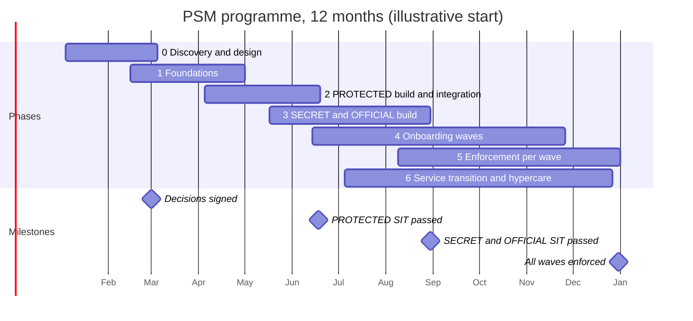

| Phase | Content | Exit criteria | Rollback / back-out |
|---|---|---|---|
| 0. Discovery and design | Inventory, decisions, LLD, procurement, security engagement | Decisions signed; orders raised | n/a |
| 1. Foundations | VMs, SOE, component flows, VIPs, AD, PKI, Ansible environment | Infrastructure accepted | Remove new objects; no user impact |
| 2. PROTECTED build and integration | PSM/PSMP/PTA/(HTML5)/Vault administration VM; ServiceNow; SIEM; monitoring; performance and HA tests | SIT passed in PROTECTED | Disable new components; users keep current access |
| 3. SECRET and OFFICIAL build | As Phase 2; SECRET with media transfer and offline automation | SIT passed in SECRET and OFFICIAL | As Phase 2 |
| 4. Onboarding waves | Pilot team, then waves: platforms, Safes, accounts, break-glass, application credentials, target flows, UAT | Wave UAT passed; rotation success above threshold | Pause wave; restore known passwords from the Vault to owners under dual control; keep direct access |
| 5. Enforcement | Bypass blocks and target GPOs per wave; jump host restriction | Bypass tests fail as intended; detections live | Re-open the specific direct path by emergency change, time-boxed and alerted |
| 6. Service transition | Runbooks, support model, training, hypercare | Service acceptance | Extend hypercare |

#### 6.5.2 Accelerated delivery option (7–9 months)

Most of the 12-month duration is driven by lead times in other workstreams (VMs, firewall changes, SECRET media
transfer, accreditation, ServiceNow), not CyberArk effort. The accelerated option runs those in
parallel, limits the first release to the capabilities needed for the outcome, and brings a pilot into operation early.

| Lever | What changes | Saving |
|---|---|---|
| **L1. Pilot first** | One classification (PROTECTED), one consuming team, RDP + SSH, ServiceNow ticketing, recordings, Splunk basics. Runs on 2 PSM + 2 PSMP of the consumer pool | Operational use after approximately **3 months**; proves capacity, ticket path and user guides before scale |
| **L2. Build all three classifications in parallel** | One set of Ansible playbooks; DCE, Network and Identity work all three at once; SECRET media transfer started in Phase 0 | About **2 months** off the build |
| **L3. Standard platforms and connection components** | CyberArk's standard (out-of-the-box) platforms and connectors first; custom ones only where a target needs it | WP21 and WP22 effort reduced by approximately half |
| **L4. Discovery-driven onboarding** | CyberArk account discovery and automatic onboarding rules for Windows local admin and Linux root; bulk REST onboarding for the rest | WP23 largely automated; the largest variable saving |
| **L5. Defer non-essentials** | HTML5 Gateway, PTA automatic responses (alerting stays from day one), niche database and web connectors move to a later wave | Shorter critical path |
| **L6. Fast Phase 0** | Open questions answered and decisions signed in 4–6 weeks | About **1 month** |
| **L7. Extra capacity** | CyberArk Professional Services or a partner for builds and onboarding | Removes the CyberArk team as a bottleneck (cost item) |

**Figure 11 — Accelerated schedule (start date illustrative)**

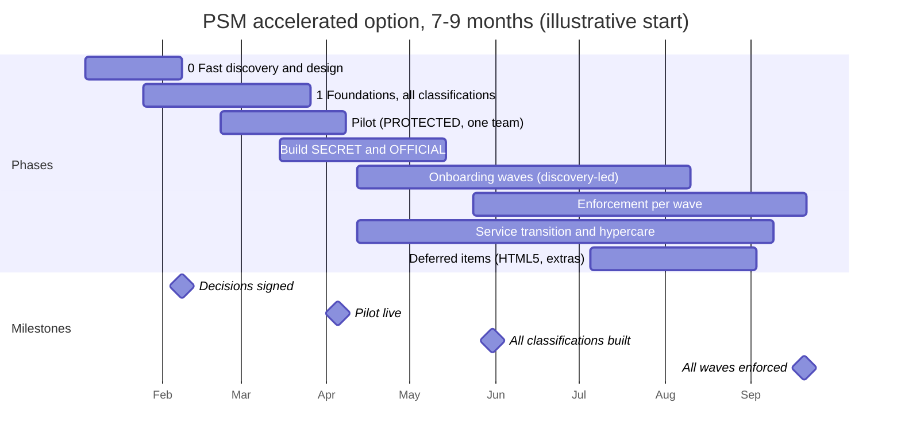

**Workstream changes under the accelerated option**

| Team | Change from the standard plan |
|---|---|
| CyberArk team | Pilot in month 2–3; playbooks reused across classifications; discovery and auto-onboarding; standard platforms first. Peak load needs 3–4 engineers, or a partner (L7) |
| Data Centre Engineering | All VMs requested in Phase 0 and delivered together (up to 48), pilot VMs first |
| Network | One firewall request covering component flows for all three classifications in Phase 1; target flows batched per wave with standard rules |
| Identity / AD | AD change list for all three classifications in one change; enforcement GPOs prepared in advance |
| Windows / Linux Platform | 2022 and RHEL 9 SOE confirmed in Phase 0 (no schedule contingency) |
| ServiceNow team | Validation logic built once and deployed to three instances in parallel; pilot instance first |
| SIEM / DSOC | Core use cases for the pilot; full catalogue by first enforcement |
| Security & Accreditation | Assessment runs alongside the pilot; SECRET artefacts started in Phase 0 |
| Consuming teams | Attachment H returned in the first 4 weeks; one team volunteers as pilot; dependency checks (WP29) ahead of each wave |
| Procurement | CALs, licences and VM capacity ordered in Phase 0 |

**Preconditions:** open questions Q9, Q14, Q23, Q25, Q28 and Q36 answered in the first 4 weeks; VM
capacity and licences available on order; the firewall and accreditation processes can take parallel
requests; one team commits to the pilot. **Effort:** total person-days are about the same or slightly
lower (standard components, automation); they are compressed into fewer months, so peak demand on each
team is higher. **Added risks:** higher peak load on Network, DCE and the CyberArk team; less time to
absorb pilot lessons before scale (mitigated by keeping waves small); deferred items need their own
change.

### 6.6 Production

High.
- About **540 users** change how they reach systems; productivity dip in early waves (R11).
- Privileged access depends on PVWA, PSM/PSMP, Vault, ServiceNow and network paths; mitigated by HA, the
  ticketing failure mode and break-glass.
- Rotation side effects: any service, scheduled task, script or application config that holds a
  privileged password breaks when CPM rotates it, unless found first (WP29, R19).
- Incident response: during a major incident, responders use the same path with an Incident ticket;
  if ServiceNow or PSM is down, the emergency path and break-glass apply (sections 3.6, 3.7).
- Added load on the Vault (recordings, audit), DR replication and Splunk (ingest).
- Removal of direct access and jump hosts after enforcement.

### 6.7 Service operations and BAU run effort

Medium–High.
- New components to monitor, patch, back up and upgrade (up to 48 servers).
- Upgrade and lifecycle: CyberArk upgrade order (Vault → PVWA → CPM → PSM/PSMP → PTA, to be validated);
  load-balanced pools upgraded as a pool (drain and upgrade all nodes in one change, or a parallel pool
  cut-over), because nodes in a pool must run the same version [CA]; monthly OS patching with a hardening
  re-check; browser and WebDriver alignment for web connectors; client tool updates; CAL and certificate
  renewals; next Windows Server uplift (before 2031).
- Recording retrieval, disposal and legal hold; break-glass reviews and twice-yearly tests.

*Indicative BAU effort after go-live (to confirm with each team):*

| Team | Ongoing work | Indicative effort |
|---|---|---|
| CyberArk team | New system onboarding, platform/connector changes, upgrades (about 2 per year), PSM/PSMP/PTA operations, recording requests, break-glass reviews | 1.5–2.5 FTE |
| DSOC | Triage of new use cases and PTA alerts | 0.2–0.5 FTE |
| Network | Target flows for new systems | 0.1–0.2 FTE |
| Windows / Linux Platform | Patching of up to 48 servers | Within existing patch cycles |
| Service Desk | L1 access questions | 0.2–0.4 FTE (higher in the first months) |

### 6.8 Impact by team and persona

| Who | What changes for them | Impact |
|---|---|---|
| Consumer administrators | Log in to PVWA, enter a ticket, connect through PSM/PSMP; no known passwords; sessions recorded | High |
| CND analysts | Own pools; same ticket and recording rules | Medium |
| Auditors | New: recording retrieval and session audit through the Auditor role | Medium (positive) |
| Service Desk | New incident categories and L1 questions | Medium |
| DSOC | New sources, use cases and PTA alerts to triage | Medium–High |
| ServiceNow team | Integration and validation logic in three instances; uptime now affects privileged access | Medium–High |
| Network team | Large firewall volume in Phases 1, 4 and 5 | High |
| Identity team | GPOs, delegations, break-glass, enforcement GPOs | Medium–High |
| Data Centre Engineering | Up to 48 VMs; storage growth | Medium–High |
| Application owners | Credential rotation; dependency checks; possible concessions | Medium |
| CyberArk team | Design, build, onboarding and a larger BAU estate | High |

### 6.9 Communications and training

| When | Audience | What |
|---|---|---|
| Phase 0 | Team leads | Briefing on scope, asks (section 4.6) and Attachment H |
| Each wave, 4 weeks before | Wave users | Announcement, guide, dates, what changes |
| Each wave, 2 weeks before | Wave users | Practical training session: PVWA *Connect*, PSMP syntax, ticket entry, break-glass |
| Go-live of each wave | Wave users | Floor-walking support; hypercare channel |
| Before enforcement | Wave users and owners | Notice of direct-access removal and date |
| Ongoing | All | KB articles, FAQ, Service Desk scripts |

### 6.10 Defects debt

| Item | Status |
|---|---|
| GPO places an internal sub-CA in Trusted Root on domain servers (found on PVWA); new PSM servers will inherit it | Open; fix at source (Identity/PKI) |
| PVWA HTTPS binding: client certificate revocation check found disabled | Open; re-enable (*PVWA Certificate Authentication (PKIPN) Guide*, IIS client-certificate configuration) |
| PVWA certificate login relies on `ClientAuthTrustMode` = 2 as a workaround for the GPO issue | Open until the GPO is fixed |

### 6.11 Concessions debt

| Item | Status |
|---|---|
| PVWA PKIPN uses UPN (weak) mapping, not Microsoft strong certificate mapping | Decision pending (*Certificate Login Options Analysis*) |
| Windows Server 2019 for PSM, only if the 2022 SOE is not feasible in time | Conditional (section 3.5.1) |
| Applications whose local credentials cannot be rotated natively | Per application, raised during onboarding (R12) |
| Recording retention not yet confirmed by Defence | Design supports it; value TBD |
| PTA without HA | Accepted (DEC-05) |

### 6.12 Document debt

- CyberArk HLD/LLD and security documentation to update for every new component.
- Network diagrams, SOE standards and the access policy to update after enforcement.
- PVWA certificate login is documented in the *PVWA Certificate Authentication (PKIPN) Guide*; its PKI lessons apply to the PSM build.

---

## 7. Resource effort and work packages

Effort is in person-days for all three classifications together, indicative, for each team to
confirm. Onboarding scales with Attachment H.

| WP | Work package | Owner | Supporting | Depends on | Phase | Effort (d) |
|---|---|---|---|---|---|---|
| WP01 | Discovery: Attachment H inventories, user inventory, wave plan | CyberArk | Consuming teams, CND | — | 0 | 15–25 + 2–3 per team |
| WP02 | HLD/LLD and decision records | CyberArk | Security, Network | WP01 | 0 | 25–35 |
| WP03 | Security assessment, accreditation, pen test coordination | Security | CyberArk | WP02 | 0–3 | 28–50 |
| WP04 | Procurement: capacity, CALs, licences, RHEL, client tools | Procurement | CyberArk, DCE | WP02 | 0–1 | 6–12 |
| WP05 | VM provisioning (up to 48) and placement | DCE | — | WP04, WP06 | 1 | 30–50 |
| WP06 | Windows Server 2022 gate and SOE; RHEL 9 SOE | Windows / Linux Platform | CyberArk | WP02 | 0–1 | 20–40 |
| WP07 | IP, DNS, component firewall flows | Network | CyberArk | WP02 | 1 | 14–21 |
| WP08 | Load balancing: VIPs, persistence, health checks, drain integration | Network | M&C, CyberArk | WP05 | 1–2 | 14–21 |
| WP09 | AD: OUs, GPOs, service accounts, delegations, RD Licensing | Identity | CyberArk | WP02 | 1 | 14–21 |
| WP10 | PKI certificates; GPO sub-CA fix | PKI | Identity | WP02 | 1 | 7–12 |
| WP11 | Ansible environment (all classifications, offline in SECRET) and playbooks | DevSecOps | CyberArk | WP06 | 1–2 | 20–32 |
| WP12 | PSM build and configuration, 18 nodes | CyberArk | DevSecOps | WP05–WP11 | 2–3 | 28–42 |
| WP13 | PSMP build and configuration, 18 nodes (AD Bridge, MFA caching, host keys, ticket prompt) | CyberArk | Identity | WP05–WP11 | 2–3 | 22–35 |
| WP14 | HTML5 Gateway (conditional), 6 nodes | CyberArk | Network, PKI | DEC-06 | 2–3 | 11–21 |
| WP15 | PTA deployment and integration, 3 nodes | CyberArk | Identity, SIEM | WP05 | 2–3 | 14–28 |
| WP16 | ServiceNow integration, three instances, incl. validation logic and PSMP ticket path | ServiceNow team | CyberArk, Security | WP02 | 2–3 | 25–40 (+ CyberArk 12–18) |
| WP17 | Hardening, AppLocker, EDR exclusions, scanning | DevSecOps | CyberArk | WP12 | 2–3 | 14–21 |
| WP18 | SIEM: Cribl, Splunk, dashboards | SIEM | CyberArk | WP12–WP15 | 2–3 | 28–50 |
| WP19 | DSOC use cases and runbooks | DSOC | SIEM, CyberArk | WP18 | 2–3 | 14–28 |
| WP20 | Monitoring and alerting | M&C | CyberArk | WP12–WP15 | 2 | 11–21 |
| WP21 | Connection components and client tools | CyberArk | DevSecOps | WP12 | 2–4 | 1–3 per component (est. 15–25 → 25–50) |
| WP22 | Platforms, Safes, RBAC, CPM/reconcile policies | CyberArk | Identity, owners | WP02 | 2–4 | 1–2 per platform type (est. 20–30 → 30–50) + 10 |
| WP23 | Account onboarding waves, incl. break-glass and native application credentials | CyberArk | Owners, Identity, Network | WP21, WP22, WP29 | 4 | 0.05–0.15 per account (bulk) + 0.5–1 per non-standard application |
| WP24 | Target firewall flows per wave | Network | CyberArk | WP23 | 4 | 22–42 |
| WP25 | Enforcement: bypass blocks, target GPOs, `sshd` restrictions, jump host restriction | Network / Identity / Platform | CyberArk | WP23 | 5 | 28–50 |
| WP26 | Testing: SIT, security, HA/DR, performance, ticketing, logging, UAT | Test lead / CyberArk | All | WP12–WP20 | 2–5 | 70–110 |
| WP27 | Service transition, runbooks, training, communications, hypercare; upgrade and records procedures | Service Ops / CyberArk | Records | WP26 | 5–6 | 25–38 |
| WP28 | Vault administration VM, 3 VMs | CyberArk | DCE, Network, DevSecOps | WP05, WP12 | 2–3 | 6–10 |
| WP29 | Credential dependency discovery before each wave (services, scheduled tasks, scripts, app configs; CPM usages) | CyberArk | Owners | WP01 | 0, 4 | 10–20 + 1–2 per team |
| — | Project management and coordination | PM | — | — | All | 0.5 FTE × 12 months |

**Onboarding example** (replace with Attachment H totals): 2,000 accounts × 0.1 d = 200 d, plus 20
non-standard applications × 0.75 d = 15 d, plus owner verification 1–2 d per team.

**Critical path:** WP01 → WP02 → WP06 (OS gate) → WP05 (VMs) → WP12/WP13 (build) → WP26 (PROTECTED
testing) → SECRET and OFFICIAL builds → WP29 → WP23 (onboarding waves) → WP25 (enforcement).

**RACI summary** (R responsible, A accountable, C consulted, I informed):

| Activity | CyberArk | DCE | Network | Identity | ServiceNow | SIEM/DSOC | Security | Service Ops | Teams |
|---|---|---|---|---|---|---|---|---|---|
| Design | A/R | C | C | C | C | C | C | I | I |
| Infrastructure | C | A/R | R | R | — | — | I | — | — |
| Build and configuration | A/R | C | C | C | — | — | C | — | — |
| Ticketing | R | — | C | — | A/R | I | C | I | I |
| Logging and use cases | C | — | — | — | — | A/R | C | I | — |
| Onboarding and rotation | A/R | — | R | R | — | I | I | I | R |
| Enforcement | A | — | R | R | — | C | C | I | C |
| Testing | A/R | C | C | C | R | R | R | C | R |
| Service transition | R | — | — | — | — | C | I | A/R | I |

---

## 8. Attachments, appendix and references

To be produced: A. Firewall and flow matrix · B. Server inventory and sizing sheet · C. Capacity
model · D. ServiceNow integration specification · E. SIEM use case catalogue · F. Platform and
connection component catalogue · G. Test strategy · I. Decision records (from section 3.15).

### Attachment H — Account inventory template (for each consuming team and CND)

An account is one privileged login that CyberArk will store, rotate and use for sessions: a username
plus its password or SSH key on one target. Examples: the local `Administrator` on each Windows
server, `root` on each Linux server, the local admin on each network device, `sa`/`sys` on each database,
the built-in admin of each application, emergency domain admin accounts. Ten Linux servers with `root`
each = 10 accounts. Personal day-to-day user accounts are not onboarded; application service
accounts are out of scope unless listed separately.

| Team | Target type | Number of targets | Privileged account(s) per target | Accounts (= targets × accounts per target) | Break-glass? | Can the app rotate it natively? | Password hard-coded anywhere? | Client tool needed on PSM | Owner |
|---|---|---|---|---|---|---|---|---|---|
| e.g. Platform | Windows servers | 120 | local Administrator | 120 | Yes | n/a | Check (services, tasks) | RDP | name |
| e.g. Platform | Linux servers | 200 | root | 200 | Yes | n/a | Check (scripts) | SSH | name |
| e.g. Network | Switches/routers | 80 | local admin | 80 | Yes | Yes (CPM plugin) | No | SSH / web | name |
| e.g. DBA | SQL Server instances | 40 | sa | 40 | Yes | Yes | Check (app configs) | SSMS | name |
| e.g. App team | Application X | 1 | built-in admin | 1 | Yes | No (concession) | No | Browser | name |

Rough numbers are fine (nearest 50). They set the onboarding effort (WP23) and which platforms and
connection components are needed.

### Attachment J — Options considered (for the record)

Direct RDP options (DEC-01 chose N1):

| Option | How | Ticket enforced | Notes |
|---|---|---|---|
| N1. PVWA *Connect* with RDP file | Native client launched by PVWA after the ticket check | Every session | **Chosen** |
| N2. Access request, then native connection string | Approved request with a ticket, then mstsc directly | Once per request window, if PSM honours it (to be validated) | Not chosen |
| N3. Ticket in the connection string / PSM prompt | Ticket on the direct path | Every session, if supported (to be validated) | Not chosen |
| N4. Direct path with detection only | Splunk flags sessions without a ticket | After the fact | Not chosen |

ITSM options (DEC-02 chose I1):

| Option | Description | Status |
|---|---|---|
| I1. ServiceNow, CyberArk's integration | Live validation at connect time | **Chosen** |
| I2. SM9, CyberArk's HP Service Manager integration | Historical HPSM integration; 14.6 support unverified | Not chosen |
| I3. Mix per classification | ServiceNow where available, SM9 elsewhere | Not chosen |
| I4. Custom plugin / broker | Internal service answering "is ticket X valid for user Y and target Z" | Kept as the fallback for target CI matching (section 3.6) |
| I5. ITSM-initiated access | ServiceNow grants time-boxed access through the CyberArk REST API | Not chosen |
| I6. Format check + later reconciliation | No live lookup; Splunk reconciliation | Not chosen |

PSMP fallbacks (only if the Phase 2 test of the PSMP ticket path fails): P1 access request first in
PVWA; P2 SSH launched from PVWA *Connect* through PSM-SSH (users lose their native SSH client); P3 reason
only, reconciled in Splunk (concession).

### References

- CyberArk: [PSM system requirements](https://docs.cyberark.com/pam-self-hosted/latest/en/content/pas%20sysreq/system%20requirements%20-%20psm.htm); [PSM for SSH system requirements](https://docs.cyberark.com/pam-self-hosted/latest/en/content/pas%20sysreq/system%20requirements%20-%20psmp.htm); [Recommended server specifications](https://docs.cyberark.com/pam-self-hosted/latest/en/content/pas%20sysreq/recommended%20server%20specifications.htm); [PSM compatibility](https://docs.cyberark.com/pam-self-hosted/latest/en/content/pas%20sysreq/psm-compatibility.htm); [AWS](https://docs.cyberark.com/pam-self-hosted/latest/en/content/pas%20cloud/aws-system-requirements.htm) and [Azure](https://docs.cyberark.com/pam-self-hosted/latest/en/content/pas%20cloud/azure-system-requirements.htm) system requirements (session tiers, 60-session ceiling); [Version 14.6 what's new](https://docs.cyberark.com/pam-self-hosted/latest/en/content/release%20notes/rn-whatsnew14-6.htm); [Known issues](https://docs.cyberark.com/pam-self-hosted/latest/en/content/release%20notes/rn-knownissues-general.htm)
- CyberArk: [Install PSM in a load-balancing environment](https://docs.cyberark.com/pam-self-hosted/latest/en/content/pas%20inst/installing-psm-in-a-load-balancing-environment.htm); [Install multiple PSM servers](https://docs.cyberark.com/pam-self-hosted/latest/en/content/pas%20inst/optional-installing-multiple-psm-servers.htm); [Install PSM HTML5 Gateway](https://docs.cyberark.com/pam-self-hosted/latest/en/content/pas%20inst/install_psm_html5.htm)
- CyberArk: [ServiceNow ticketing integration](https://docs.cyberark.com/pam-self-hosted/latest/en/content/pasimp/ticketingintegrationservicenow.htm); [Integrate PSM for SSH with enterprise ticketing systems](https://docs.cyberark.com/pam-self-hosted/latest/en/content/pasimp/psmp-configureticketing.htm); [Connect through PSM for SSH](https://docs.cyberark.com/pam-self-hosted/latest/en/content/pasimp/psso-pmsp.htm); [Configure dual control with ticketing](https://docs.cyberark.com/pam-self-hosted/latest/en/content/pasimp/configuring-dual-control-together-with-ticketing-integration.htm); [Version 10.6 what's new](https://docs.cyberark.com/pam-self-hosted/latest/en/content/release%20notes/rn-whatsnew10-6.htm) (requester match)
- CyberArk: [Integrating with SIEM applications](https://docs.cyberark.com/pam-self-hosted/latest/en/content/pasimp/integrating-with-siem-applications.htm)
- Microsoft: [Windows Server 2019](https://learn.microsoft.com/en-us/lifecycle/products/windows-server-2019), [2022](https://learn.microsoft.com/en-us/lifecycle/products/windows-server-2022), [2025](https://learn.microsoft.com/en-us/lifecycle/products/windows-server-2025) lifecycle
- Security Services PSD project kick-off notes, 9 November 2026 (internal; SIEM path CyberArk → Cribl → Splunk/DSOC)
- *PVWA Certificate Authentication (PKIPN) Guide*, including the *Certificate Login Options Analysis* (CyberArk team, November 2026)

### Glossary

| Term | Meaning |
|---|---|
| AD | Active Directory |
| Break-glass | Emergency account for use when normal access fails |
| CAB | Change Advisory Board |
| CAL | Client Access Licence (RDS CAL: Remote Desktop Services CAL) |
| CMDB | Configuration Management Database (ServiceNow) |
| CND | Computer Network Defence team |
| Connection component | How PSM opens a session to a target type (RDP, SSH, a database client, a web connector) |
| CPM | Central Policy Manager: rotates and verifies passwords |
| DR | Disaster recovery |
| DSOC | The security operations centre that triages SIEM alerts |
| EDR | Endpoint detection and response |
| FTE | Full-time equivalent |
| GPO | Group Policy Object |
| HA | High availability |
| ITSM | IT service management (here, ServiceNow) |
| LB | Load balancer |
| LLD / HLD | Low-level design / high-level design |
| MFA | Multi-factor authentication |
| N-1 | Capacity with one node out of service |
| NLA | Network Level Authentication (RDP) |
| OU | Organisational unit (Active Directory) |
| PAM | Privileged Access Management |
| PKIPN | PVWA certificate login using the Principal Name (UPN) in the certificate |
| Platform | CyberArk policy for a type of account (rotation, connection, session settings) |
| PSM | Privileged Session Manager: Windows servers that run privileged sessions on the user's behalf |
| PSMP | PSM for SSH: Linux servers that proxy SSH sessions |
| PTA | Privileged Threat Analytics |
| PVWA | Password Vault Web Access: the CyberArk web portal |
| RBAC | Role-based access control |
| RTO / RPO | Recovery time objective / recovery point objective |
| Safe | A Vault container for accounts, with its own permissions |
| SIEM | Security information and event management (Splunk) |
| SIT | System integration testing |
| SOE | Standard operating environment (hardened server build) |
| UAT | User acceptance testing |
| UPN | User principal name |
| VIP | Virtual IP address on the load balancer that fronts a pool |

---

## 9. Clarifications

### 9.1 Answered

| # | Answer |
|---|---|
| Q1 / Q2 | 4 PSM + 4 PSMP for consumers and 2 PSM + 2 PSMP for CND per classification; production only |
| Q3 | Design to 14.6; include upgrade and lifecycle; same version in each load-balanced pool |
| Q4 | All target types in scope; onboarding of all accounts, platforms, Safes, CPM/reconcile, connection components, AD changes; break-glass accounts; native application credential rotation where possible |
| Q5 | PVWA *Connect* (native RDP client after the ticket check) and native PSMP SSH; HTML5 Gateway assessed; full LB design |
| Q6 | Uplift PSM from Windows Server 2019; recommendation 2022 (DEC-03) |
| Q7 | Include the RDS CAL model and quantities |
| Q8 | Full recording lifecycle; retention TBD pending Defence |
| Q11 | CyberArk → Cribl → Splunk → DSOC, with monitoring, dashboards, alerts, use cases |
| Q19 | 250 PROTECTED, 200 SECRET, 90 OFFICIAL users; 2–4 sessions each |
| Q22 | No existing PSM; CyberArk-based sizing |
| Q24 | PTA single node, no HA |
| Q29 | OFFICIAL in scope |
| Q30 | ServiceNow in each classification |
| Q31 | N1 |
| Q32 (part) | CND pools in OFFICIAL too |
| Q34 | One Vault administration VM per classification; administers Vault and DR Vault |
| — | PTA mandatory; HTML5 Gateway optional; check-out/check-in for all break-glass; Ansible where supported; more than 5 consuming teams |

### 9.2 Open

| # | Question |
|---|---|
| Q9 | SECRET: media transfer process, approved product list, lead times |
| Q12 | Change framework definition of "major" (section 1.4) |
| Q13 | Meaning of "GFX" in the cost section |
| Q14 | Funding source; CyberArk licence entitlement (PSM, PSMP, PTA); third-party support |
| Q15 | Baseline documents to reference |
| Q20 | CND: number of users; reached only from CND networks? |
| Q21 | Database and management client tools needed on PSM, and their licensing |
| Q23 | ServiceNow connectivity from each classification's PVWA; CMDB quality for CI matching |
| Q25 | Number of sites (data centres) per classification |
| Q26 | Existing jump hosts: keep, restrict or retire after enforcement? |
| Q27 | Exact number of consuming teams; account counts via Attachment H |
| Q28 | Load balancer platform per classification |
| Q32 | Number of sites for OFFICIAL |
| Q33 | Which ServiceNow fields/conditions the 14.6 integration can check; whether it can check the target CI |
| Q35 | Confirm the current state in section 1.2 (components, sites, how people access targets today) |
| Q36 | Existing PVWA and CPM node counts per classification, and current load |
| Q37 | PTA domain controller events: PTA agent on DCs, or forwarding from the SIEM? |
